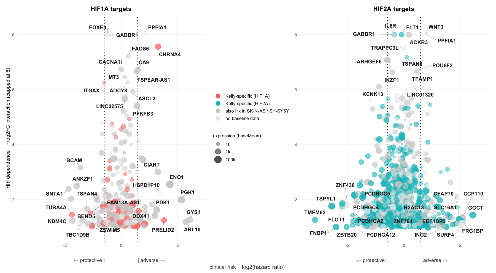
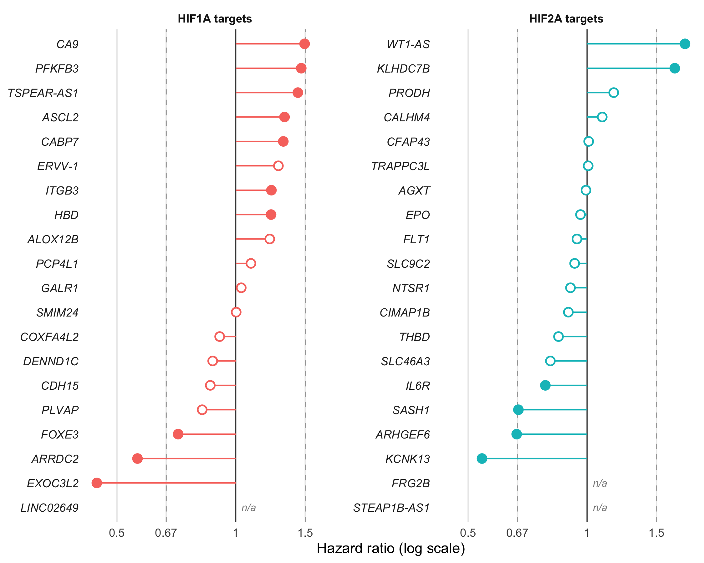
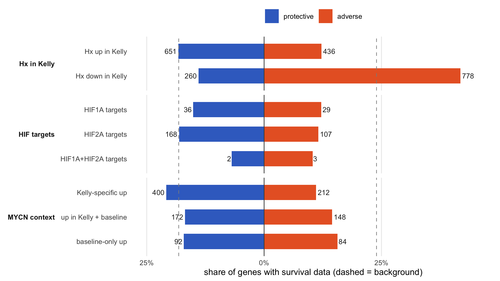
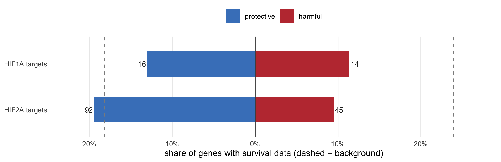
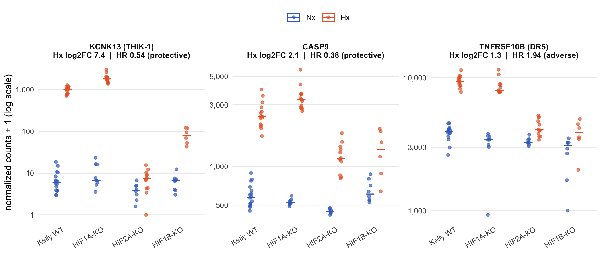

Master_Table_Dive
================

- [Input](#input)
- [Reduction](#reduction)
- [Reduced table](#reduced-table)
- [Risk versus HIF dependence](#risk-versus-hif-dependence)
- [HR Ratio of TOP HIF1A & HIF2A](#hr-ratio-of-top-hif1a--hif2a)
- [Hypoxia-induced genes: protective or
  adverse?](#hypoxia-induced-genes-protective-or-adverse)
  - [Stage 1: what hypoxia regulates in
    Kelly](#stage-1-what-hypoxia-regulates-in-kelly)
  - [Stage 2: HIF1A vs HIF2A targets](#stage-2-hif1a-vs-hif2a-targets)
  - [Stage 3: the MYCN context](#stage-3-the-mycn-context)
  - [The whole picture](#the-whole-picture)
  - [The full CUT&RUN overlap lists](#the-full-cutrun-overlap-lists)
- [KCNK13, CASP9, DR5: an apoptosis-priming
  signature?](#kcnk13-casp9-dr5-an-apoptosis-priming-signature)

Follow-up analysis on the annotated master table built in
[Master_Table.Rmd](Master_Table.Rmd) (see [its rendered
output](Readme.md) for how the annotation columns are defined). This
document starts by reducing the table to the genes that are actually
worth looking at. Code blocks are collapsed - click *Code* to expand.

<details>

<summary>

Code
</summary>

``` r
library(dplyr)
library(tidyverse)
library(knitr)
library(ggplot2)
library(ggrepel)
library(patchwork)
library(openxlsx)
```

</details>

# Input

`master_counts_table.xlsx` carries everything: the DESeq2 contrasts, the
annotation columns, and the per-sample normalized counts. Reading 65 MB
of Excel on every knit is slow, so it is cached as an RDS and only
re-read when the xlsx is newer.

<details>

<summary>

Code
</summary>

``` r
in_dir  <- here::here("6_XM_data_merge")
xlsx_in <- file.path(in_dir, "master_counts_table.xlsx")
rds_cache <- file.path(in_dir, "cache", "master_counts_table.rds")

dir.create(dirname(rds_cache), showWarnings = FALSE, recursive = TRUE)
if (file.exists(rds_cache) &&
    file.mtime(rds_cache) > file.mtime(xlsx_in)) {
  master <- readRDS(rds_cache)
} else {
  master <- as.data.frame(readxl::read_xlsx(xlsx_in))
  saveRDS(master, rds_cache)
}

count_cols <- grep("^counts_", colnames(master), value = TRUE)

tab(data.frame(
  Item = c("genes", "columns", "of them per-sample counts", "annotation columns"),
  n    = c(nrow(master), ncol(master), length(count_cols),
           sum(colnames(master) %in% c("Target", "Hx_Baseline", "pubmed_total",
                                       "pubmed_hypoxia", "pubmed_source", "HR_risk")))
), "master_counts_table as loaded")
```

</details>

**master_counts_table as loaded**

| Item                      |     n |
|:--------------------------|------:|
| genes                     | 64537 |
| columns                   |   147 |
| of them per-sample counts |    88 |
| annotation columns        |     6 |

# Reduction

Most of the table is not expressed: 61% of all genes have a
`baseMean_Kelly` of exactly zero. Expression is therefore the primary
filter.

A gene is kept anyway if it has at least 50 publications. That rescue is
there so well-characterised genes stay visible as a reference even when
they are silent in this cell line - TLR2, HFE, NOD2, POSTN and DCN are
all annotated HIF targets that a pure expression cutoff would drop.

**The threshold is deliberately low**, because `pubmed_total` counts
*curated gene-to-publication links*, not mentions. NCBI creates those
links mainly for papers treating a gene as a molecular entity, which
systematically undercounts genes whose literature is old, physiological
or biochemical:

| Gene               | PubMed full-text search | `pubmed_total` |
|--------------------|------------------------:|---------------:|
| myoglobin / `MB`   |                  18,113 |             95 |
| hemoglobin / `HBB` |                 286,325 |            876 |
| insulin / `INS`    |                 522,216 |          1,034 |
| `TP53`             |                      \- |         20,399 |

So the column measures how intensively a gene is studied *as a gene*,
not how famous it is. That is usually the more useful reading here -
GAPDH scores 637 despite appearing in tens of thousands of papers as a
loading control, and those papers are not about GAPDH - but classic
literature is underrepresented, so 50 links already marks a well-studied
gene.

One consequence of Ensembl-to-Entrez being many-to-one: 1,691 symbols
occupy more than one row (NLRP2 has four Ensembl loci sharing Entrez
55655), and each row carries the same literature count. Rows are genes
as annotated here, so a count of “genes above N publications”
double-counts those. This comes from the annotation itself, not from the
fallback mapping - the duplication rate is 12.5% for `annotation` and
13.2% for `symbol_map`.

Literature coverage is used **only** in that direction: it can keep a
gene in, it never throws one out. A strongly expressed but unstudied
gene is a candidate, not noise, and filtering on publication counts
would preferentially discard exactly those - one Kelly-specific target
sits at `baseMean` 7,235 with no annotation at all. `pubmed_total` and
`pubmed_hypoxia` otherwise stay in the table as a ranking aid.

<details>

<summary>

Code
</summary>

``` r
min_basemean <- 10
min_pubmed   <- 50

expressed <- !is.na(master$baseMean_Kelly) & master$baseMean_Kelly >= min_basemean
rescued   <- !expressed & !is.na(master$pubmed_total) & master$pubmed_total >= min_pubmed
keep      <- expressed | rescued

dive <- master[keep, ]

# Why each gene is in, so the rescued ones can be excluded again downstream
# without recomputing the rule.
dive$dive_reason <- ifelse(expressed[keep], "expressed", "literature")
dive <- dive %>% dplyr::relocate(dive_reason, .after = symbol)

tab(data.frame(
  Step = c("master_counts_table",
           sprintf("baseMean_Kelly >= %d", min_basemean),
           sprintf("+ rescued: pubmed_total >= %d", min_pubmed)),
  Genes = c(nrow(master), sum(expressed), nrow(dive)),
  Share = sprintf("%.0f%%", 100 * c(nrow(master), sum(expressed), nrow(dive)) / nrow(master))
), "Reduction")
```

</details>

**Reduction**

| Step                            | Genes | Share |
|:--------------------------------|------:|:------|
| master_counts_table             | 64537 | 100%  |
| baseMean_Kelly \>= 10           | 18471 | 29%   |
| \+ rescued: pubmed_total \>= 50 | 21573 | 33%   |

The rescue adds 11% to the table. Worth knowing before using it: 617 of
the rescued genes have a `baseMean` of exactly zero, so they enter as
rows of pure zero counts. That is informative as a reference - “this
well-known gene is not expressed in Kelly” - but they should be excluded
from anything that consumes the count columns, which `dive_reason` makes
easy.

**Expression of the 3,102 literature-rescued genes**

| baseMean  | Genes |
|:----------|------:|
| exactly 0 |   919 |
| 0 - 1     |  1413 |
| 1 - 10    |   770 |

What survives, by annotation. The reduction removes three quarters of
the rows but keeps the large majority of the annotated candidates, which
is the point:

**Effect of the reduction per annotation set**

| Set                     | before | expressed | rescued | after | kept |
|:------------------------|-------:|----------:|--------:|------:|:-----|
| all genes               |  64537 |     18471 |    3102 | 21573 | 33%  |
| HIF targets             |   1837 |      1311 |      85 |  1396 | 76%  |
| Kelly-specific targets  |    922 |       685 |      52 |   737 | 80%  |
| HR adverse              |   6081 |      4598 |     134 |  4732 | 78%  |
| with hypoxia literature |   7945 |      5911 |    1497 |  7408 | 93%  |

The best-studied HIF targets that a pure expression cutoff would have
dropped - all of them now retained by the rescue:

**HIF targets kept by the literature rescue**

| symbol | Target      | baseMean | pubmed_total | pubmed_hypoxia |
|:-------|:------------|---------:|-------------:|---------------:|
| TLR2   | Hif2a       |     2.09 |         3812 |             22 |
| HFE    | Hif2a       |     1.92 |         2259 |             10 |
| NOD2   | Hif2a       |     2.97 |         1997 |              2 |
| POSTN  | Hif2a       |     2.79 |         1016 |             21 |
| SOST   | Hif2a       |     3.61 |          961 |              8 |
| DCN    | Hif2a       |     5.09 |          948 |              6 |
| ABCA4  | Hif1a_Hif2a |     6.61 |          754 |              1 |
| UGT1A1 | Hif2a       |     1.08 |          753 |              0 |

Still dropped: annotated targets that are both silent and barely
studied. These are the ones the filter is meant to catch.

**Best-studied HIF targets still removed**

| symbol   | Target      | baseMean | pubmed_total | pubmed_hypoxia |
|:---------|:------------|---------:|-------------:|---------------:|
| EFHD1    | Hif1a_Hif2a |     3.58 |           49 |              1 |
| SIGLEC10 | Hif2a       |     8.43 |           49 |              1 |
| AKR1D1   | Hif2a       |     6.79 |           48 |              0 |
| ITGBL1   | Hif2a       |     2.96 |           48 |              0 |
| LAMC3    | Hif1a       |     8.71 |           47 |              1 |
| ESAM     | Hif2a       |     4.32 |           46 |              0 |

# Reduced table

**Top Kelly-specific targets in the reduced table**

| symbol      | Target | baseMean | log2FC | HR_risk | pubmed_total | pubmed_hypoxia |
|:------------|:-------|---------:|-------:|:--------|-------------:|---------------:|
| CALHM4      | Hif2a  |      665 |  13.14 | ns      |           13 |              0 |
| FLT1        | Hif2a  |      275 |  12.07 | ns      |         2122 |            151 |
| CHRNA4      | Hif1a  |     1622 |  11.40 | adverse |          218 |              2 |
| IL6R        | Hif2a  |      179 |  10.84 | ns      |          893 |              8 |
| SLC9C2      | Hif2a  |      133 |  10.15 | ns      |            5 |              0 |
| STEAP1B-AS1 | Hif2a  |       26 |   9.06 | NA      |            3 |              0 |
| SLCO2A1     | Hif2a  |      187 |   8.80 | ns      |          211 |              2 |
| FRG2B       | Hif2a  |       46 |   8.80 | NA      |            3 |              0 |
| ATP8A2      | Hif2a  |       51 |   8.69 | ns      |           45 |              0 |
| LINGO1-AS1  | Hif2a  |      115 |   8.68 | NA      |            2 |              0 |

# Risk versus HIF dependence

One panel per HIF, showing every target of that HIF against two axes:

- **x** - clinical risk as `log2(HR)`. Left of zero the gene is
  protective, right of it adverse. The dotted lines mark the 1.5 / 0.67
  thresholds used for `HR_risk`.
- **y** - HIF dependence, the interaction term negated so that *up*
  means *more dependent on this HIF*. Capped at 8; nine genes sit above
  it and are drawn at the cap.

Two further variables ride along:

| Channel | Meaning |
|----|----|
| Hue | coral / cyan = Kelly-specific, grey = also hypoxic in the baseline lines, pale grey = no baseline data |
| Size and saturation | expression (`baseMean_Kelly`) - one variable on two channels, so faint small dots are lowly expressed and large solid ones are not |

Hues are the genotype colours used elsewhere in the project (`#F8766D`
for HIF1A, `#00BFC4` for HIF2A). The grey had to be lightened to
`#D0D0D0`: against a mid grey the cyan is indistinguishable for
red-green colour deficiency (ΔE 2.3), and at this lightness both hues
separate cleanly (ΔE 8.6 and 15.3).

<details>

<summary>

Code
</summary>

``` r
COL <- c("Kelly-specific (HIF1A)" = "#F8766D", "Kelly-specific (HIF2A)" = "#00BFC4",
         "also Hx in SK-N-AS / SH-SY5Y" = "#D0D0D0", "no baseline data" = "#ECECEC")
y_cap <- 8

prep <- function(grp, ycol, panel, tgt_lab) {
  dive %>%
    dplyr::filter(Target %in% grp, !is.na(HR), HR >= 0.1, HR <= 10) %>%
    dplyr::transmute(
      panel = panel, symbol,
      log2HR = log2(HR), dep = pmin(-.data[[ycol]], y_cap),
      cls = dplyr::case_when(is.na(Hx_Baseline)     ~ "no baseline data",
                             Hx_Baseline == "none"  ~ tgt_lab,
                             TRUE ~ "also Hx in SK-N-AS / SH-SY5Y"),
      expr = log10(baseMean_Kelly + 1),
      kelly = !is.na(Hx_Baseline) & Hx_Baseline == "none")
}

pdat <- dplyr::bind_rows(
  prep(c("Hif1a", "Hif1a_Hif2a"), "Hif1aHxNx.vs.KellyHxNx.log2FoldChange",
       "HIF1A targets", "Kelly-specific (HIF1A)"),
  prep(c("Hif2a", "Hif1a_Hif2a"), "Hif2aHxNx.vs.KellyHxNx.log2FoldChange",
       "HIF2A targets", "Kelly-specific (HIF2A)"))
pdat$cls   <- factor(pdat$cls, levels = names(COL))
pdat$panel <- factor(pdat$panel, levels = c("HIF1A targets", "HIF2A targets"))

# Label the periphery: the extremes on either axis, whatever category they fall
# into. Those are the genes the plot exists to surface.
edge_labels <- function(d, n_dep = 14, n_hr = 10) {
  d <- d[!is.na(d$symbol), ]
  d[unique(c(head(order(-d$dep), n_dep),
             head(order(-d$log2HR), n_hr),
             head(order(d$log2HR), n_hr))), ]
}
lab <- dplyr::bind_rows(lapply(split(pdat, pdat$panel), edge_labels))

# Size and alpha both carry expression; identical name/breaks/labels make ggplot
# merge them into a single legend instead of showing the same variable twice.
expr_breaks <- log10(c(10, 1000, 100000) + 1)
expr_labels <- c("10", "1k", "100k")
xr <- range(pdat$log2HR); yr <- range(pdat$dep)

# Each panel only contains three of the four classes, so its colour legend would
# miss a key and the two legends would not be recognised as identical - patchwork
# then stacks both instead of collecting them. This invisible layer carries all
# four levels in every panel, making the legends match exactly.
legend_dummy <- data.frame(log2HR = NA_real_, dep = NA_real_, expr = NA_real_,
                           cls = factor(names(COL), levels = names(COL)))

# The protective / adverse wording is placed at the cutoff coordinates rather than
# used as an axis title, so each word butts against its own threshold line.
hr_line <- log2(1.5)
ann_y   <- yr[1] - 1.2

mk <- function(d, ptitle, show_y) {
  ggplot(d, aes(log2HR, dep)) +
    geom_vline(xintercept = c(-hr_line, hr_line), colour = "black",
               linetype = "dotted", linewidth = 0.6) +
    # hjust 1 / 0 puts the "|" glyph itself exactly on the cutoff, so it reads as
    # a continuation of the threshold line.
    annotate("text", x = -hr_line, y = ann_y, label = "← protective |",
             hjust = 1, size = 3.1, colour = "grey20") +
    annotate("text", x = hr_line, y = ann_y, label = "| adverse →",
             hjust = 0, size = 3.1, colour = "grey20") +
    geom_point(aes(colour = cls, size = expr, alpha = expr),
               show.legend = c(colour = FALSE, size = TRUE, alpha = TRUE)) +
    geom_point(data = legend_dummy, aes(colour = cls), size = 3.2, alpha = 1,
               na.rm = TRUE) +
    ggrepel::geom_text_repel(data = dplyr::filter(lab, panel == d$panel[1]),
                             aes(label = symbol), size = 3.2, fontface = "bold",
                             colour = "grey10", box.padding = 0.6,
                             point.padding = 0.2, max.overlaps = Inf,
                             max.time = 2, max.iter = 20000, segment.size = 0.2,
                             segment.colour = "grey55", min.segment.length = 0) +
    # limits = names(COL) keeps the scale identical in both panels, which is what
    # lets patchwork collect the two legends into one.
    scale_colour_manual(values = COL, limits = names(COL), drop = FALSE, name = NULL,
      guide = guide_legend(order = 1, ncol = 1,
                           override.aes = list(size = 3.2, alpha = 1))) +
    scale_size_continuous(range = c(0.8, 5.5), name = "expression (baseMean)",
      breaks = expr_breaks, labels = expr_labels, limits = range(pdat$expr),
      guide = guide_legend(order = 2, ncol = 1, override.aes = list(colour = "grey35"))) +
    scale_alpha_continuous(range = c(0.35, 1), name = "expression (baseMean)",
      breaks = expr_breaks, labels = expr_labels, limits = range(pdat$expr),
      guide = guide_legend(order = 2, ncol = 1, override.aes = list(colour = "grey35"))) +
    coord_cartesian(xlim = xr + c(-0.25, 0.25), ylim = yr + c(-0.15, 0.35),
                    clip = "off") +
    labs(title = ptitle, x = NULL,
         y = if (show_y) sprintf("HIF dependence    −log2FC interaction (capped at %d)",
                                 y_cap) else NULL) +
    theme_minimal(base_size = 9) +
    theme(panel.grid.minor = element_blank(),
          panel.grid.major = element_line(linewidth = 0.2, colour = "grey94"),
          plot.title = element_text(face = "bold", size = 11, hjust = 0.5),
          plot.margin = margin(t = 5, r = 8, b = 26, l = 5),
          legend.key.height = unit(0.9, "lines"),
          legend.title = element_text(size = 8), legend.text = element_text(size = 8))
}

p1 <- mk(dplyr::filter(pdat, panel == "HIF1A targets"), "HIF1A targets", TRUE)
p2 <- mk(dplyr::filter(pdat, panel == "HIF2A targets"), "HIF2A targets", FALSE)

(p1 + patchwork::guide_area() + p2 +
   patchwork::plot_layout(guides = "collect", widths = c(1, 0.4, 1))) +
  patchwork::plot_annotation(caption = "clinical risk    log2(hazard ratio)") &
  theme(legend.box = "vertical", legend.direction = "vertical",
        legend.justification = "center",
        plot.caption = element_text(hjust = 0.5, size = 9.5, colour = "grey25",
                                    margin = margin(t = 4)))
```

</details>

<!-- -->

**Genes per panel - the difference to `in_dive` are genes without a
usable hazard ratio**

| Panel         | in_dive | plotted | Kelly_specific |
|:--------------|--------:|--------:|---------------:|
| HIF1A targets |     308 |     250 |             66 |
| HIF2A targets |    1122 |     838 |            513 |

<details>

<summary>

Code
</summary>

``` r
out_file <- here::here("6_XM_data_merge", "master_table_dive.xlsx")
openxlsx::write.xlsx(dive, out_file, rowNames = FALSE)
```

</details>

- [master_table_dive.xlsx](master_table_dive.xlsx) - 21,573 genes x 148
  columns, 34.6 MB

# HR Ratio of TOP HIF1A & HIF2A

Hazard ratios for the top HIF1A and HIF2A target genes shown in the
HIF-1β CUT&RUN figure, in the same order and colours. Filled points are
significant in the Cox model (p \< 0.05); the dashed lines mark the HR
1.5 / 1/1.5 risk cutoffs. Two genes carry older symbols in the master
table (COXFA4L2 = NDUFA4L2, CIMAP1B = ODF3L2) and are relabelled here;
LINC02649, STEAP1B-AS1 and FRG2B have no survival data.

<details>

<summary>

Code
</summary>

``` r
top_hif1a <- c("FOXE3", "CA9", "ALOX12B", "DENND1C", "TSPEAR-AS1", "LINC02649",
               "HBD", "ITGB3", "SMIM24", "EXOC3L2", "PFKFB3", "PCP4L1", "CDH15",
               "NDUFA4L2", "ASCL2", "ERVV-1", "PLVAP", "ARRDC2", "GALR1", "CABP7")
top_hif2a <- c("ODF3L2", "IL6R", "FLT1", "EPO", "STEAP1B-AS1", "FRG2B", "CALHM4",
               "KCNK13", "TRAPPC3L", "WT1-AS", "SLC9C2", "SASH1", "THBD",
               "ARHGEF6", "NTSR1", "AGXT", "KLHDC7B", "SLC46A3", "CFAP43",
               "PRODH")
relabel <- c(NDUFA4L2 = "COXFA4L2", ODF3L2 = "CIMAP1B")

hr_top <- dplyr::bind_rows(
    tibble(symbol = top_hif1a, group = "HIF1A targets"),
    tibble(symbol = top_hif2a, group = "HIF2A targets")) %>%
  dplyr::left_join(master %>% dplyr::select(symbol, HR, p_value_HR),
                   by = "symbol") %>%
  dplyr::mutate(
    label = ifelse(symbol %in% names(relabel), relabel[symbol], symbol),
    group = factor(group, levels = c("HIF1A targets", "HIF2A targets")),
    sig   = !is.na(p_value_HR) & p_value_HR < 0.05) %>%
  dplyr::group_by(group) %>%
  # Highest HR at the top of each panel; genes without survival data at the bottom.
  dplyr::mutate(label = factor(label, levels = label[order(HR, na.last = FALSE)])) %>%
  dplyr::ungroup()

hr_cols <- c("HIF1A targets" = "#F8766D", "HIF2A targets" = "#00BFC4")

ggplot(hr_top, aes(y = label, x = HR, colour = group)) +
  geom_vline(xintercept = 1, colour = "grey30", linewidth = 0.4) +
  geom_vline(xintercept = c(1/1.5, 1.5), colour = "grey65",
             linetype = "dashed", linewidth = 0.35) +
  geom_segment(aes(x = 1, xend = HR, yend = label),
               linewidth = 0.5, na.rm = TRUE) +
  geom_point(aes(fill = after_scale(ifelse(hr_top$sig, colour, "white"))),
             shape = 21, size = 2.6, stroke = 0.9, na.rm = TRUE) +
  geom_text(data = hr_top %>% dplyr::filter(is.na(HR)),
            aes(x = 1, label = "n/a"), colour = "grey55",
            size = 2.8, hjust = -0.4, fontface = "italic") +
  scale_x_continuous(trans = "log2",
                     breaks = c(0.5, 1/1.5, 1, 1.5, 2),
                     labels = c("0.5", "0.67", "1", "1.5", "2")) +
  scale_colour_manual(values = hr_cols, guide = "none") +
  facet_wrap(~group, scales = "free_y") +
  labs(x = "Hazard ratio (log scale)", y = NULL) +
  theme_minimal(base_size = 11) +
  theme(axis.text.y = element_text(face = "italic", colour = "grey15"),
        panel.grid.minor = element_blank(),
        panel.grid.major.y = element_blank(),
        panel.grid.major.x = element_line(colour = "grey92"),
        strip.text = element_text(face = "bold"))
```

</details>

<!-- -->

# Hypoxia-induced genes: protective or adverse?

The question, built up in three stages: (1) do the genes that go up
under hypoxia predict better or worse outcome, (2) does the answer
differ between HIF1A and HIF2A targets, and (3) does it depend on the
MYCN context - Kelly is MYCN-amplified, SK-N-AS and SH-SY5Y are not.

Two things to keep in mind when reading the numbers. Only 25,398 of the
64,537 rows have survival data at all (the hazard ratios come from the
high-risk microarray cohort), so every set shrinks once it is
intersected with the HR data. And that background is not 50/50: 23.9% of
all genes with survival data are `adverse` and 18.2% `protective`, so a
raw majority is not yet a signal - each set is therefore also tested
*against* that background (Fisher test on adverse vs protective counts;
`OR_adv` \> 1 means enriched for adverse).

Sets are defined on the full master table, not the reduced dive table,
because genes induced only in the baseline lines may fail the Kelly
expression filter.

<details>

<summary>

Code
</summary>

``` r
up_kelly <- !is.na(master$Kelly.Hx.vs.Nx.padj) & master$Kelly.Hx.vs.Nx.padj < 0.05 &
            master$Kelly.Hx.vs.Nx.log2FoldChange > 1
dn_kelly <- !is.na(master$Kelly.Hx.vs.Nx.padj) & master$Kelly.Hx.vs.Nx.padj < 0.05 &
            master$Kelly.Hx.vs.Nx.log2FoldChange < -1
up_base  <- (!is.na(master$padj_SKNAS)  & master$padj_SKNAS  < 0.05 & master$log2FC_SKNAS  > 1) |
            (!is.na(master$padj_SHSY5Y) & master$padj_SHSY5Y < 0.05 & master$log2FC_SHSY5Y > 1)

has_hr  <- !is.na(master$HR)
bg_adv  <- sum(master$HR_risk == "adverse", na.rm = TRUE)
bg_prot <- sum(master$HR_risk == "protective", na.rm = TRUE)

# One row of statistics per gene set: the within-set majority (binomial test,
# adverse vs protective), the enrichment against the background (Fisher), and
# the continuous shift of the HR distribution (Wilcoxon on log2 HR).
hr_stats <- function(label, stage, sel) {
  s    <- sel & has_hr
  adv  <- sum(master$HR_risk[s] == "adverse")
  prot <- sum(master$HR_risk[s] == "protective")
  fis  <- fisher.test(matrix(c(adv, prot, bg_adv - adv, bg_prot - prot), 2))
  wc   <- wilcox.test(log2(master$HR[s]), log2(master$HR[has_hr & !sel]))
  data.frame(Set = label, stage = stage,
             n = sum(sel), HR_data = sum(s),
             protective = prot, ns = sum(master$HR_risk[s] == "ns"), adverse = adv,
             pct_prot = 100 * prot / sum(s), pct_adv = 100 * adv / sum(s),
             median_HR = median(master$HR[s]),
             p_majority = binom.test(adv, adv + prot)$p.value,
             OR_adv = unname(fis$estimate), p_vs_bg = fis$p.value,
             p_shift = wc$p.value)
}

hr_res <- dplyr::bind_rows(
  hr_stats("Hx up in Kelly",         "Hx in Kelly",  up_kelly),
  hr_stats("Hx down in Kelly",       "Hx in Kelly",  dn_kelly),
  hr_stats("HIF1A targets",          "HIF targets",  master$Target %in% "Hif1a"),
  hr_stats("HIF2A targets",          "HIF targets",  master$Target %in% "Hif2a"),
  hr_stats("HIF1A+HIF2A targets",    "HIF targets",  master$Target %in% "Hif1a_Hif2a"),
  hr_stats("Kelly-specific up",      "MYCN context", up_kelly & !is.na(master$Hx_Baseline) &
                                                       master$Hx_Baseline == "none"),
  hr_stats("up in Kelly + baseline", "MYCN context", up_kelly & !is.na(master$Hx_Baseline) &
                                                       master$Hx_Baseline != "none"),
  hr_stats("baseline-only up",       "MYCN context", up_base & !up_kelly))

hr_tab <- function(stage) {
  hr_res %>%
    dplyr::filter(stage == !!stage) %>%
    dplyr::mutate(dplyr::across(c(pct_prot, pct_adv), ~sprintf("%.1f%%", .x)),
                  median_HR = round(median_HR, 2), OR_adv = round(OR_adv, 2),
                  dplyr::across(c(p_majority, p_vs_bg, p_shift), ~sprintf("%.1e", .x))) %>%
    dplyr::select(-stage)
}
```

</details>

## Stage 1: what hypoxia regulates in Kelly

Of the 5,882 hypoxia-induced genes, 3,566 have survival data - and among
those, **protective clearly outnumbers adverse** (651 vs 436, binomial p
= 9e-11). Against the adverse-leaning background the depletion is even
stronger (OR 0.47). The mirror image is the more striking result: the
genes hypoxia *represses* are heavily adverse (42% adverse vs 14%
protective, OR 2.5, median HR 1.27). In this cohort the adverse part of
the hypoxia response is what gets switched *off*, not on.

**Hx-regulated genes (Kelly WT, \|log2FC\| \> 1, padj \< 0.05) vs
survival**

| Set | n | HR_data | protective | ns | adverse | pct_prot | pct_adv | median_HR | p_majority | OR_adv | p_vs_bg | p_shift |
|:---|---:|---:|---:|---:|---:|:---|:---|---:|:---|---:|:---|:---|
| Hx up in Kelly | 5882 | 3566 | 651 | 2479 | 436 | 18.3% | 12.2% | 0.95 | 7.4e-11 | 0.47 | 1.9e-31 | 4.3e-38 |
| Hx down in Kelly | 2383 | 1861 | 260 | 823 | 778 | 14.0% | 41.8% | 1.27 | 1.6e-60 | 2.46 | 4.0e-37 | 3.9e-51 |

## Stage 2: HIF1A vs HIF2A targets

The thesis that HIF1A targets are adverse and HIF2A targets protective
is, in this form, **not supported**: both target sets lean protective,
and HIF1A targets are *not* adverse-enriched (12% adverse vs 15%
protective). The direct comparison of the two ratios is far from
significant (Fisher p = 0.40). Only the continuous view leaves a hint in
the expected direction: the HR distribution of HIF2A targets sits
slightly lower (median 0.94 vs 1.00, Wilcoxon p = 0.013) - a weak
protective shift for HIF2A rather than an adverse shift for HIF1A. The
combined HIF1A+HIF2A set is too small to say anything (5 classified
genes).

**HIF target sets (Target column) vs survival**

| Set | n | HR_data | protective | ns | adverse | pct_prot | pct_adv | median_HR | p_majority | OR_adv | p_vs_bg | p_shift |
|:---|---:|---:|---:|---:|---:|:---|:---|---:|:---|---:|:---|:---|
| HIF1A targets | 322 | 238 | 36 | 173 | 29 | 15.1% | 12.2% | 1.00 | 4.6e-01 | 0.61 | 5.9e-02 | 1.7e-01 |
| HIF2A targets | 1472 | 928 | 168 | 653 | 107 | 18.1% | 11.5% | 0.94 | 2.8e-04 | 0.47 | 1.6e-09 | 9.4e-13 |
| HIF1A+HIF2A targets | 43 | 29 | 2 | 24 | 3 | 6.9% | 10.3% | 0.87 | 1.0e+00 | 1.14 | 1.0e+00 | 1.4e-01 |

**Direct HIF1A vs HIF2A comparison**

| Test                                              | p     |
|:--------------------------------------------------|:------|
| adverse:protective ratio, HIF1A vs HIF2A (Fisher) | 0.4   |
| log2 HR distribution, HIF1A vs HIF2A (Wilcoxon)   | 0.013 |

## Stage 3: the MYCN context

Splitting the hypoxia-induced genes by where they respond: `Hx_Baseline`
separates the Kelly-specific ones (`none`) from those also induced in
SK-N-AS / SH-SY5Y; the third set are genes induced *only* in the
baseline lines. The result is a gradient: the **Kelly-specific response
is the most protective-leaning** (11% adverse, OR 0.38), the shared
response sits in the middle, and the baseline-only response is closest
to background - still mildly protective (OR 0.69, p = 0.017), but with
the weakest signal. So the protective association of hypoxia-induced
genes is strongest exactly in the MYCN-amplified context, and no set
flips to adverse.

**Hypoxia-induced genes by cell-line context vs survival**

| Set | n | HR_data | protective | ns | adverse | pct_prot | pct_adv | median_HR | p_majority | OR_adv | p_vs_bg | p_shift |
|:---|---:|---:|---:|---:|---:|:---|:---|---:|:---|---:|:---|:---|
| Kelly-specific up | 2811 | 1919 | 400 | 1307 | 212 | 20.8% | 11.0% | 0.93 | 2.6e-14 | 0.38 | 6.7e-30 | 2.3e-31 |
| up in Kelly + baseline | 1357 | 1021 | 172 | 701 | 148 | 16.8% | 14.5% | 0.96 | 2.0e-01 | 0.64 | 1.2e-04 | 2.2e-06 |
| baseline-only up | 788 | 537 | 92 | 361 | 84 | 17.1% | 15.6% | 0.98 | 6.0e-01 | 0.69 | 1.7e-02 | 1.8e-02 |

## The whole picture

All eight sets on one axis: share of protective genes to the left,
adverse to the right, with the background shares as dashed reference
lines. Every hypoxia-*induced* set stays left of the background on the
adverse side; only the hypoxia-*repressed* genes break the pattern.

<details>

<summary>

Code
</summary>

``` r
pol_cols <- c(protective = "#3B6FC9", adverse = "#E8632C")

pol <- hr_res %>%
  dplyr::mutate(Set = factor(Set, levels = rev(Set)),
                stage = factor(stage, levels = unique(stage))) %>%
  tidyr::pivot_longer(c(pct_prot, pct_adv), names_to = "side", values_to = "pct") %>%
  dplyr::mutate(side = ifelse(side == "pct_prot", "protective", "adverse"),
                x = ifelse(side == "protective", -pct, pct),
                n = ifelse(side == "protective", protective, adverse))

ggplot(pol, aes(x = x, y = Set, fill = side)) +
  geom_col(width = 0.62) +
  geom_vline(xintercept = 0, colour = "grey30", linewidth = 0.4) +
  geom_vline(xintercept = c(-100 * bg_prot / sum(has_hr), 100 * bg_adv / sum(has_hr)),
             linetype = "dashed", colour = "grey55", linewidth = 0.35) +
  geom_text(aes(label = n, hjust = ifelse(side == "protective", 1.15, -0.15)),
            size = 2.9, colour = "grey15") +
  scale_x_continuous(labels = function(x) sprintf("%g%%", abs(x)),
                     expand = expansion(mult = 0.12)) +
  scale_fill_manual(values = pol_cols, breaks = c("protective", "adverse"),
                    name = NULL) +
  facet_grid(stage ~ ., scales = "free_y", space = "free_y", switch = "y") +
  labs(x = "share of genes with survival data (dashed = background)", y = NULL) +
  theme_minimal(base_size = 10) +
  theme(panel.grid.major.y = element_blank(),
        panel.grid.minor = element_blank(),
        strip.placement = "outside",
        strip.text.y.left = element_text(angle = 0, face = "bold", hjust = 1),
        legend.position = "top")
```

</details>

<!-- -->

**Answer to the opening question:** in these data hypoxia-induced genes
are mainly *protective* - as a raw majority, against the background, and
in every subset tested. The adverse arm of the hypoxia response consists
of the genes hypoxia represses. The HIF1A-adverse / HIF2A-protective
split does not hold as a dichotomy; there is at most a mild protective
shift of HIF2A targets. And the protective lean is strongest in the
Kelly-specific (MYCN-amplified) response. All of this is association in
a high-risk cohort, not causality - adverse-classified single genes
still exist in every set (WT1-AS and KLHDC7B above are examples).

## The full CUT&RUN overlap lists

The same question, asked of the complete HIF-1β CUT&RUN overlap lists
(peaks within 100 kb, split into HIF1A-unique and HIF2A-unique genes)
instead of the RNA-seq-derived sets. All list genes are present in the
master table via their Ensembl IDs; 24 genes appear on both lists.
Following the volcano-plot wording, *harmful* here is what the tables
call `adverse`. The list membership is also available as the `CaR`
column of the master table (values `Hif1a` / `Hif2a` / `Hif1a_Hif2a`,
mirroring `Target`).

The result mirrors stage 2, now from the binding side: the **HIF2A peak
list is clearly protective-leaning** (92 protective vs 45 harmful of 474
with survival data), while the **HIF1A list is balanced** (16 vs 14 of
123) and indistinguishable from background. The direct comparison of the
two ratios is not significant (Fisher p = 0.21) - the lists differ in
how strongly they deviate from background, not provably from each other.

<details>

<summary>

Code
</summary>

``` r
car_h1 <- readxl::read_xlsx(here::here("6_XM_data_merge", "HIF1A_unique_genes_100kb.xlsx"))
car_h2 <- readxl::read_xlsx(here::here("6_XM_data_merge", "HIF2A_unique_genes_100kb.xlsx"))

sel_car1 <- master$Ensembl %in% car_h1$Ensembl
sel_car2 <- master$Ensembl %in% car_h2$Ensembl

car_res <- dplyr::bind_rows(
  hr_stats("HIF1A targets", "CUT&RUN", sel_car1),
  hr_stats("HIF2A targets", "CUT&RUN", sel_car2))

tab(car_res %>%
      dplyr::mutate(dplyr::across(c(pct_prot, pct_adv), ~sprintf("%.1f%%", .x)),
                    median_HR = round(median_HR, 2), OR_adv = round(OR_adv, 2),
                    dplyr::across(c(p_majority, p_vs_bg, p_shift), ~sprintf("%.1e", .x))) %>%
      dplyr::rename(harmful = adverse, pct_harm = pct_adv, OR_harm = OR_adv) %>%
      dplyr::select(-stage),
    "CUT&RUN overlap lists (100 kb) vs survival")
```

</details>

**CUT&RUN overlap lists (100 kb) vs survival**

| Set | n | HR_data | protective | ns | harmful | pct_prot | pct_harm | median_HR | p_majority | OR_harm | p_vs_bg | p_shift |
|:---|---:|---:|---:|---:|---:|:---|:---|---:|:---|---:|:---|:---|
| HIF1A targets | 145 | 123 | 16 | 93 | 14 | 13.0% | 11.4% | 1.01 | 8.6e-01 | 0.66 | 2.7e-01 | 5.8e-01 |
| HIF2A targets | 581 | 474 | 92 | 337 | 45 | 19.4% | 9.5% | 0.91 | 7.3e-05 | 0.37 | 1.5e-08 | 2.7e-10 |

<details>

<summary>

Code
</summary>

``` r
car_cols <- c(protective = "#4682C4", harmful = "#C03A3E")

car_pol <- car_res %>%
  dplyr::mutate(Set = factor(Set, levels = rev(Set))) %>%
  tidyr::pivot_longer(c(pct_prot, pct_adv), names_to = "side", values_to = "pct") %>%
  dplyr::mutate(side = factor(ifelse(side == "pct_prot", "protective", "harmful"),
                              levels = c("protective", "harmful")),
                x = ifelse(side == "protective", -pct, pct),
                n = ifelse(side == "protective", protective, adverse))

ggplot(car_pol, aes(x = x, y = Set, fill = side)) +
  geom_col(width = 0.55) +
  geom_vline(xintercept = 0, colour = "grey30", linewidth = 0.4) +
  geom_vline(xintercept = c(-100 * bg_prot / sum(has_hr), 100 * bg_adv / sum(has_hr)),
             linetype = "dashed", colour = "grey55", linewidth = 0.35) +
  geom_text(aes(label = n, hjust = ifelse(side == "protective", 1.15, -0.15)),
            size = 3, colour = "grey15") +
  scale_x_continuous(labels = function(x) sprintf("%g%%", abs(x)),
                     expand = expansion(mult = 0.12)) +
  scale_fill_manual(values = car_cols, name = NULL) +
  labs(x = "share of genes with survival data (dashed = background)", y = NULL) +
  theme_minimal(base_size = 10) +
  theme(panel.grid.major.y = element_blank(),
        panel.grid.minor = element_blank(),
        legend.position = "top")
```

</details>

<!-- -->

# KCNK13, CASP9, DR5: an apoptosis-priming signature?

KCNK13 (THIK-1) is the most protective HIF2A target from the CUT&RUN
shortlist (HR 0.54) and essentially unstudied in cancer - its literature
is about microglia, where the channel gates inflammasome activation via
K⁺ efflux. K⁺ efflux is also a permissive condition for apoptosome
assembly, and the two apoptosis genes that hypoxia co-induces in Kelly
are exactly the matching pieces: CASP9 (the apoptosome caspase) and
TNFRSF10B (death receptor DR5). The working hypothesis: HIF2A does not
kill the cells, it lowers their apoptosis threshold - and tumors that
keep this priming intact behave less aggressively.

The counts view below shows the per-sample normalized counts across all
four genotypes. The KCNK13 induction collapses in the HIF2A-KO, is
halved (in log2 terms) in the HIF1B-KO - consistent with HIF2A needing
its dimerization partner ARNT - and is untouched in the HIF1A-KO. CASP9
and DR5 move the same way at smaller amplitude. SK-N-AS / SH-SY5Y add
nothing here: KCNK13 is hypoxia-induced there too (log2FC 1.9 in
SK-N-AS), and the baseline lines have no KO genotypes to separate the
HIFs.

<details>

<summary>

Code
</summary>

``` r
prime_symbols <- c("KCNK13", "CASP9", "TNFRSF10B")
prime_display <- c(KCNK13 = "KCNK13 (THIK-1)", CASP9 = "CASP9",
                   TNFRSF10B = "TNFRSF10B (DR5)")

prime <- master %>%
  dplyr::filter(symbol %in% prime_symbols) %>%
  dplyr::group_by(symbol) %>%
  dplyr::slice_max(baseMean_Kelly, n = 1, with_ties = FALSE) %>%
  dplyr::ungroup() %>%
  dplyr::mutate(panel = sprintf("%s\nHx log2FC %.1f  |  HR %.2f (%s)",
                                prime_display[symbol],
                                Kelly.Hx.vs.Nx.log2FoldChange, HR, HR_risk),
                panel = factor(panel, levels = panel[match(prime_symbols, symbol)]))

cd <- prime %>%
  dplyr::select(panel, dplyr::all_of(count_cols)) %>%
  tidyr::pivot_longer(-panel, names_to = "sample", values_to = "counts") %>%
  dplyr::mutate(
    genotype = dplyr::recode(sub("_(Nx|Hx)_[0-9]+$", "", sub("^counts_", "", sample)),
                             "WT" = "Kelly WT", "HIF1a-KO" = "HIF1A-KO",
                             "HIF2a-KO" = "HIF2A-KO", "HIF1b-KO" = "HIF1B-KO"),
    genotype = factor(genotype, levels = c("Kelly WT", "HIF1A-KO",
                                           "HIF2A-KO", "HIF1B-KO")),
    condition = factor(ifelse(grepl("_Hx_", sample), "Hx", "Nx"),
                       levels = c("Nx", "Hx")))

cond_cols <- c(Nx = "#3B6FC9", Hx = "#E8632C")

ggplot(cd, aes(genotype, counts + 1, colour = condition)) +
  geom_point(position = position_jitterdodge(jitter.width = 0.12,
                                             dodge.width = 0.55),
             size = 1.2, alpha = 0.65) +
  stat_summary(fun = median, fun.min = median, fun.max = median,
               geom = "crossbar", width = 0.42, fatten = 0,
               linewidth = 0.5, position = position_dodge(0.55)) +
  scale_y_log10(labels = function(x) format(x, big.mark = ",", scientific = FALSE)) +
  scale_colour_manual(values = cond_cols, name = NULL) +
  facet_wrap(~panel, scales = "free_y") +
  labs(x = NULL, y = "normalized counts + 1 (log scale)") +
  theme_minimal(base_size = 10) +
  theme(panel.grid.minor = element_blank(),
        panel.grid.major.x = element_blank(),
        strip.text = element_text(face = "bold", size = 8.5),
        axis.text.x = element_text(angle = 30, hjust = 1),
        legend.position = "top")
```

</details>

<!-- -->

One honest wrinkle the panel titles expose: the trio is not uniformly
protective. KCNK13 (0.54) and CASP9 (0.38) are, but DR5 itself scores
adverse (HR 1.94) - unsurprising for a death receptor that doubles as a
general stress-response gene, and a reminder that the priming reading
rests on the K⁺-efflux/apoptosome pair, not on DR5.

The pattern to take away: in WT and HIF1A-KO the three genes move
together under hypoxia; in HIF2A-KO the response is gone while the cells
are exposed to the same 1% O₂. If KCNK13 were simply a marker of cells
drifting into apoptosis, the KOs would induce it like the WT - instead
it behaves like a deliberate, HIF2A-driven program. Whether that program
actually lowers the apoptotic threshold is a wet-lab question: Annexin /
cleaved-caspase-3 under hypoxia in WT vs HIF2A-KO, with and without a
THIK-1 blocker.
