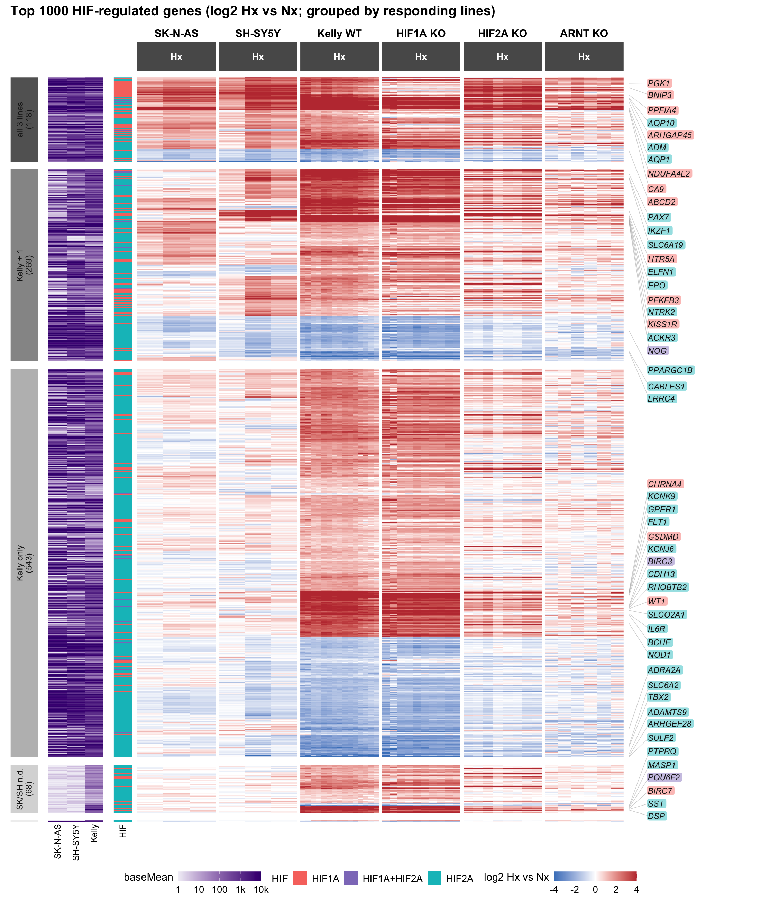
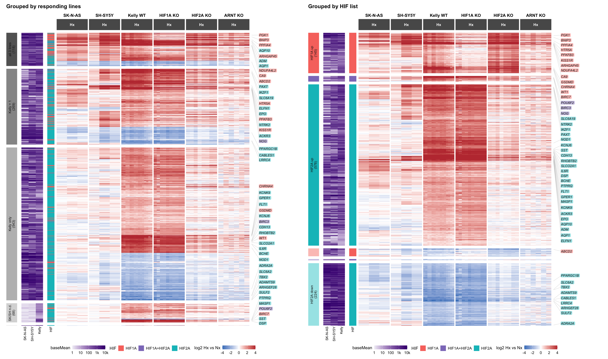
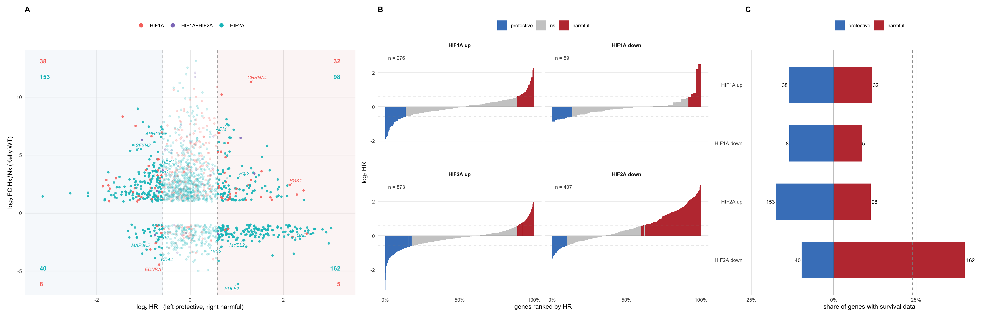
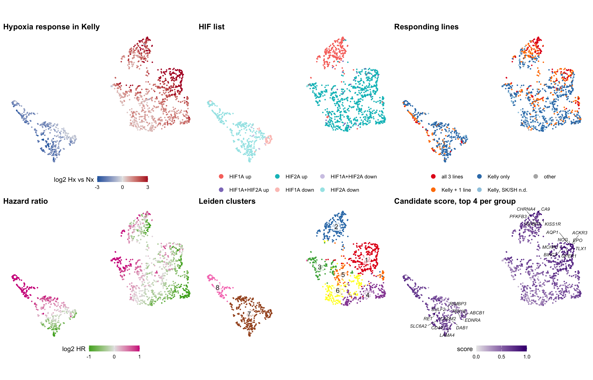

Manuscript figures: HIF1A / HIF2A regulated genes
================

- [Input](#input)
  - [Responding lines](#responding-lines)
  - [Candidate score](#candidate-score)
- [Figure 1: Hypoxia response in Kelly vs SK-N-AS /
  SH-SY5Y](#figure-1-hypoxia-response-in-kelly-vs-sk-n-as--sh-sy5y)
- [Figure 2: Protective or harmful?](#figure-2-protective-or-harmful)
  - [Variant 1: four groups](#variant-1-four-groups)
  - [Variant 2: HIF1A+HIF2A as its own
    group](#variant-2-hif1ahif2a-as-its-own-group)
- [Figure 3: UMAP](#figure-3-umap)
  - [TOP candidates](#top-candidates)

Final figures for the manuscript part that follows Xheni’s figures
(RNA-seq overview, CUT&RUN, overlap of core genes). Every figure here is
built from the same gene set: the four HIF-regulated lists from the
Kelly RNA-seq, now including the hypoxia-*repressed* genes. Exploratory
variants live in [Master_Table_Dive.Rmd](Master_Table_Dive.Rmd); this
document only holds what goes into the manuscript, plus the variants
still to be decided. Code blocks are collapsed - click *Code* to expand.

<details>

<summary>

Code
</summary>

``` r
library(dplyr)
library(tidyr)
library(ggplot2)
library(ggrepel)
library(patchwork)
```

</details>

# Input

The four lists (copied from the manuscript folder into
[gene_lists/](gene_lists/)) define the gene set. All of them are Kelly
WT hypoxia DEGs (padj \< 0.05, \|log2FC\| \> 1) whose response depends
on the respective HIF (interaction term in the KO). The annotation -
hazard ratio, literature counts, responses in SK-N-AS and SH-SY5Y -
comes from the master table, the per-sample expression from the VST
cache built in the Dive.

<details>

<summary>

Code
</summary>

``` r
in_dir <- here::here("6_XM_data_merge")
cache  <- function(f) {
  p <- file.path(in_dir, "cache", f)
  if (!file.exists(p)) stop(f, " missing - knit Master_Table_Dive.Rmd once to build it")
  readRDS(p)
}
master <- cache("master_counts_table.rds")
hm     <- cache("hx_heatmap_vst.rds")    # VST, centered on Nx per line / batch

list_files <- c(`HIF1A up`   = "HIF1a_regulated_DEGs_new_alternative.xlsx",
                `HIF1A down` = "HIF1a_downregulated_DEGs_positive_interaction_alternative.xlsx",
                `HIF2A up`   = "HIF2a_regulated_DEGs_alternative.xlsx",
                `HIF2A down` = "HIF2a_GroupIII_positive_interaction_WT_down.xlsx")

lists <- purrr::imap_dfr(list_files, function(f, grp) {
  d <- readxl::read_xlsx(file.path(in_dir, "gene_lists", f))
  names(d) <- sub("^HIF[12][aA]_interaction", "interaction", names(d))
  tibble(list = grp, Ensembl = d$ensembl_gene_id, symbol_list = d$gene_symbol,
         log2FC = d$WT_Hx_log2FC, padj = d$WT_Hx_padj, baseMean = d$baseMean,
         int_log2FC = d$interaction_log2FC)
}) %>%
  dplyr::mutate(hif = sub(" .*", "", list), dir = sub(".* ", "", list),
                list = factor(list, levels = names(list_files)))

tab(lists %>% dplyr::count(list, name = "genes") %>%
      dplyr::mutate(`log2FC range` = sapply(split(lists$log2FC, lists$list), function(x)
                      sprintf("%.1f to %.1f", min(x), max(x)))),
    "The four gene lists")
```

</details>

**The four gene lists**

| list       | genes | log2FC range |
|:-----------|------:|:-------------|
| HIF1A up   |   378 | 1.0 to 12.1  |
| HIF1A down |    75 | -4.4 to -1.0 |
| HIF2A up   |  1354 | 1.0 to 13.1  |
| HIF2A down |   515 | -6.1 to -1.0 |

60 genes are on two lists: 47 on both up-lists and 13 on both
down-lists, never on an up- and a down-list. Below, every gene appears
once, as `HIF1A`, `HIF2A` or `HIF1A+HIF2A`; whether the latter becomes
its own group in the manuscript is still open (Figure 2 shows both
versions).

<details>

<summary>

Code
</summary>

``` r
hif_levels <- c("HIF1A", "HIF1A+HIF2A", "HIF2A")
grp6_levels <- c(paste(hif_levels, "up"), paste(hif_levels, "down"))

genes <- lists %>%
  dplyr::group_by(Ensembl) %>%
  dplyr::summarise(hif = ifelse(dplyr::n() > 1, "HIF1A+HIF2A", hif[1]),
                   dir = dir[1], symbol_list = symbol_list[1],
                   log2FC = log2FC[1], baseMean = baseMean[1], .groups = "drop") %>%
  dplyr::left_join(master %>% dplyr::distinct(Ensembl, .keep_all = TRUE) %>%
                     dplyr::select(Ensembl, symbol, HR, p_value_HR, HR_risk,
                                   pubmed_total, pubmed_hypoxia,
                                   Kelly.Hx.vs.Nx.log2FoldChange, Kelly.Hx.vs.Nx.padj,
                                   log2FC_SKNAS, padj_SKNAS, log2FC_SHSY5Y, padj_SHSY5Y),
                   by = "Ensembl") %>%
  dplyr::mutate(
    hif   = factor(hif, levels = hif_levels),
    dir   = factor(dir, levels = c("up", "down")),
    grp6  = factor(paste(hif, dir), levels = grp6_levels),
    # Plot label: master symbol, else the list symbol; unannotated loci get none.
    label = dplyr::coalesce(symbol, symbol_list),
    label = ifelse(is.na(label) | grepl("^ENSG", label), NA, label))

tab(as.data.frame.matrix(table(genes$hif, genes$dir)) %>% tibble::rownames_to_column("HIF"),
    paste0("Genes per HIF and direction (", nrow(genes), " unique genes)"))
```

</details>

**Genes per HIF and direction (2262 unique genes)**

| HIF         |   up | down |
|:------------|-----:|-----:|
| HIF1A       |  331 |   62 |
| HIF1A+HIF2A |   47 |   13 |
| HIF2A       | 1307 |  502 |

## Responding lines

Kelly is MYCN-amplified, SK-N-AS and SH-SY5Y are not. Each gene is
assigned by the lines in which it is a hypoxia DEG (padj \< 0.05,
\|log2FC\| \> 1, either direction), as in the Dive. One group is new:
genes that are **not testable** in either baseline line (no padj in
SK-N-AS nor SH-SY5Y, mostly too low counts there) are kept apart as
`Kelly, SK/SH n.d.` instead of being counted as Kelly only - “not
measured” is not the same as “not responding”. The few list genes that
miss the DEG cutoff in the master table’s Kelly contrast (borderline,
log2FC from a slightly different model) are `other`.

<details>

<summary>

Code
</summary>

``` r
deg <- function(l2fc, padj) !is.na(padj) & padj < 0.05 & abs(l2fc) > 1
pat_levels <- c("all 3 lines", "Kelly + 1 line", "Kelly only", "Kelly, SK/SH n.d.", "other")

genes <- genes %>%
  dplyr::mutate(
    K  = deg(Kelly.Hx.vs.Nx.log2FoldChange, Kelly.Hx.vs.Nx.padj),
    A  = deg(log2FC_SKNAS, padj_SKNAS),
    H  = deg(log2FC_SHSY5Y, padj_SHSY5Y),
    nd = is.na(padj_SKNAS) & is.na(padj_SHSY5Y),
    pattern = factor(dplyr::case_when(K & A & H   ~ "all 3 lines",
                                      K & (A | H) ~ "Kelly + 1 line",
                                      K & nd      ~ "Kelly, SK/SH n.d.",
                                      K           ~ "Kelly only",
                                      TRUE        ~ "other"),
                     levels = pat_levels)) %>%
  dplyr::select(-K, -A, -H, -nd)

tab(as.data.frame.matrix(table(genes$grp6, genes$pattern)) %>% tibble::rownames_to_column("group"),
    "Genes per group and responding lines")
```

</details>

**Genes per group and responding lines**

| group | all 3 lines | Kelly + 1 line | Kelly only | Kelly, SK/SH n.d. | other |
|:---|---:|---:|---:|---:|---:|
| HIF1A up | 88 | 106 | 84 | 50 | 3 |
| HIF1A+HIF2A up | 3 | 14 | 20 | 10 | 0 |
| HIF2A up | 59 | 256 | 739 | 244 | 9 |
| HIF1A down | 4 | 9 | 42 | 7 | 0 |
| HIF1A+HIF2A down | 0 | 1 | 10 | 2 | 0 |
| HIF2A down | 17 | 93 | 343 | 41 | 8 |

## Candidate score

One score ranks the genes wherever a selection is needed: the top 1000
for the heatmap, the named genes, and the candidate list at the end. It
is a weighted mean of three percentile ranks (0 = lowest, 1 = highest
among the 2262 genes), so the three ingredients are on the same scale
regardless of their units:

| Ingredient | Column | Reading |
|----|----|----|
| hypoxia response | \|log2FC\| Kelly WT (from the lists) | strong effect |
| expression | log10 baseMean (from the lists) | robustly measured, relevant amount |
| popularity | log10(`pubmed_total` + 1) | well-studied gene, recognisable to the reader |

`pubmed_total` counts curated gene-to-paper links in NCBI gene2pubmed,
not mentions (see the Dive), so 50 already marks a well-studied gene.
For the 347 genes without a literature record the score is the weighted
mean of the two remaining ingredients - unknown is not scored as zero.
Popularity counts *for* a gene here, because the selection is meant to
show readers genes they know; for a novelty-oriented candidate list the
sign of that weight would flip.

<details>

<summary>

Code
</summary>

``` r
score_w <- c(log2FC = 1/3, baseMean = 1/3, popularity = 1/3)

comp <- cbind(log2FC     = dplyr::percent_rank(abs(genes$log2FC)),
              baseMean   = dplyr::percent_rank(log10(genes$baseMean + 1)),
              popularity = dplyr::percent_rank(log10(genes$pubmed_total + 1)))
w <- matrix(score_w, nrow(comp), 3, byrow = TRUE) * !is.na(comp)
genes$score <- rowSums(comp * w, na.rm = TRUE) / rowSums(w)

tab(genes %>% dplyr::filter(!is.na(label)) %>% dplyr::slice_max(score, n = 8) %>%
      dplyr::transmute(gene = label, group = grp6, log2FC = round(log2FC, 1),
                       baseMean = round(baseMean), pubmed_total, score = round(score, 2)),
    "Highest-scoring genes overall")
```

</details>

**Highest-scoring genes overall**

| gene   | group          | log2FC | baseMean | pubmed_total | score |
|:-------|:---------------|-------:|---------:|-------------:|------:|
| EPO    | HIF2A up       |   12.5 |     4152 |         1202 |  0.97 |
| CA9    | HIF1A up       |   10.9 |     2877 |         1333 |  0.96 |
| AQP1   | HIF2A up       |    7.7 |    12405 |          378 |  0.96 |
| RET    | HIF2A down     |   -4.9 |     4530 |         2445 |  0.94 |
| CDKN1C | HIF1A+HIF2A up |    7.9 |     1967 |          581 |  0.94 |
| PFKFB3 | HIF1A up       |    5.8 |     7128 |          390 |  0.94 |
| GPER1  | HIF2A up       |    5.6 |     2112 |          711 |  0.92 |
| ACKR3  | HIF2A up       |    9.1 |      980 |          545 |  0.92 |

# Figure 1: Hypoxia response in Kelly vs SK-N-AS / SH-SY5Y

The heatmap from section 5 of the Dive, now for the HIF-regulated genes:
log2 Hx vs Nx (Hx samples only, every line centered on its own
normoxia), rows grouped by responding lines and clustered (Ward) within
each group on the mean response of the three lines. No HR strip, no
primary tumours.

**Top 1000.** The 2213 genes with expression data are too many to read,
so the top 1000 by candidate score are taken - per group (HIF and
direction) in proportion to its size, so the composition of the gene set
is kept and the repressed genes, which have smaller fold changes, are
not pushed out.

**Named genes.** 50 genes are named, chosen as *typical* for their
responding-lines group: allocated across the groups by the square root
of their size (large groups get more names, small ones are not left
empty), and within a group ranked half by candidate score and half by
how clearly the gene shows the group’s pattern in the VST response:

| Group | Typical = |
|----|----|
| all 3 lines | weakest of the three responses is still large (same direction as Kelly) |
| Kelly + 1 line | Kelly and the responding line strong, the third line flat |
| Kelly only, Kelly SK/SH n.d. | Kelly strong, both baseline lines flat |

Within each group up- and down-regulated genes are named in proportion.
The label colour marks the HIF.

<details>

<summary>

Code
</summary>

``` r
hm_panels <- c("SK-N-AS", "SH-SY5Y", "Kelly", "HIF1A KO", "HIF2A KO", "ARNT KO")
hm_lines  <- c("SK-N-AS", "SH-SY5Y", "Kelly")

# Hx response per gene and panel: mean of the Hx samples = log2 vs Nx.
hx_resp_all <- sapply(hm_panels, function(l)
  rowMeans(hm$mat[, hm$cols$line == l & hm$cols$condition == "Hx"]))
hx_resp <- hx_resp_all[, hm_lines]

hif_cols <- c(HIF1A = "#F8766D", `HIF1A+HIF2A` = "#8E7CC3", HIF2A = "#00BFC4")
pat_greys <- c(`all 3 lines` = "#636363", `Kelly + 1 line` = "#969696",
               `Kelly only` = "#BDBDBD", `Kelly, SK/SH n.d.` = "#D9D9D9", other = "#F0F0F0")
grp6_cols <- c(`HIF1A up` = "#F8766D", `HIF1A+HIF2A up` = "#8E7CC3", `HIF2A up` = "#00BFC4",
               `HIF1A down` = "#FCC5C0", `HIF1A+HIF2A down` = "#D2C9E6", `HIF2A down` = "#A6E6E8")
strip_short <- c(`Kelly + 1 line` = "Kelly + 1", `Kelly, SK/SH n.d.` = "SK/SH n.d.",
                 `HIF1A+HIF2A up` = "both up", `HIF1A+HIF2A down` = "both down")
hm_guide <- guide_colourbar(barwidth = unit(6, "lines"), barheight = unit(0.7, "lines"),
                            title.vjust = 0.9)

g_hm <- genes %>% dplyr::filter(Ensembl %in% rownames(hm$mat))

# Top 1000: the best-scoring share of every group.
n_top <- 1000
top1000 <- g_hm %>%
  dplyr::group_by(grp6) %>%
  dplyr::filter(rank(-score, ties.method = "first") <= round(dplyr::n() * n_top / nrow(g_hm))) %>%
  dplyr::ungroup()

# Typicality of each gene for its responding-lines group (VST response).
r  <- hx_resp[top1000$Ensembl, ]
aK <- abs(r[, "Kelly"]); aA <- abs(r[, "SK-N-AS"]); aH <- abs(r[, "SH-SY5Y"])
sA <- sign(r[, "SK-N-AS"]) == sign(r[, "Kelly"]); sH <- sign(r[, "SH-SY5Y"]) == sign(r[, "Kelly"])
top1000$typical <- dplyr::case_when(
  top1000$pattern == "all 3 lines"    ~ pmin(aK, aA * sA, aH * sH),
  top1000$pattern == "Kelly + 1 line" ~ pmin(aK, pmax(aA * sA, aH * sH)) - pmin(aA, aH),
  top1000$pattern %in% c("Kelly only", "Kelly, SK/SH n.d.") ~ aK - pmax(aA, aH))

# Split n names over groups by sqrt(group size), largest remainder rounding.
alloc <- function(sizes, n) {
  q <- n * sqrt(sizes) / sum(sqrt(sizes))
  k <- floor(q)
  i <- order(q - k, decreasing = TRUE)[seq_len(n - sum(k))]
  k[i] <- k[i] + 1
  setNames(k, names(sizes))
}
pick_typical <- function(d, n) {
  cand <- d %>% dplyr::filter(!is.na(label), !is.na(typical), pattern != "other") %>%
    dplyr::group_by(pattern) %>%
    dplyr::mutate(rank = 0.5 * dplyr::percent_rank(typical) + 0.5 * score) %>%
    dplyr::ungroup()
  k <- alloc(table(droplevels(cand$pattern)), n)
  purrr::imap_dfr(k, function(kk, p) {
    cp <- cand %>% dplyr::filter(pattern == p)
    kd <- alloc(table(droplevels(cp$dir))^2, kk)   # ^2 undoes the sqrt: proportional
    purrr::imap_dfr(kd, function(kx, dx)
      cp %>% dplyr::filter(dir == dx) %>% dplyr::slice_max(rank, n = kx, with_ties = FALSE))
  })
}
top50 <- pick_typical(top1000, 50)

tab(top1000 %>% dplyr::count(pattern, dir) %>%
      tidyr::pivot_wider(names_from = dir, values_from = n, values_fill = 0) %>%
      dplyr::left_join(top50 %>% dplyr::count(pattern, name = "named"), by = "pattern"),
    paste0("Top ", nrow(top1000), " by responding lines and direction, and how many are named"))
```

</details>

**Top 1000 by responding lines and direction, and how many are named**

| pattern           |  up | down | named |
|:------------------|----:|-----:|------:|
| all 3 lines       | 100 |   18 |    10 |
| Kelly + 1 line    | 206 |   63 |    14 |
| Kelly only        | 372 |  171 |    20 |
| Kelly, SK/SH n.d. |  64 |    4 |     6 |
| other             |   1 |    1 |    NA |

<details>

<summary>

Code
</summary>

``` r
base_means <- master %>% dplyr::distinct(Ensembl, .keep_all = TRUE) %>%
  dplyr::select(Ensembl, Kelly = baseMean_Kelly, `SK-N-AS` = baseMean_SKNAS,
                `SH-SY5Y` = baseMean_SHSY5Y)

# Row positions: fixed groups (in `levels` order), Ward clustering on the mean
# Hx response of the three lines within each group, small gap between groups.
hm_rows <- function(ens, split, levels) {
  grp <- split[ens]
  gap <- max(1, round(length(ens) / 100))
  y <- c(); off <- 0
  # y runs upwards, so the first level is laid out last and ends up on top.
  for (g in rev(intersect(levels, unique(grp)))) {
    e <- ens[grp == g]
    if (length(e) > 1) e <- e[hclust(dist(hx_resp[e, , drop = FALSE]), method = "ward.D2")$order]
    y   <- c(y, setNames(off + seq_along(e), e))
    off <- off + length(e) + gap
  }
  list(y = y, group = setNames(grp, ens)[names(y)])
}

hx_heatmap <- function(ens, split, levels, strip_cols, marks, title = NULL, lim = 4) {
  rows <- hm_rows(ens, split, levels)
  pos  <- rows$y
  n    <- max(pos)
  m    <- hm$mat[names(pos), , drop = FALSE]

  # Every Hx block gets the same width, however many samples it holds.
  cols <- hm$cols %>%
    dplyr::filter(condition == "Hx") %>%
    dplyr::mutate(line = factor(line, levels = hm_panels)) %>%
    dplyr::arrange(line, batch) %>%
    dplyr::group_by(line) %>%
    dplyr::mutate(xmin = (dplyr::row_number() - 1) / dplyr::n(),
                  xmax = dplyr::row_number() / dplyr::n()) %>%
    dplyr::ungroup()
  long <- tibble(Ensembl = rep(rownames(m), ncol(m)),
                 sample  = rep(colnames(m), each = nrow(m)),
                 value   = as.vector(m)) %>%
    dplyr::mutate(y = pos[Ensembl]) %>%
    dplyr::inner_join(cols %>% dplyr::select(sample, line, xmin, xmax), by = "sample")
  yscale <- scale_y_continuous(limits = c(0.5, n + 0.5), expand = c(0, 0), oob = scales::oob_keep)
  strip_x <- theme(axis.text.x = element_text(angle = 90, hjust = 1, vjust = 0.5, size = 9,
                                              margin = margin(t = 2)))

  p_head <- ggplot(tibble(line = factor(hm_panels, levels = hm_panels))) +
    geom_rect(aes(xmin = 0, xmax = 1, ymin = 0, ymax = 1), fill = "grey35") +
    geom_text(aes(x = 0.5, y = 0.5, label = "Hx"), colour = "white", size = 3.4, fontface = "bold") +
    facet_grid(. ~ line, labeller = labeller(line = c(Kelly = "Kelly WT",
                                                      setNames(hm_panels[-3], hm_panels[-3])))) +
    scale_x_continuous(expand = c(0, 0)) +
    theme_void(base_size = 10) +
    theme(strip.text = element_text(face = "bold", size = 11, margin = margin(b = 3)),
          panel.spacing.x = unit(3, "pt"))

  p_main <- ggplot(long, aes(xmin = xmin, xmax = xmax, ymin = y - 0.5, ymax = y + 0.5, fill = value)) +
    geom_rect() +
    scale_fill_gradient2(low = "#4682C4", mid = "white", high = "#C03A3E",
                         limits = c(-lim, lim), oob = scales::squish,
                         name = "log2 Hx vs Nx", guide = hm_guide) +
    facet_grid(. ~ line) + scale_x_continuous(expand = c(0, 0)) + yscale +
    theme_void(base_size = 10) +
    theme(strip.text = element_blank(), panel.spacing.x = unit(3, "pt"))

  bm <- base_means %>% dplyr::filter(Ensembl %in% names(pos)) %>%
    tidyr::pivot_longer(-Ensembl, names_to = "line", values_to = "baseMean") %>%
    dplyr::mutate(y = pos[Ensembl], line = factor(line, levels = hm_lines))
  p_bm <- ggplot(bm, aes(x = line, y = y, fill = log10(baseMean + 1))) +
    geom_raster() +
    scale_fill_gradient(low = "#F2F0F7", high = "#3F007D", limits = c(0, 4),
                        oob = scales::squish, na.value = "grey90",
                        breaks = 0:4, labels = c("1", "10", "100", "1k", "10k"),
                        name = "baseMean", guide = hm_guide) +
    scale_x_discrete(expand = c(0, 0)) + yscale + theme_void(base_size = 10) + strip_x

  # HIF list membership of every row.
  tg <- tibble(Ensembl = names(pos), y = pos,
               hif = genes$hif[match(names(pos), genes$Ensembl)])
  p_tgt <- ggplot(tg, aes(x = "HIF", y = y, fill = hif)) +
    geom_raster() +
    scale_fill_manual(values = hif_cols, drop = FALSE, name = "HIF") +
    scale_x_discrete(expand = c(0, 0)) + yscale + theme_void(base_size = 10) + strip_x

  # Group strip, labelled (short name over n) where the group is tall enough.
  gd <- tibble(y = pos, group = rows$group)
  gl <- gd %>% dplyr::group_by(group) %>%
    dplyr::summarise(y = mean(y), n = dplyr::n()) %>%
    dplyr::mutate(short = dplyr::coalesce(strip_short[group], group)) %>%
    dplyr::filter(n >= 0.0065 * nchar(short) * length(pos))
  p_grp <- ggplot(gd, aes(x = 1, y = y, fill = group)) +
    geom_raster(show.legend = FALSE) +
    geom_text(data = gl, aes(label = paste0(short, "\n(", n, ")")), angle = 90, size = 3.1,
              lineheight = 0.9, colour = "grey10") +
    scale_fill_manual(values = strip_cols) +
    scale_x_continuous(expand = c(0, 0)) + yscale + theme_void()

  # Named genes, repelled along y, boxes in the HIF colour.
  mk <- marks %>% dplyr::filter(Ensembl %in% names(pos)) %>% dplyr::mutate(y = pos[Ensembl])
  lab_args <- list(direction = "y", hjust = 0, nudge_x = 0.25, xlim = c(0.25, NA),
                   size = 3, fontface = "italic", label.size = 0,
                   label.padding = unit(0.12, "lines"), min.segment.length = 0,
                   box.padding = 0.09, max.overlaps = Inf, seed = 1, show.legend = FALSE,
                   max.iter = 20000)
  p_lab <- ggplot(mk, aes(x = 0, y = y, label = label, fill = hif)) +
    do.call(ggrepel::geom_label_repel,
            c(lab_args, list(alpha = 0.45, colour = NA, segment.colour = "grey60",
                             segment.size = 0.25))) +
    do.call(ggrepel::geom_label_repel,
            c(lab_args, list(fill = NA, colour = "grey10", segment.colour = NA))) +
    scale_fill_manual(values = hif_cols, guide = "none") +
    scale_x_continuous(limits = c(0, 1.6), expand = c(0, 0)) + yscale +
    theme_void()

  plot_spacer() + plot_spacer() + plot_spacer() + p_head + plot_spacer() +
    p_grp + p_bm + p_tgt + p_main + p_lab +
    plot_layout(ncol = 5, widths = c(0.45, 0.9, 0.3, 8, 2),
                heights = c(0.5, 12), guides = "collect") +
    plot_annotation(title = title) &
    theme(legend.position = "bottom", legend.text = element_text(size = 10),
          legend.title = element_text(size = 11), legend.key.size = unit(1, "lines"),
          plot.title = element_text(face = "bold", size = 14))
}

hx_pair <- function(..., widths = NULL) {
  patchwork::wrap_plots(lapply(list(...), function(p) patchwork::wrap_elements(full = p)),
                        nrow = 1, widths = widths)
}

split_pat  <- setNames(as.character(top1000$pattern), top1000$Ensembl)
split_grp6 <- setNames(as.character(top1000$grp6), top1000$Ensembl)
```

</details>

<details>

<summary>

Code
</summary>

``` r
hx_heatmap(top1000$Ensembl, split_pat, pat_levels, pat_greys, top50,
           title = "Top 1000 HIF-regulated genes (log2 Hx vs Nx; grouped by responding lines)")
```

</details>

**Figure 1. Top 1000 HIF-regulated genes, grouped by responding lines**

<!-- -->

**Top 1000 per responding-lines group: composition and median absolute
response per line**

| pattern | genes | % up | % HIF1A | % HIF2A | Kelly \|log2\| | SK-N-AS \|log2\| | SH-SY5Y \|log2\| |
|:---|---:|---:|---:|---:|---:|---:|---:|
| all 3 lines | 118 | 85 | 47 | 50 | 2.49 | 1.49 | 1.71 |
| Kelly + 1 line | 269 | 77 | 20 | 76 | 1.99 | 0.76 | 1.09 |
| Kelly only | 543 | 69 | 9 | 88 | 1.65 | 0.36 | 0.41 |
| Kelly, SK/SH n.d. | 68 | 94 | 16 | 82 | 1.56 | 0.19 | 0.14 |
| other | 2 | 50 | 0 | 100 | 1.06 | 0.35 | 0.14 |

### Variant for the meeting: rows grouped by HIF list

Same genes, same names, but the rows grouped by HIF and direction
instead of responding lines (the analogue of 5b, right). This puts the
HIF1A / HIF2A contrast first and leaves the MYCN context to be read from
the SK-N-AS and SH-SY5Y columns.

<details>

<summary>

Code
</summary>

``` r
hx_pair(
  hx_heatmap(top1000$Ensembl, split_pat, pat_levels, pat_greys, top50,
             title = "Grouped by responding lines"),
  hx_heatmap(top1000$Ensembl, split_grp6, grp6_levels, grp6_cols, top50,
             title = "Grouped by HIF list"))
```

</details>

**Figure 1, variant: grouped by responding lines (left) vs by HIF list
(right)**

<!-- -->

# Figure 2: Protective or harmful?

All 1577 genes with survival data (hazard ratio from the high-risk
microarray cohort). `harmful` is what the master table calls `adverse`:
HR \> 1.5 with p \< 0.05; `protective` HR \< 1/1.5 with p \< 0.05. Three
panels per variant:

- **A** - hypoxia response vs clinical risk, one point per gene. Faint
  points are `ns`. The numbers in the corners count protective / harmful
  genes per quadrant; names are the highest-scoring classified genes per
  quadrant.
- **B** - waterfall: every gene of a group as one bar, sorted by HR.
- **C** - share of protective and harmful genes per group, against the
  background of all genes with survival data (dashed lines).

Two variants: (1) four groups, genes on two lists counted in both, (2)
`HIF1A+HIF2A` as its own group. How HIF, risk and responding lines go
together is shown in Figure 3 rather than by a third colour code here.

<details>

<summary>

Code
</summary>

``` r
risk_cols <- c(protective = "#4682C4", ns = "grey80", harmful = "#C03A3E")
pat_cols  <- c(`all 3 lines` = "#E41A1C", `Kelly + 1 line` = "#FF7F00",
               `Kelly only` = "#377EB8", `Kelly, SK/SH n.d.` = "#9ECAE1", other = "grey70")

has_hr  <- !is.na(master$HR)
bg_prot <- 100 * mean(master$HR_risk[has_hr] == "protective")
bg_harm <- 100 * mean(master$HR_risk[has_hr] == "adverse")
bg_n    <- c(prot = sum(master$HR_risk[has_hr] == "protective"),
             harm = sum(master$HR_risk[has_hr] == "adverse"))

g_hr <- genes %>%
  dplyr::filter(!is.na(HR)) %>%
  dplyr::mutate(risk = factor(dplyr::recode(HR_risk, adverse = "harmful"),
                              levels = names(risk_cols)),
                log2HR = log2(HR))

# Variant 1: one row per gene and list, so genes on two lists count in both.
g_hr4 <- lists %>% dplyr::select(Ensembl, group = list) %>%
  dplyr::inner_join(g_hr, by = "Ensembl")

# Statistics per group: binomial test harmful vs protective within the group,
# Fisher test against the background, as in the Dive.
risk_stats <- function(d, ...) {
  d %>% dplyr::group_by(...) %>%
    dplyr::summarise(N = dplyr::n(), protective = sum(risk == "protective"),
                     harmful = sum(risk == "harmful"), .groups = "drop") %>%
    dplyr::rowwise() %>%
    dplyr::mutate(pct_prot = 100 * protective / N, pct_harm = 100 * harmful / N,
                  p_binom = if (protective + harmful > 0) binom.test(harmful, protective + harmful)$p.value else NA,
                  OR_harm = unname(fisher.test(matrix(c(harmful, protective,
                                                        bg_n["harm"] - harmful,
                                                        bg_n["prot"] - protective), 2))$estimate),
                  p_vs_bg = fisher.test(matrix(c(harmful, protective,
                                                 bg_n["harm"] - harmful,
                                                 bg_n["prot"] - protective), 2))$p.value) %>%
    dplyr::ungroup()
}
stats_tab <- function(s) {
  s %>% dplyr::mutate(dplyr::across(c(pct_prot, pct_harm), ~sprintf("%.1f%%", .x)),
                      OR_harm = round(OR_harm, 2),
                      dplyr::across(c(p_binom, p_vs_bg), ~sprintf("%.1e", .x)))
}

# A: quadrant plot. `colour` names the colour column; `count_by` the column
# the corner counts are split by (defaults to the colour).
quad_plot <- function(d, colour, cols, count_by = colour, count_data = d, n_lab = 4) {
  xr <- max(abs(d$log2HR)) * 1.02
  yr <- range(d$log2FC)
  cnt <- count_data %>% dplyr::filter(risk != "ns") %>%
    dplyr::count(dir, risk, cat = .data[[count_by]]) %>%
    dplyr::group_by(dir, risk) %>% dplyr::arrange(cat, .by_group = TRUE) %>%
    dplyr::mutate(k = dplyr::row_number() - 1) %>% dplyr::ungroup() %>%
    dplyr::mutate(x = ifelse(risk == "harmful", xr, -xr),
                  hjust = ifelse(risk == "harmful", 1, 0),
                  y = ifelse(dir == "up", yr[2] - k * 0.07 * diff(yr), yr[1] + k * 0.07 * diff(yr)))
  lab <- d %>% dplyr::filter(risk != "ns", !is.na(label)) %>%
    dplyr::group_by(dir, risk) %>% dplyr::slice_max(score, n = n_lab, with_ties = FALSE)
  ggplot(d, aes(log2HR, log2FC)) +
    annotate("rect", xmin = log2(1.5), xmax = Inf, ymin = -Inf, ymax = Inf, fill = "#C03A3E", alpha = .05) +
    annotate("rect", xmin = -Inf, xmax = log2(1/1.5), ymin = -Inf, ymax = Inf, fill = "#4682C4", alpha = .05) +
    geom_hline(yintercept = 0, colour = "grey30", linewidth = 0.4) +
    geom_vline(xintercept = 0, colour = "grey30", linewidth = 0.4) +
    geom_vline(xintercept = log2(c(1/1.5, 1.5)), linetype = "dashed", colour = "grey60", linewidth = 0.35) +
    geom_point(data = d %>% dplyr::arrange(risk != "ns"),
               aes(colour = .data[[colour]], alpha = risk != "ns"), size = 1.1) +
    scale_alpha_manual(values = c(`FALSE` = 0.2, `TRUE` = 0.85), guide = "none") +
    ggrepel::geom_text_repel(data = lab, aes(label = label, colour = .data[[colour]]), size = 2.6,
                             fontface = "italic", show.legend = FALSE, max.overlaps = Inf,
                             min.segment.length = 0, segment.size = 0.25, seed = 1) +
    geom_text(data = cnt, aes(x, y, label = n, colour = cat, hjust = hjust),
              size = 3.4, fontface = "bold", show.legend = FALSE) +
    scale_colour_manual(values = cols, name = NULL, drop = TRUE) +
    scale_x_continuous(limits = c(-xr, xr)) +
    guides(colour = guide_legend(override.aes = list(size = 2.5, alpha = 1))) +
    labs(x = expression(log[2]~HR~"  (left protective, right harmful)"),
         y = expression(log[2]~FC~Hx/Nx~"(Kelly WT)"), title = "A") +
    theme_minimal(base_size = 10) +
    theme(panel.grid.minor = element_blank(), legend.position = "top",
          plot.title = element_text(face = "bold"))
}

# B: waterfall, one bar per gene, sorted by HR within each facet.
waterfall <- function(d, facet, fill = "risk", cols = risk_cols, ncol = 2) {
  w <- d %>% dplyr::group_by(.data[[facet]]) %>% dplyr::arrange(log2HR, .by_group = TRUE) %>%
    dplyr::mutate(xmin = (dplyr::row_number() - 1) / dplyr::n(), xmax = dplyr::row_number() / dplyr::n(),
                  n = dplyr::n()) %>% dplyr::ungroup()
  ggplot(w, aes(xmin = xmin, xmax = xmax, ymin = 0, ymax = log2HR, fill = .data[[fill]])) +
    geom_rect() +
    geom_hline(yintercept = log2(c(1/1.5, 1.5)), linetype = "dashed", colour = "grey55", linewidth = 0.35) +
    geom_hline(yintercept = 0, colour = "grey30", linewidth = 0.3) +
    geom_text(data = w %>% dplyr::distinct(.data[[facet]], n), inherit.aes = FALSE,
              aes(x = 0.02, y = max(w$log2HR) * 0.95, label = paste0("n = ", n)),
              hjust = 0, size = 2.8, colour = "grey30") +
    scale_fill_manual(values = cols, name = NULL) +
    facet_wrap(facet, ncol = ncol) +
    scale_x_continuous(labels = scales::percent, breaks = c(0, 0.5, 1)) +
    labs(x = "genes ranked by HR", y = expression(log[2]~HR), title = "B") +
    theme_minimal(base_size = 10) +
    theme(panel.grid.minor = element_blank(), panel.grid.major.x = element_blank(),
          legend.position = "top", strip.text = element_text(face = "bold"),
          plot.title = element_text(face = "bold"))
}

# C: diverging bars, protective left, harmful right, background dashed.
risk_bars <- function(s, row, facet = NULL) {
  b <- s %>%
    tidyr::pivot_longer(c(pct_prot, pct_harm), names_to = "side", values_to = "pct") %>%
    dplyr::mutate(side = factor(ifelse(side == "pct_prot", "protective", "harmful"),
                                levels = c("protective", "harmful")),
                  x = ifelse(side == "protective", -pct, pct),
                  n = ifelse(side == "protective", protective, harmful),
                  row = forcats::fct_rev(.data[[row]]))
  p <- ggplot(b, aes(x, row, fill = side)) +
    geom_col(width = 0.62) +
    geom_vline(xintercept = 0, colour = "grey30", linewidth = 0.4) +
    geom_vline(xintercept = c(-bg_prot, bg_harm), linetype = "dashed", colour = "grey55", linewidth = 0.35) +
    geom_text(aes(label = n, hjust = ifelse(side == "protective", 1.15, -0.15)), size = 2.9) +
    scale_fill_manual(values = risk_cols[c("protective", "harmful")], name = NULL) +
    scale_x_continuous(labels = function(x) sprintf("%g%%", abs(x)), expand = expansion(mult = 0.15)) +
    labs(x = "share of genes with survival data", y = NULL, title = "C") +
    theme_minimal(base_size = 10) +
    theme(panel.grid.major.y = element_blank(), panel.grid.minor = element_blank(),
          legend.position = "top", plot.title = element_text(face = "bold"))
  if (!is.null(facet))
    p <- p + facet_grid(rows = vars(.data[[facet]]), scales = "free_y", space = "free_y", switch = "y") +
      theme(strip.placement = "outside", strip.text.y.left = element_text(angle = 0, face = "bold"))
  p
}
```

</details>

## Variant 1: four groups

Genes on two lists count in both groups in B and C (and in the corner
counts of A, so the numbers match C); in A they are drawn once, in
purple.

<details>

<summary>

Code
</summary>

``` r
s1 <- risk_stats(g_hr4, group)
cnt4 <- g_hr4 %>% dplyr::mutate(hif4 = factor(sub(" .*", "", group), levels = hif_levels))
quad_plot(g_hr, "hif", hif_cols, count_by = "hif4", count_data = cnt4) +
  waterfall(g_hr4, "group") +
  risk_bars(s1, "group") +
  plot_layout(widths = c(8, 8, 6))
```

</details>

**Figure 2, variant 1. Four groups**

<!-- -->

**Variant 1: protective vs harmful per group (p_binom: within the group;
p_vs_bg: Fisher vs all genes with HR)**

| group      |   N | protective | harmful | pct_prot | pct_harm | p_binom | OR_harm | p_vs_bg |
|:-----------|----:|-----------:|--------:|:---------|:---------|:--------|--------:|:--------|
| HIF1A up   | 276 |         38 |      32 | 13.8%    | 11.6%    | 5.5e-01 |    0.64 | 6.9e-02 |
| HIF1A down |  59 |          8 |       5 | 13.6%    | 8.5%     | 5.8e-01 |    0.47 | 2.6e-01 |
| HIF2A up   | 873 |        153 |      98 | 17.5%    | 11.2%    | 6.2e-04 |    0.48 | 1.5e-08 |
| HIF2A down | 407 |         40 |     162 | 9.8%     | 39.8%    | 1.3e-18 |    3.13 | 2.2e-12 |

## Variant 2: HIF1A+HIF2A as its own group

<details>

<summary>

Code
</summary>

``` r
s2 <- risk_stats(g_hr, grp6)
quad_plot(g_hr, "hif", hif_cols) +
  waterfall(g_hr, "grp6", ncol = 3) +
  risk_bars(s2, "grp6") +
  plot_layout(widths = c(8, 9, 6))
```

</details>

**Figure 2, variant 2. Six groups, HIF1A+HIF2A separate**

<!-- -->

**Variant 2: protective vs harmful per group**

| grp6 | N | protective | harmful | pct_prot | pct_harm | p_binom | OR_harm | p_vs_bg |
|:---|---:|---:|---:|:---|:---|:---|---:|:---|
| HIF1A up | 246 | 35 | 30 | 14.2% | 12.2% | 6.2e-01 | 0.65 | 1.0e-01 |
| HIF1A+HIF2A up | 30 | 3 | 2 | 10.0% | 6.7% | 1.0e+00 | 0.51 | 6.6e-01 |
| HIF2A up | 843 | 150 | 96 | 17.8% | 11.4% | 7.0e-04 | 0.48 | 1.6e-08 |
| HIF1A down | 51 | 7 | 4 | 13.7% | 7.8% | 5.5e-01 | 0.43 | 2.3e-01 |
| HIF1A+HIF2A down | 8 | 1 | 1 | 12.5% | 12.5% | 1.0e+00 | 0.76 | 1.0e+00 |
| HIF2A down | 399 | 39 | 161 | 9.8% | 40.4% | 8.3e-19 | 3.19 | 1.6e-12 |

# Figure 3: UMAP

One point per gene (genes with survival data and expression in all three
lines), embedded on four blocks:

- **hypoxia response in Kelly**: log2 Hx vs Nx (VST)
- **HIF dependence**: Hx response in the HIF1A KO and in the HIF2A KO
  minus the response in WT Kelly, signed by the Kelly direction, so
  negative = the KO loses the response, for induced and repressed genes
  alike
- **responding lines**: log2 Hx vs Nx in SK-N-AS and SH-SY5Y
- **hazard ratio**: log2 HR

Every column is scaled and every block divided by √(number of columns),
so the four blocks weigh the same. Clusters: Leiden on the
15-nearest-neighbour graph of the input space (not the 2D picture),
numbered from most induced to most repressed.

<details>

<summary>

Code
</summary>

``` r
u_genes <- g_hr %>% dplyr::filter(Ensembl %in% rownames(hx_resp))
ue <- u_genes$Ensembl
u_dep <- (hx_resp_all[ue, c("HIF1A KO", "HIF2A KO")] - hx_resp_all[ue, "Kelly"]) *
         sign(hx_resp_all[ue, "Kelly"])
u_blocks <- list(Kelly = cbind(Kelly = hx_resp[ue, "Kelly"]),
                 HIF   = u_dep,
                 lines = hx_resp[ue, c("SK-N-AS", "SH-SY5Y")],
                 HR    = cbind(log2HR = u_genes$log2HR))
u_x <- do.call(cbind, lapply(u_blocks, function(b) scale(b) / sqrt(ncol(b))))
set.seed(1)
u_fit <- uwot::umap(u_x, n_neighbors = 15, min_dist = 0.05, ret_nn = TRUE)

u_nn <- u_fit$nn$euclidean$idx
u_g  <- igraph::simplify(igraph::graph_from_edgelist(
  cbind(rep(seq_len(nrow(u_nn)), ncol(u_nn) - 1), as.vector(u_nn[, -1])), directed = FALSE))
set.seed(1)
u_cl <- igraph::cluster_leiden(u_g, objective_function = "modularity",
                               resolution = 0.8, n_iterations = 10)$membership
u_cl <- as.integer(factor(u_cl, levels = order(-tapply(hx_resp[ue, "Kelly"], u_cl, median))))

ud <- u_genes %>%
  dplyr::mutate(U1 = u_fit$embedding[, 1], U2 = u_fit$embedding[, 2],
                kelly = hx_resp[ue, "Kelly"], dep1 = u_dep[, "HIF1A KO"], dep2 = u_dep[, "HIF2A KO"],
                cluster = factor(u_cl))

umap_theme <- list(theme_void(base_size = 11), coord_equal(),
                   theme(legend.position = "bottom", plot.title = element_text(face = "bold"),
                         plot.background = element_rect(fill = "white", colour = NA)))
umap_cat <- function(col, values, title) {
  ggplot(ud, aes(U1, U2, colour = .data[[col]])) +
    geom_point(size = 0.5) + scale_colour_manual(values = values, name = NULL) +
    guides(colour = guide_legend(override.aes = list(size = 3), nrow = 2)) +
    ggtitle(title) + umap_theme
}
umap_num <- function(col, lim, title, name, low = "#2166AC", high = "#B2182B") {
  ggplot(ud %>% dplyr::arrange(abs(.data[[col]])), aes(U1, U2, colour = .data[[col]])) +
    geom_point(size = 0.5) +
    scale_colour_gradient2(low = low, mid = "grey90", high = high, limits = c(-lim, lim),
                           breaks = c(-lim, 0, lim), oob = scales::squish, name = name,
                           guide = hm_guide) +
    ggtitle(title) + umap_theme
}

# TOP candidates: the highest candidate score per HIF group and direction.
top_cand <- ud %>% dplyr::filter(!is.na(label)) %>%
  dplyr::group_by(grp6) %>% dplyr::slice_max(score, n = 4, with_ties = FALSE) %>% dplyr::ungroup()

umap_num("kelly", 3, "Hypoxia response in Kelly", "log2 Hx vs Nx") +
  umap_cat("grp6", grp6_cols, "HIF list") +
  umap_cat("pattern", pat_cols, "Responding lines") +
  umap_num("log2HR", 1, "Hazard ratio", "log2 HR", low = "#4DAC26", high = "#D01C8B") +
  (ggplot(ud, aes(U1, U2, colour = cluster)) + geom_point(size = 0.5) +
     geom_label(data = ud %>% dplyr::group_by(cluster) %>%
                  dplyr::summarise(U1 = median(U1), U2 = median(U2)),
                aes(label = cluster), colour = "grey10", size = 4, label.size = 0,
                fill = scales::alpha("white", 0.7)) +
     scale_colour_manual(values = rep(RColorBrewer::brewer.pal(9, "Set1"), 3), guide = "none") +
     ggtitle("Leiden clusters") + umap_theme) +
  (ggplot(ud %>% dplyr::arrange(score), aes(U1, U2, colour = score)) + geom_point(size = 0.5) +
     ggrepel::geom_text_repel(data = top_cand, aes(label = label), colour = "grey10", size = 2.7,
                              fontface = "italic", max.overlaps = Inf, min.segment.length = 0,
                              segment.size = 0.25, seed = 1) +
     scale_colour_gradient(low = "grey92", high = "#3F007D", limits = c(0, 1), breaks = c(0, 0.5, 1),
                           name = "score",
                           guide = hm_guide) +
     ggtitle("Candidate score, top 4 per group") + umap_theme) +
  patchwork::plot_layout(nrow = 2, ncol = 3)
```

</details>

**Figure 3. UMAP of the HIF-regulated genes**

<!-- -->

**Leiden clusters (1574 genes): medians of the response (log2 Hx vs Nx)
and HIF dependence (negative = KO loses the response)**

| cluster | genes | % up | Kelly | SK-N-AS | SH-SY5Y | HIF1A dep | HIF2A dep | % HIF1A | % HIF2A | % Kelly only | HR | % harmful | % protective |
|:---|---:|---:|---:|---:|---:|---:|---:|---:|---:|---:|---:|---:|---:|
| 1 | 269 | 100 | 2.62 | 0.33 | 0.57 | 0.27 | -1.90 | 1 | 94 | 60 | 0.90 | 2 | 13 |
| 2 | 236 | 100 | 1.63 | 0.82 | 1.16 | -1.10 | 0.56 | 95 | 3 | 28 | 0.99 | 11 | 15 |
| 3 | 126 | 99 | 1.11 | 0.30 | 0.35 | 0.12 | -0.85 | 5 | 94 | 74 | 1.75 | 74 | 0 |
| 4 | 192 | 99 | 1.08 | 0.18 | 0.05 | 0.23 | -0.89 | 1 | 96 | 84 | 0.64 | 0 | 54 |
| 5 | 104 | 97 | 0.83 | 1.17 | 0.45 | 0.13 | -0.63 | 4 | 94 | 30 | 0.91 | 1 | 13 |
| 6 | 194 | 100 | 0.81 | 0.00 | 0.00 | 0.25 | -0.70 | 4 | 94 | 92 | 1.01 | 0 | 0 |
| 7 | 336 | 0 | -1.34 | -0.11 | -0.50 | 0.02 | -1.00 | 14 | 83 | 80 | 0.99 | 15 | 14 |
| 8 | 117 | 1 | -1.48 | -0.65 | -0.60 | 0.31 | -1.14 | 2 | 98 | 65 | 3.07 | 100 | 0 |

## TOP candidates

The ten highest-scoring genes per HIF list (genes on two lists can
appear in both). The full scored table is exported as
`manuscript_gene_scores.xlsx`.

**TOP candidates per list**

| list | gene | HIF | lines | log2FC | baseMean | pubmed_total | HR | risk | score |
|:---|:---|:---|:---|---:|---:|---:|---:|:---|---:|
| HIF1A up | CA9 | HIF1A | all 3 lines | 10.9 | 2877 | 1333 | 1.49 | ns | 0.96 |
| HIF1A up | CDKN1C | HIF1A+HIF2A | all 3 lines | 7.9 | 1967 | 581 | NA | NA | 0.94 |
| HIF1A up | PFKFB3 | HIF1A | Kelly + 1 line | 5.8 | 7128 | 390 | 1.47 | ns | 0.94 |
| HIF1A up | CHRNA4 | HIF1A | Kelly only | 11.3 | 1624 | 218 | 2.47 | harmful | 0.91 |
| HIF1A up | KISS1R | HIF1A | Kelly + 1 line | 9.7 | 578 | 351 | 1.19 | ns | 0.89 |
| HIF1A up | BNIP3 | HIF1A | all 3 lines | 3.2 | 19638 | 558 | 0.83 | ns | 0.89 |
| HIF1A up | NOG | HIF1A+HIF2A | Kelly + 1 line | 12.1 | 1660 | 114 | 1.08 | ns | 0.88 |
| HIF1A up | MCHR1 | HIF1A+HIF2A | Kelly + 1 line | 6.1 | 1472 | 200 | 1.01 | ns | 0.88 |
| HIF1A up | WT1 | HIF1A | Kelly only | 8.9 | 135 | 1222 | NA | NA | 0.86 |
| HIF1A up | BIRC3 | HIF1A+HIF2A | Kelly only | 5.2 | 465 | 510 | 0.75 | ns | 0.86 |
| HIF1A down | EDNRA | HIF1A | Kelly only | -4.4 | 139 | 255 | 0.63 | protective | 0.78 |
| HIF1A down | LAMA4 | HIF1A | all 3 lines | -3.1 | 368 | 141 | 0.55 | protective | 0.74 |
| HIF1A down | IGFBP3 | HIF1A | Kelly + 1 line | -1.9 | 580 | 1438 | 1.06 | ns | 0.72 |
| HIF1A down | ABCB1 | HIF1A | all 3 lines | -1.8 | 866 | 5050 | 0.81 | ns | 0.72 |
| HIF1A down | LGR5 | HIF1A | Kelly only | -1.9 | 360 | 485 | 1.02 | ns | 0.69 |
| HIF1A down | ABCD2 | HIF1A | all 3 lines | -3.5 | 99 | 72 | 1.09 | ns | 0.67 |
| HIF1A down | WNT5A | HIF1A | Kelly only | -1.9 | 180 | 994 | 0.99 | ns | 0.67 |
| HIF1A down | DAB1 | HIF1A+HIF2A | Kelly only | -1.9 | 349 | 152 | 0.59 | protective | 0.64 |
| HIF1A down | OAS1 | HIF1A | Kelly only | -2.1 | 47 | 273 | 0.92 | ns | 0.62 |
| HIF1A down | PLPP3 | HIF1A | Kelly + 1 line | -2.6 | 55 | 75 | 0.60 | protective | 0.60 |
| HIF2A up | EPO | HIF2A | Kelly + 1 line | 12.5 | 4152 | 1202 | 0.96 | ns | 0.97 |
| HIF2A up | AQP1 | HIF2A | all 3 lines | 7.7 | 12405 | 378 | 0.87 | ns | 0.96 |
| HIF2A up | CDKN1C | HIF1A+HIF2A | all 3 lines | 7.9 | 1967 | 581 | NA | NA | 0.94 |
| HIF2A up | GPER1 | HIF2A | Kelly only | 5.6 | 2112 | 711 | 1.28 | ns | 0.92 |
| HIF2A up | ACKR3 | HIF2A | Kelly + 1 line | 9.1 | 980 | 545 | 1.13 | ns | 0.92 |
| HIF2A up | ADM | HIF2A | all 3 lines | 7.7 | 1109 | 453 | 1.74 | harmful | 0.91 |
| HIF2A up | NTRK2 | HIF2A | Kelly + 1 line | 6.4 | 697 | 706 | 1.11 | ns | 0.90 |
| HIF2A up | FLT1 | HIF2A | Kelly only | 12.0 | 275 | 2122 | 0.94 | ns | 0.89 |
| HIF2A up | DSP | HIF2A | Kelly, SK/SH n.d. | 10.5 | 518 | 419 | 0.84 | ns | 0.89 |
| HIF2A up | BCHE | HIF2A | Kelly only | 4.4 | 2485 | 316 | 0.95 | ns | 0.89 |
| HIF2A down | RET | HIF2A | Kelly + 1 line | -4.9 | 4530 | 2445 | 1.30 | ns | 0.94 |
| HIF2A down | SULF2 | HIF2A | Kelly only | -6.1 | 4224 | 131 | 2.03 | harmful | 0.89 |
| HIF2A down | SLC6A2 | HIF2A | Kelly only | -2.6 | 4686 | 558 | 0.80 | ns | 0.83 |
| HIF2A down | CD44 | HIF2A | Kelly only | -3.6 | 266 | 3514 | 0.65 | protective | 0.82 |
| HIF2A down | MYBL2 | HIF2A | Kelly only | -2.4 | 12298 | 323 | 2.20 | harmful | 0.81 |
| HIF2A down | ADAMTS9 | HIF2A | Kelly only | -3.6 | 1252 | 161 | 1.20 | ns | 0.81 |
| HIF2A down | ADRA2A | HIF2A | Kelly only | -3.8 | 338 | 425 | 0.98 | ns | 0.81 |
| HIF2A down | CAD | HIF2A | Kelly + 1 line | -2.3 | 7924 | 309 | 4.77 | harmful | 0.80 |
| HIF2A down | IL7 | HIF2A | Kelly only | -3.2 | 355 | 602 | 0.81 | ns | 0.80 |
| HIF2A down | TBX2 | HIF2A | Kelly only | -2.9 | 13298 | 90 | 1.60 | harmful | 0.80 |

<details>

<summary>

Code
</summary>

``` r
openxlsx::write.xlsx(
  genes %>%
    dplyr::left_join(lists %>% dplyr::group_by(Ensembl) %>%
                       dplyr::summarise(lists = paste(list, collapse = ", ")), by = "Ensembl") %>%
    dplyr::mutate(in_top1000 = Ensembl %in% top1000$Ensembl,
                  named_fig1 = Ensembl %in% top50$Ensembl,
                  umap_cluster = ud$cluster[match(Ensembl, ud$Ensembl)]) %>%
    dplyr::arrange(dplyr::desc(score)),
  here::here("6_XM_data_merge", "manuscript_gene_scores.xlsx"), overwrite = TRUE)
```

</details>
