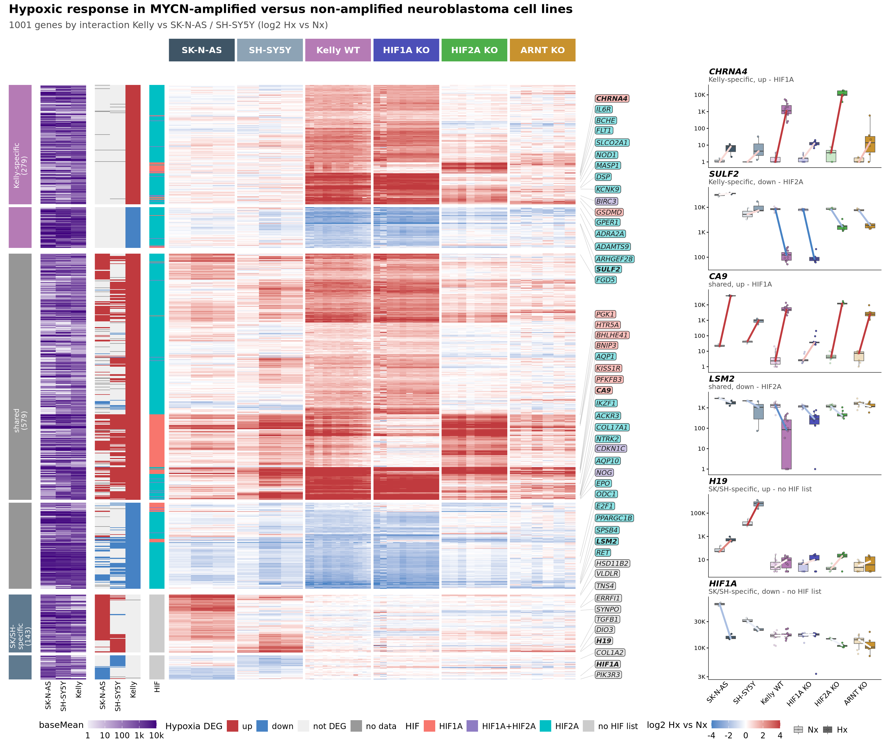
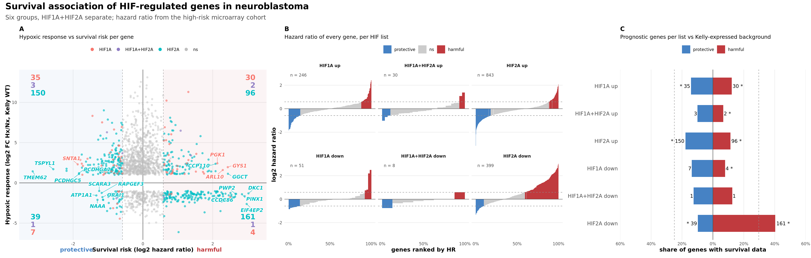
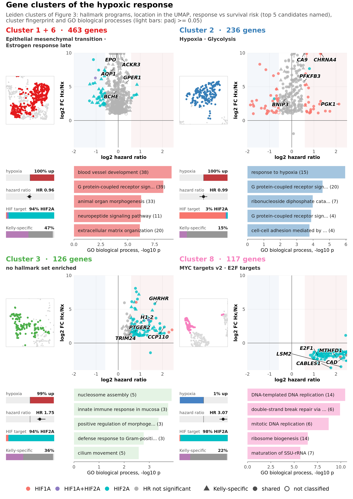
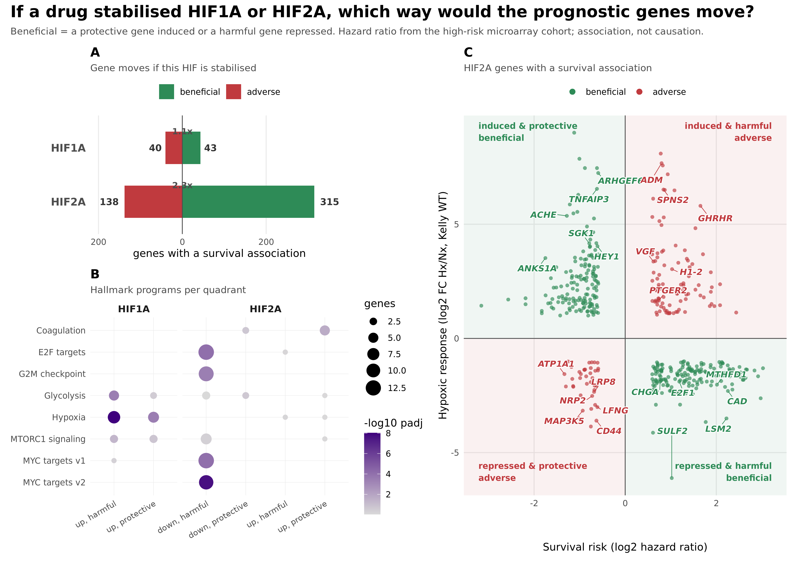
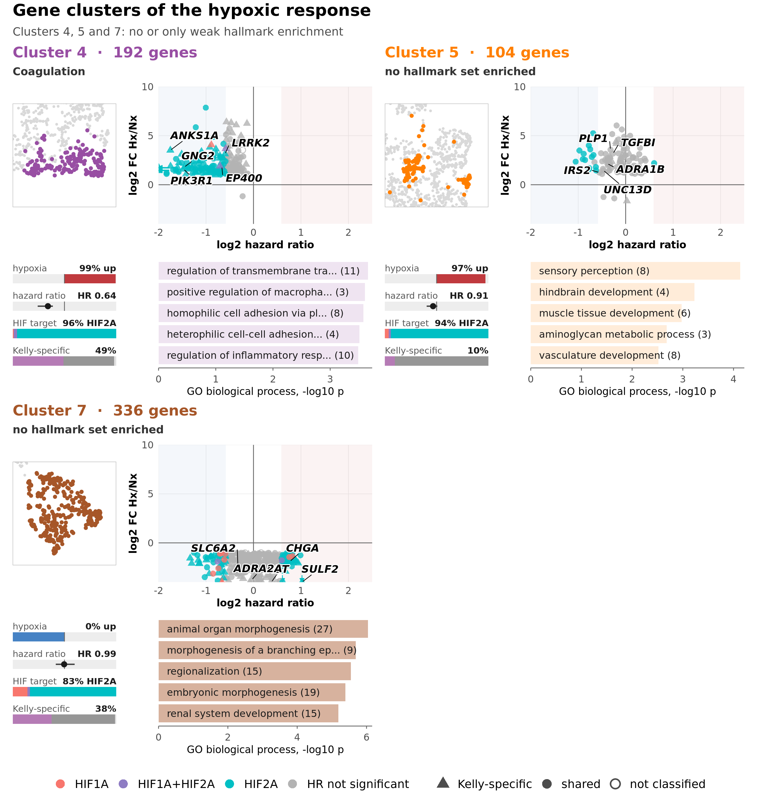

Manuscript figures: HIF1A / HIF2A regulated genes
================

- [Input](#input)
  - [Interaction: Kelly vs SK-N-AS /
    SH-SY5Y](#interaction-kelly-vs-sk-n-as--sh-sy5y)
  - [Candidate score](#candidate-score)
- [Figure 1: Hypoxia response in Kelly vs SK-N-AS /
  SH-SY5Y](#figure-1-hypoxia-response-in-kelly-vs-sk-n-as--sh-sy5y)
- [Figure 2: Protective or harmful?](#figure-2-protective-or-harmful)
  - [Variant 1: four groups](#variant-1-four-groups)
  - [Variant 2: HIF1A+HIF2A as its own
    group](#variant-2-hif1ahif2a-as-its-own-group)
- [Figure 3: UMAP](#figure-3-umap)
- [Figure 4: Gene clusters](#figure-4-gene-clusters)
- [Figure 5: The clinical reading](#figure-5-the-clinical-reading)
- [TOP candidates](#top-candidates)
- [Appendix: Figure 1 variants](#appendix-figure-1-variants)
  - [Responding lines (cutoff groups)](#responding-lines-cutoff-groups)
  - [Figure 4: the remaining clusters](#figure-4-the-remaining-clusters)
  - [Variant: rows grouped by responding
    lines](#variant-rows-grouped-by-responding-lines)
  - [Variant: rows grouped by HIF
    list](#variant-rows-grouped-by-hif-list)
- [Export](#export)

Final figures for the manuscript part that follows Xheni’s figures
(RNA-seq overview, CUT&RUN, overlap of core genes). Every figure here is
built from the same gene set: the four HIF-regulated lists from the
Kelly RNA-seq, now including the hypoxia-*repressed* genes. Exploratory
variants live in [Master_Table_Dive.Rmd](Master_Table_Dive.Rmd); this
document only holds what goes into the manuscript, plus the variants
still to be decided. Code blocks are collapsed - click *Code* to expand.

<details>

<summary>

Code
</summary>

``` r
# Attached: dplyr for %>% and tibble(), ggplot2 and patchwork for the plot
# grammar. Everything else is called with pkg::.
library(dplyr)
library(ggplot2)
library(patchwork)
```

</details>

# Input

The four lists (copied from the manuscript folder into
[gene_lists/](gene_lists/)) define the gene set. All of them are Kelly
WT hypoxia DEGs (padj \< 0.05, \|log2FC\| \> 1) whose response depends
on the respective HIF (interaction term in the KO). The annotation -
hazard ratio, literature counts, responses in SK-N-AS and SH-SY5Y -
comes from the master table, the per-sample expression from the VST
cache built in the Dive.

<details>

<summary>

Code
</summary>

``` r
in_dir <- here::here("6_XM_data_merge")
# DESeq2 objects, read only when the interaction or count caches are rebuilt:
# the first of these folders that exists (workstation, then laptop)
gdrive <- Filter(dir.exists, c(
  "/data/charite/kelly_data",
  "/Users/simonkelterborn/Library/CloudStorage/GoogleDrive-simon.kelterborn@gmail.com/Meine Ablage/! OneDrive Charité"))[1]
cache  <- function(f) {
  p <- file.path(in_dir, "cache", f)
  if (!file.exists(p)) stop(f, " missing - knit Master_Table_Dive.Rmd once to build it")
  readRDS(p)
}
master <- cache("master_counts_table.rds")
hm     <- cache("hx_heatmap_vst.rds")    # VST, centered on Nx per line / batch

list_files <- c(`HIF1A up`   = "HIF1a_regulated_DEGs_new_alternative.xlsx",
                `HIF1A down` = "HIF1a_downregulated_DEGs_positive_interaction_alternative.xlsx",
                `HIF2A up`   = "HIF2a_regulated_DEGs_alternative.xlsx",
                `HIF2A down` = "HIF2a_GroupIII_positive_interaction_WT_down.xlsx")

lists <- purrr::imap_dfr(list_files, function(f, grp) {
  d <- readxl::read_xlsx(file.path(in_dir, "gene_lists", f))
  names(d) <- sub("^HIF[12][aA]_interaction", "interaction", names(d))
  tibble(list = grp, Ensembl = d$ensembl_gene_id, symbol_list = d$gene_symbol,
         log2FC = d$WT_Hx_log2FC, padj = d$WT_Hx_padj, baseMean = d$baseMean,
         int_log2FC = d$interaction_log2FC)
}) %>%
  dplyr::mutate(hif = sub(" .*", "", list), dir = sub(".* ", "", list),
                list = factor(list, levels = names(list_files)))

tab(lists %>% dplyr::count(list, name = "genes") %>%
      dplyr::mutate(`log2FC range` = sapply(split(lists$log2FC, lists$list), function(x)
                      sprintf("%.1f to %.1f", min(x), max(x)))),
    "The four gene lists")
```

</details>

**The four gene lists**

| list       | genes | log2FC range |
|:-----------|------:|:-------------|
| HIF1A up   |   378 | 1.0 to 12.1  |
| HIF1A down |    75 | -4.4 to -1.0 |
| HIF2A up   |  1354 | 1.0 to 13.1  |
| HIF2A down |   515 | -6.1 to -1.0 |

60 genes are on two lists: 47 on both up-lists and 13 on both
down-lists, never on an up- and a down-list. Below, every gene appears
once, as `HIF1A`, `HIF2A` or `HIF1A+HIF2A`; whether the latter becomes
its own group in the manuscript is still open (Figure 2 shows both
versions).

<details>

<summary>

Code
</summary>

``` r
hif_levels <- c("HIF1A", "HIF1A+HIF2A", "HIF2A")
grp6_levels <- c(paste(hif_levels, "up"), paste(hif_levels, "down"))

genes <- lists %>%
  dplyr::group_by(Ensembl) %>%
  dplyr::summarise(hif = ifelse(dplyr::n() > 1, "HIF1A+HIF2A", hif[1]),
                   dir = dir[1], symbol_list = symbol_list[1],
                   log2FC = log2FC[1], baseMean = baseMean[1],
                   # KO effect: on two lists, the stronger of the two interaction terms
                   int_log2FC = int_log2FC[which.max(abs(int_log2FC))], .groups = "drop") %>%
  dplyr::left_join(master %>% dplyr::distinct(Ensembl, .keep_all = TRUE) %>%
                     dplyr::select(Ensembl, symbol, HR, p_value_HR, HR_risk,
                                   pubmed_total, pubmed_hypoxia,
                                   Kelly.Hx.vs.Nx.log2FoldChange, Kelly.Hx.vs.Nx.padj,
                                   log2FC_SKNAS, padj_SKNAS, log2FC_SHSY5Y, padj_SHSY5Y),
                   by = "Ensembl") %>%
  dplyr::mutate(
    hif   = factor(hif, levels = hif_levels),
    dir   = factor(dir, levels = c("up", "down")),
    grp6  = factor(paste(hif, dir), levels = grp6_levels),
    # Plot label: master symbol, else the list symbol; unannotated loci get none.
    label = dplyr::coalesce(symbol, symbol_list),
    label = ifelse(is.na(label) | grepl("^ENSG", label), NA, label))

tab(as.data.frame.matrix(table(genes$hif, genes$dir)) %>% tibble::rownames_to_column("HIF"),
    paste0("Genes per HIF and direction (", nrow(genes), " unique genes)"))
```

</details>

**Genes per HIF and direction (2262 unique genes)**

| HIF         |   up | down |
|:------------|-----:|-----:|
| HIF1A       |  331 |   62 |
| HIF1A+HIF2A |   47 |   13 |
| HIF2A       | 1307 |  502 |

## Interaction: Kelly vs SK-N-AS / SH-SY5Y

Whether a gene responds in Kelly only or in all three lines can be read
from fixed log2FC cutoffs (appendix), but the gap between “DEG” (\> 1)
and “flat” (\<= 0.5) leaves most genes unclear. An interaction term
tests the difference directly: does the hypoxia response in Kelly differ
from the one in SK-N-AS (or SH-SY5Y)? One DESeq2 model on the raw counts
of the Kelly WT samples (31, three projects) and the 12 SK-N-AS /
SH-SY5Y samples, on the genes of both data sets (at least 10 counts in
at least 3 samples):

`~ block + hxK + hxA + hxH`

`block` is one intercept per Kelly project and per baseline line; `hxK`,
`hxA`, `hxH` are the Hx effects in Kelly, SK-N-AS and SH-SY5Y. The
contrasts `hxK - hxA` and `hxK - hxH` are the interaction terms (log2 of
the ratio of the two Hx/Nx ratios). Line and data set are confounded,
but that cancels in the interaction, which compares ratios within each
line; what does not cancel is a difference in the hypoxia protocol
between the two experiments.

An interaction is *significant* when padj \< 0.05 and \|log2\| \> 1.
Groups:

| Group | Definition |
|----|----|
| shared | Kelly DEG; no significant interaction with at least one line, or a baseline line is a DEG too (Kelly stronger counts as shared) |
| Kelly-specific | Kelly DEG; significant interaction with both lines in Kelly’s direction; neither SK-N-AS nor SH-SY5Y a DEG |
| SK/SH-specific | not a Kelly DEG; SK-N-AS or SH-SY5Y a DEG with a significant interaction against Kelly in that line’s direction |
| not testable | Kelly DEG, but no interaction result for one of the lines (gene missing or filtered in one data set) |

Shared and Kelly-specific are list genes; SK/SH-specific are searched
among all genes of the master table.

<details>

<summary>

Code
</summary>

``` r
# Hypoxia DEG: padj < 0.05 and |log2FC| > 1.
deg <- function(l2fc, padj) !is.na(padj) & padj < 0.05 & abs(l2fc) > 1

int_cache <- file.path(in_dir, "cache", "int_kelly_sksh.rds")
if (!file.exists(int_cache)) {
  loadNamespace("DESeq2")
  dk <- readRDS(file.path(gdrive, "dds_filtered_with_metadata.rds"))
  dk <- dk[, dk$genotype == "WT"]
  e <- new.env()
  load(file.path(gdrive, "SKNAS_SHSY5Y.dds"), envir = e)
  db <- e$dds
  ig <- intersect(rownames(dk), rownames(db))
  cd <- data.frame(
    line  = c(rep("Kelly", ncol(dk)), as.character(db$Celltype)),
    cond  = c(as.character(dk$condition), ifelse(db$Condition == "Hypoxia", "Hx", "Nx")),
    block = c(paste0("Kelly_", dk$project), make.names(as.character(db$Celltype))))
  cd <- cd %>% dplyr::mutate(block = factor(block),
                             hxK = as.numeric(line == "Kelly" & cond == "Hx"),
                             hxA = as.numeric(line == "SK-N-AS" & cond == "Hx"),
                             hxH = as.numeric(line == "SH-SY5Y" & cond == "Hx"))
  dds <- DESeq2::DESeqDataSetFromMatrix(
    cbind(DESeq2::counts(dk)[ig, ], DESeq2::counts(db)[ig, ]), cd, ~ block + hxK + hxA + hxH)
  dds <- dds[rowSums(DESeq2::counts(dds) >= 10) >= 3, ]
  dds <- DESeq2::DESeq(dds, quiet = TRUE)
  rn  <- DESeq2::resultsNames(dds)
  ctr <- function(w) {
    v <- setNames(rep(0, length(rn)), rn); v[names(w)] <- w
    as.data.frame(DESeq2::results(dds, contrast = v))
  }
  kA <- ctr(c(hxK = 1, hxA = -1)); kH <- ctr(c(hxK = 1, hxH = -1))
  saveRDS(tibble(Ensembl = rownames(kA),
                 intA_log2FC = kA$log2FoldChange, intA_padj = kA$padj,
                 intH_log2FC = kH$log2FoldChange, intH_padj = kH$padj), int_cache)
}
int_res <- readRDS(int_cache)

# Significant interaction in direction s (Kelly minus baseline line).
int_sig <- function(l2fc, padj, s) !is.na(padj) & padj < 0.05 & abs(l2fc) > 1 & sign(l2fc) == s
int_levels <- c("shared", "Kelly-specific", "SK/SH-specific", "not testable", "other")

genes <- genes %>%
  dplyr::select(-dplyr::any_of(names(int_res)[-1])) %>%
  dplyr::left_join(int_res, by = "Ensembl") %>%
  dplyr::mutate(
    K  = deg(Kelly.Hx.vs.Nx.log2FoldChange, Kelly.Hx.vs.Nx.padj),
    A  = deg(log2FC_SKNAS, padj_SKNAS),
    H  = deg(log2FC_SHSY5Y, padj_SHSY5Y),
    KA = int_sig(intA_log2FC, intA_padj, sign(Kelly.Hx.vs.Nx.log2FoldChange)),
    KH = int_sig(intH_log2FC, intH_padj, sign(Kelly.Hx.vs.Nx.log2FoldChange)),
    int_group = factor(dplyr::case_when(
      K & (is.na(intA_padj) | is.na(intH_padj)) ~ "not testable",
      K & KA & KH & !A & !H                     ~ "Kelly-specific",
      K                                         ~ "shared",
      TRUE                                      ~ "other"), levels = int_levels)) %>%
  dplyr::select(-K, -A, -H, -KA, -KH)

# SK/SH-specific among all genes: the responding line with the stronger
# response gives direction, log2FC and baseMean.
sksh_spec <- master %>% dplyr::distinct(Ensembl, .keep_all = TRUE) %>%
  dplyr::filter(!Ensembl %in% genes$Ensembl) %>%
  dplyr::inner_join(int_res, by = "Ensembl") %>%
  dplyr::mutate(
    K  = deg(Kelly.Hx.vs.Nx.log2FoldChange, Kelly.Hx.vs.Nx.padj),
    AK = deg(log2FC_SKNAS, padj_SKNAS) & int_sig(intA_log2FC, intA_padj, -sign(log2FC_SKNAS)),
    HK = deg(log2FC_SHSY5Y, padj_SHSY5Y) & int_sig(intH_log2FC, intH_padj, -sign(log2FC_SHSY5Y))) %>%
  dplyr::filter(!K & (AK | HK)) %>%
  dplyr::mutate(use_A = AK & (!HK | abs(log2FC_SKNAS) >= abs(log2FC_SHSY5Y)),
                sk_log2FC   = ifelse(use_A, log2FC_SKNAS, log2FC_SHSY5Y),
                sk_baseMean = ifelse(use_A, baseMean_SKNAS, baseMean_SHSY5Y),
                line = dplyr::case_when(AK & HK ~ "both", AK ~ "SK-N-AS", TRUE ~ "SH-SY5Y"),
                dir  = factor(ifelse(sk_log2FC > 0, "up", "down"), levels = c("up", "down")),
                int_group = factor("SK/SH-specific", levels = int_levels),
                label = ifelse(is.na(symbol) | grepl("^ENSG", symbol), NA, symbol))

tab(dplyr::bind_rows(genes %>% dplyr::select(int_group, dir),
                     sksh_spec %>% dplyr::select(int_group, dir)) %>%
      dplyr::count(int_group, dir) %>%
      tidyr::pivot_wider(names_from = dir, values_from = n, values_fill = 0),
    "Interaction groups by direction (shared, Kelly-specific, not testable, other: list genes; SK/SH-specific: all genes)")
```

</details>

**Interaction groups by direction (shared, Kelly-specific, not testable,
other: list genes; SK/SH-specific: all genes)**

| int_group      |   up | down |
|:---------------|-----:|-----:|
| shared         | 1084 |  378 |
| Kelly-specific |  524 |  178 |
| SK/SH-specific |  256 |  107 |
| not testable   |   65 |   13 |
| other          |   12 |    8 |

## Candidate score

One score ranks the genes wherever a selection is needed: the genes for
the heatmap, the named genes, and the candidate list at the end. It is a
weighted mean of four percentile ranks (0 = lowest, 1 = highest among
the 2262 genes), so the four ingredients are on the same scale
regardless of their units:

| Ingredient | Column | Reading |
|----|----|----|
| hypoxia response | \|log2FC\| Kelly WT (from the lists) | strong effect |
| HIF dependence | \|interaction log2FC\| (from the lists) | strong KO effect: the response depends on the HIF |
| expression | log10 baseMean (from the lists) | robustly measured, relevant amount |
| popularity | log10(`pubmed_total` + 1) | well-studied gene, recognisable to the reader |

`pubmed_total` counts curated gene-to-paper links in NCBI gene2pubmed,
not mentions (see the Dive), so 50 already marks a well-studied gene.
For the 347 genes without a literature record the score is the weighted
mean of the three remaining ingredients - unknown is not scored as zero.
Response and KO effect are correlated (both measure how strongly the
gene reacts), so they share one third of the weight (1/6 each);
expression and popularity get one third each. Popularity counts *for* a
gene here, because the selection is meant to show readers genes they
know; for a novelty-oriented candidate list the sign of that weight
would flip.

<details>

<summary>

Code
</summary>

``` r
# Weighted mean of percentile ranks; a missing ingredient drops out of the
# weights instead of counting as zero.
pct_score <- function(comp, w) {
  wm <- matrix(w, nrow(comp), length(w), byrow = TRUE) * !is.na(comp)
  rowSums(comp * wm, na.rm = TRUE) / rowSums(wm)
}
# Genes of SK-N-AS / SH-SY5Y (no KOs there): response and expression in the
# responding line and popularity, 1/3 each.
line_score <- function(d) pct_score(cbind(dplyr::percent_rank(abs(d$sk_log2FC)),
                                          dplyr::percent_rank(log10(d$sk_baseMean + 1)),
                                          dplyr::percent_rank(log10(d$pubmed_total + 1))),
                                    rep(1/3, 3))

score_w <- c(log2FC = 1/6, KO = 1/6, baseMean = 1/3, popularity = 1/3)

comp <- cbind(log2FC     = dplyr::percent_rank(abs(genes$log2FC)),
              KO         = dplyr::percent_rank(abs(genes$int_log2FC)),
              baseMean   = dplyr::percent_rank(log10(genes$baseMean + 1)),
              popularity = dplyr::percent_rank(log10(genes$pubmed_total + 1)))
genes$score <- pct_score(comp, score_w)

tab(round(cor(comp, method = "spearman", use = "pairwise.complete.obs"), 2) %>%
      as.data.frame() %>% tibble::rownames_to_column(" "),
    "How much the ingredients overlap (Spearman correlation of the percentile ranks)")
```

</details>

**How much the ingredients overlap (Spearman correlation of the
percentile ranks)**

|            | log2FC |    KO | baseMean | popularity |
|:-----------|-------:|------:|---------:|-----------:|
| log2FC     |   1.00 |  0.59 |    -0.14 |      -0.01 |
| KO         |   0.59 |  1.00 |    -0.29 |      -0.03 |
| baseMean   |  -0.14 | -0.29 |     1.00 |       0.47 |
| popularity |  -0.01 | -0.03 |     0.47 |       1.00 |

<details>

<summary>

Code
</summary>

``` r
tab(genes %>% dplyr::filter(!is.na(label)) %>% dplyr::slice_max(score, n = 8) %>%
      dplyr::transmute(gene = label, group = grp6, log2FC = round(log2FC, 1),
                       `KO int.` = round(int_log2FC, 1),
                       baseMean = round(baseMean), pubmed_total, score = round(score, 2)),
    "Highest-scoring genes overall")
```

</details>

**Highest-scoring genes overall**

| gene   | group          | log2FC | KO int. | baseMean | pubmed_total | score |
|:-------|:---------------|-------:|--------:|---------:|-------------:|------:|
| EPO    | HIF2A up       |   12.5 |    -6.2 |     4152 |         1202 |  0.97 |
| CA9    | HIF1A up       |   10.9 |    -6.8 |     2877 |         1333 |  0.96 |
| PFKFB3 | HIF1A up       |    5.8 |    -5.3 |     7128 |          390 |  0.95 |
| AQP1   | HIF2A up       |    7.7 |    -2.8 |    12405 |          378 |  0.93 |
| CDKN1C | HIF1A+HIF2A up |    7.9 |    -4.4 |     1967 |          581 |  0.93 |
| RET    | HIF2A down     |   -4.9 |     2.7 |     4530 |         2445 |  0.92 |
| ACKR3  | HIF2A up       |    9.1 |    -8.3 |      980 |          545 |  0.92 |
| BNIP3  | HIF1A up       |    3.2 |    -3.5 |    19638 |          558 |  0.92 |

# Figure 1: Hypoxia response in Kelly vs SK-N-AS / SH-SY5Y

The heatmap from section 5 of the Dive, now for the HIF-regulated genes:
log2 Hx vs Nx (Hx samples only, every line centered on its own
normoxia), rows grouped by the interaction groups (section
*Interaction*), top to bottom: **Kelly-specific**, **shared** (Kelly
stronger included) and **SK/SH-specific**; `not testable` and `other`
are left out. No HR strip, no primary tumours. Two variants, grouped by
the cutoff groups and by HIF list, are in the appendix.

**Row order.** Within each group the rows are split into *clusters* by
direction (induced on top, repressed below, separated by a small gap),
and within a cluster clustered (Ward) on the mean Hx response of all six
panels. The HIF lists are not pre-sorted: the KO columns separate HIF1A
from HIF2A genes by themselves, so the HIF strip still reads as bands.
Clustering on the three lines alone (as in the Dive) mixes them, because
their Hx response in Kelly WT looks alike - the HIFs are told apart only
by the KOs.

**Left strips.** The group strip in the line colours (Kelly-specific in
Kelly’s colour, SK/SH-specific in the baseline lines’ hue); baseMean per
line, and whether the gene is a hypoxia DEG in that line (padj \< 0.05,
\|log2FC\| \> 1; up / down / not / no log2FC), from the master table.

**Example genes.** For each cluster with at least 10 genes the most
typical named gene is shown on the right as normalized counts, Nx
(light) and Hx (dark) for every line, in the colours of the panel
headers. A line joins the Nx and Hx medians of every line, coloured by
that line’s Hx response on the heatmap’s scale. Counts of SK-N-AS /
SH-SY5Y and of the Kelly lines come from two DESeq2 data sets, each
normalized on its own (median of ratios); the levels are comparable in
order of magnitude, not exactly.

**Gene set.** At most 1000 rows, taken from every group (and HIF list
and direction) in proportion to its size: list genes by candidate score,
SK/SH-specific genes by the line score (percentile ranks of \|log2FC\|
and baseMean in the responding line and of the popularity, 1/3 each; no
KO term - there are no SK-N-AS / SH-SY5Y KOs). Their HIF strip is grey:
they are on no list.

**Named genes.** 50 genes are named, chosen as *typical* for their
group: allocated across the groups by the square root of their size
(large groups get more names, small ones are not left empty), and within
a group ranked half by candidate score and half by how clearly the gene
shows the group’s pattern in the VST response:

| Group | Typical = |
|----|----|
| shared | Kelly and the stronger baseline line both strong (same direction) |
| Kelly-specific | Kelly strong, both baseline lines flat |
| SK/SH-specific | the stronger baseline line strong, Kelly flat |

Within each group up- and down-regulated genes are named in proportion.
The label colour marks the HIF.

<details>

<summary>

Code
</summary>

``` r
hm_panels <- c("SK-N-AS", "SH-SY5Y", "Kelly", "HIF1A KO", "HIF2A KO", "ARNT KO")
hm_lines  <- c("SK-N-AS", "SH-SY5Y", "Kelly")

# Hx response per gene and panel: mean of the Hx samples = log2 vs Nx.
hx_resp_all <- sapply(hm_panels, function(l)
  rowMeans(hm$mat[, hm$cols$line == l & hm$cols$condition == "Hx"]))
hx_resp <- hx_resp_all[, hm_lines]

# Line colours: Kelly and the KOs as in the PCA (XM_SK_compare.Rmd); the two
# baseline lines share one hue in two shades.
line_cols <- c(`SK-N-AS` = "#3F5566", `SH-SY5Y` = "#8DA3B5", Kelly = "#B57BB5",
               `HIF1A KO` = "#4C4FB8", `HIF2A KO` = "#4DAF4A", `ARNT KO` = "#C8922E")
line_names <- c(Kelly = "Kelly WT", setNames(hm_panels[-3], hm_panels[-3]))
hif_cols <- c(HIF1A = "#F8766D", `HIF1A+HIF2A` = "#8E7CC3", HIF2A = "#00BFC4")
hif_cols_hm <- c(hif_cols, `no HIF list` = "grey80")
strip_short <- c(`Kelly + 1 line` = "Kelly + 1", `SK/SH only` = "SK/SH\nonly",
                 `SK/SH-specific` = "SK/SH-\nspecific",
                 `HIF1A+HIF2A up` = "both up", `HIF1A+HIF2A down` = "both down")
hm_title <- "Hypoxic response in MYCN-amplified versus non-amplified neuroblastoma cell lines"
hm_guide <- guide_colourbar(barwidth = unit(6, "lines"), barheight = unit(0.7, "lines"),
                            title.vjust = 0.9)

# How clearly a gene shows the pattern of its group (VST response), for the
# interaction groups and the cutoff groups of the appendix.
typicality <- function(ens, group) {
  r  <- hx_resp[ens, , drop = FALSE]
  aK <- abs(r[, "Kelly"]); aA <- abs(r[, "SK-N-AS"]); aH <- abs(r[, "SH-SY5Y"])
  sA <- sign(r[, "SK-N-AS"]) == sign(r[, "Kelly"]); sH <- sign(r[, "SH-SY5Y"]) == sign(r[, "Kelly"])
  dplyr::case_when(
    group == "shared"                            ~ pmin(aK, pmax(aA * sA, aH * sH)),
    group == "all 3 lines"                       ~ pmin(aK, aA * sA, aH * sH),
    group == "Kelly + 1 line"                    ~ pmin(aK, pmax(aA * sA, aH * sH)) - pmin(aA, aH),
    group %in% c("Kelly-specific", "Kelly only") ~ aK - pmax(aA, aH),
    group %in% c("SK/SH-specific", "SK/SH only") ~ pmax(aA, aH) - aK)
}

# Split n names over groups by sqrt(group size), largest remainder rounding.
alloc <- function(sizes, n) {
  q <- n * sqrt(sizes) / sum(sqrt(sizes))
  k <- floor(q)
  i <- order(q - k, decreasing = TRUE)[seq_len(n - sum(k))]
  k[i] <- k[i] + 1
  setNames(k, names(sizes))
}
pick_typical <- function(d, n) {
  cand <- d %>% dplyr::filter(!is.na(label), !is.na(typical)) %>%
    dplyr::group_by(pattern) %>%
    dplyr::mutate(rank = 0.5 * dplyr::percent_rank(typical) + 0.5 * score) %>%
    dplyr::ungroup()
  k <- alloc(table(droplevels(cand$pattern)), n)
  purrr::imap_dfr(k, function(kk, p) {
    cp <- cand %>% dplyr::filter(pattern == p)
    kd <- alloc(table(droplevels(cp$dir))^2, kk)   # ^2 undoes the sqrt: proportional
    purrr::imap_dfr(kd, function(kx, dx)
      cp %>% dplyr::filter(dir == dx) %>% dplyr::slice_max(rank, n = kx, with_ties = FALSE))
  })
}

# One example per cluster (group x direction, at least 10 genes): the
# best-ranked named gene of the cluster.
pick_examples <- function(top, set) {
  top %>%
    dplyr::inner_join(set %>% dplyr::count(pattern, dir, name = "n_cluster"), by = c("pattern", "dir")) %>%
    dplyr::filter(n_cluster >= 10) %>%
    dplyr::group_by(pattern, dir) %>% dplyr::slice_max(rank, n = 1, with_ties = FALSE) %>%
    dplyr::ungroup() %>%
    dplyr::mutate(subtitle = paste0(gsub("\n", " ", gsub("-\n", "-", dplyr::coalesce(
                                      strip_short[as.character(pattern)], as.character(pattern)))),
                                    ", ", dir, " - ", hif_lab))
}
```

</details>

Normalized counts for the example genes come from the two DESeq2 objects
(`gdrive`); the counts are cached like the VST matrix.

<details>

<summary>

Code
</summary>

``` r
cnt_cache <- file.path(in_dir, "cache", "hx_counts.rds")
# Cached; rebuilt for the old plus the new genes when a requested gene is missing.
load_counts <- function(ens) {
  cnt <- if (file.exists(cnt_cache)) readRDS(cnt_cache)
  if (!is.null(cnt) && all(ens %in% rownames(cnt$mat))) return(cnt)
  ens <- union(rownames(cnt$mat), ens)
  loadNamespace("DESeq2")
  dds_k <- readRDS(file.path(gdrive, "dds_filtered_with_metadata.rds"))
  e <- new.env()
  load(file.path(gdrive, "SKNAS_SHSY5Y.dds"), envir = e)
  norm <- function(d) DESeq2::counts(DESeq2::estimateSizeFactors(d), normalized = TRUE)
  n_k <- norm(dds_k); n_b <- norm(e$dds)
  pad <- function(m) {   # genes missing from one data set stay NA, not 0
    out <- matrix(NA_real_, length(ens), ncol(m), dimnames = list(ens, colnames(m)))
    i <- intersect(ens, rownames(m)); out[i, ] <- m[i, ]; out
  }
  cnt <- list(mat = cbind(pad(n_k), pad(n_b)))
  saveRDS(cnt, cnt_cache)
  cnt
}
cnt <- load_counts(union(genes$Ensembl, sksh_spec$Ensembl))
# Same samples as the heatmap (batches with a normoxia reference).
cnt_cols <- hm$cols %>% dplyr::filter(sample %in% colnames(cnt$mat)) %>%
  dplyr::mutate(line = factor(line, levels = hm_panels),
                condition = factor(condition, levels = c("Nx", "Hx")))
```

</details>

<details>

<summary>

Code
</summary>

``` r
base_means <- master %>% dplyr::distinct(Ensembl, .keep_all = TRUE) %>%
  dplyr::select(Ensembl, Kelly = baseMean_Kelly, `SK-N-AS` = baseMean_SKNAS,
                `SH-SY5Y` = baseMean_SHSY5Y)

# Hypoxia DEG state per gene and line (master table).
deg_cols <- c(up = "#C03A3E", down = "#4682C4", `not DEG` = "#EFEFEF", `no data` = "grey60")
deg_state <- function(l2fc, padj) dplyr::case_when(
  is.na(l2fc)               ~ "no data",   # padj NA (filtered): not DEG
  deg(l2fc, padj) & l2fc > 0 ~ "up",
  deg(l2fc, padj)            ~ "down",
  TRUE                       ~ "not DEG")
deg_states <- master %>% dplyr::distinct(Ensembl, .keep_all = TRUE) %>%
  dplyr::transmute(Ensembl,
                   Kelly     = deg_state(Kelly.Hx.vs.Nx.log2FoldChange, Kelly.Hx.vs.Nx.padj),
                   `SK-N-AS` = deg_state(log2FC_SKNAS, padj_SKNAS),
                   `SH-SY5Y` = deg_state(log2FC_SHSY5Y, padj_SHSY5Y)) %>%
  tidyr::pivot_longer(-Ensembl, names_to = "line", values_to = "state")

# Row positions: fixed groups (in `levels` order); within a group one cluster
# per direction (up on top), Ward clustering inside each cluster on the mean
# Hx response of all six panels.
# Gap between groups, half a gap between the two clusters of a group.
hm_rows <- function(ens, split, levels, set) {
  grp <- split[ens]
  g   <- set[match(ens, set$Ensembl), ]
  gap <- max(1, round(length(ens) / 100))
  y <- c(); off <- 0; last <- NULL
  # y runs upwards, so everything is laid out in reverse and the first level
  # ends up on top.
  for (gr in rev(intersect(levels, unique(grp)))) for (d in rev(levels(g$dir))) {
    blk <- ens[grp == gr & g$dir == d]
    if (!length(blk)) next
    if (!is.null(last)) off <- off + if (last == gr) ceiling(gap / 2) else gap
    e <- blk
    if (length(e) > 1)
      e <- e[hclust(dist(hx_resp_all[e, , drop = FALSE]), method = "ward.D2")$order]
    y   <- c(y, setNames(off + seq_along(e), e))
    off <- off + length(e)
    last <- gr
  }
  list(y = y, group = setNames(grp, ens)[names(y)],
       cluster = setNames(paste(grp, g$dir), ens)[names(y)])
}

# Normalized counts of one gene: Nx (light) and Hx (dark) per line.
# A line joins the Nx and Hx medians of each line (dodge 0.8: boxes at -0.2 /
# +0.2), coloured by the line's Hx response on the heatmap scale.
count_panel <- function(e, title, subtitle, x_axis = FALSE, lim = 4) {
  d <- cnt_cols %>% dplyr::mutate(count = cnt$mat[e, sample])
  med <- d %>% dplyr::filter(!is.na(count)) %>%
    dplyr::group_by(line, condition) %>%
    dplyr::summarise(m = stats::median(count + 1), .groups = "drop") %>%
    tidyr::pivot_wider(names_from = condition, values_from = m) %>%
    dplyr::filter(!is.na(Nx), !is.na(Hx)) %>%
    dplyr::mutate(x = as.numeric(line), resp = hx_resp_all[e, as.character(line)])
  ggplot(d, aes(x = line, y = count + 1, fill = line, alpha = condition)) +
    geom_boxplot(position = position_dodge(0.8), width = 0.7, outlier.shape = NA,
                 colour = "grey30", linewidth = 0.25) +
    geom_point(position = position_jitterdodge(jitter.width = 0.25, dodge.width = 0.8, seed = 1),
               shape = 21, size = 0.9, stroke = 0.2, colour = "grey15") +
    geom_segment(data = med, aes(x = x - 0.2, xend = x + 0.2, y = Nx, yend = Hx, colour = resp),
                 inherit.aes = FALSE, linewidth = 1.1, lineend = "round") +
    scale_colour_gradient2(low = "#4682C4", mid = "white", high = "#C03A3E",
                           limits = c(-lim, lim), oob = scales::squish, guide = "none") +
    scale_y_log10(labels = scales::label_number(scale_cut = scales::cut_short_scale()),
                  expand = expansion(mult = 0.08)) +
    scale_fill_manual(values = line_cols, guide = "none") +
    scale_alpha_manual(values = c(Nx = 0.3, Hx = 1), name = NULL,
                       guide = guide_legend(override.aes = list(fill = "grey40"))) +
    scale_x_discrete(labels = line_names) +
    labs(title = title, subtitle = subtitle, x = NULL, y = NULL) +
    theme_classic(base_size = 9) +
    theme(plot.title = element_text(face = "bold.italic", size = 10.5, margin = margin(b = 1)),
          plot.subtitle = element_text(size = 8.5, colour = "grey30", margin = margin(b = 2)),
          axis.text.x = if (x_axis) element_text(angle = 45, hjust = 1, size = 8.5) else element_blank(),
          axis.ticks.x = element_blank(), axis.line = element_line(linewidth = 0.25),
          plot.margin = margin(2, 4, 2, 4))
}

hx_heatmap <- function(ens, split, levels, strip_cols, marks, title = NULL, subtitle = NULL, lim = 4,
                       examples = NULL, set) {
  rows <- hm_rows(ens, split, levels, set)
  pos  <- rows$y
  n    <- max(pos)
  m    <- hm$mat[names(pos), , drop = FALSE]

  # Every Hx block gets the same width, however many samples it holds.
  cols <- hm$cols %>%
    dplyr::filter(condition == "Hx") %>%
    dplyr::mutate(line = factor(line, levels = hm_panels)) %>%
    dplyr::arrange(line, batch) %>%
    dplyr::group_by(line) %>%
    dplyr::mutate(xmin = (dplyr::row_number() - 1) / dplyr::n(),
                  xmax = dplyr::row_number() / dplyr::n()) %>%
    dplyr::ungroup()
  long <- tibble(Ensembl = rep(rownames(m), ncol(m)),
                 sample  = rep(colnames(m), each = nrow(m)),
                 value   = as.vector(m)) %>%
    dplyr::mutate(y = pos[Ensembl]) %>%
    dplyr::inner_join(cols %>% dplyr::select(sample, line, xmin, xmax), by = "sample")
  yscale <- scale_y_continuous(limits = c(0.5, n + 0.5), expand = c(0, 0), oob = scales::oob_keep)
  strip_x <- theme(axis.text.x = element_text(angle = 90, hjust = 1, vjust = 0.5, size = 9,
                                              margin = margin(t = 2)))

  p_head <- ggplot(tibble(line = factor(hm_panels, levels = hm_panels))) +
    geom_rect(aes(xmin = 0, xmax = 1, ymin = 0, ymax = 1, fill = line), show.legend = FALSE) +
    geom_text(aes(x = 0.5, y = 0.5, label = line_names[as.character(line)]),
              colour = "white", size = 3.9, fontface = "bold") +
    scale_fill_manual(values = line_cols) +
    facet_grid(. ~ line) +
    scale_x_continuous(expand = c(0, 0)) +
    theme_void(base_size = 10) +
    theme(strip.text = element_blank(), panel.spacing.x = unit(3, "pt"))

  p_main <- ggplot(long, aes(xmin = xmin, xmax = xmax, ymin = y - 0.5, ymax = y + 0.5, fill = value)) +
    geom_rect() +
    scale_fill_gradient2(low = "#4682C4", mid = "white", high = "#C03A3E",
                         limits = c(-lim, lim), oob = scales::squish,
                         name = "log2 Hx vs Nx", guide = hm_guide) +
    facet_grid(. ~ line) + scale_x_continuous(expand = c(0, 0)) + yscale +
    theme_void(base_size = 10) +
    theme(strip.text = element_blank(), panel.spacing.x = unit(3, "pt"))

  bm <- base_means %>% dplyr::filter(Ensembl %in% names(pos)) %>%
    tidyr::pivot_longer(-Ensembl, names_to = "line", values_to = "baseMean") %>%
    dplyr::mutate(y = pos[Ensembl], line = factor(line, levels = hm_lines))
  p_bm <- ggplot(bm, aes(x = line, y = y, fill = log10(baseMean + 1))) +
    geom_raster() +
    scale_fill_gradient(low = "#F2F0F7", high = "#3F007D", limits = c(0, 4),
                        oob = scales::squish, na.value = "grey90",
                        breaks = 0:4, labels = c("1", "10", "100", "1k", "10k"),
                        name = "baseMean", guide = hm_guide) +
    scale_x_discrete(expand = c(0, 0)) + yscale + theme_void(base_size = 10) + strip_x

  # Hypoxia DEG per line.
  dg <- deg_states %>% dplyr::filter(Ensembl %in% names(pos)) %>%
    dplyr::mutate(y = pos[Ensembl], line = factor(line, levels = hm_lines))
  p_deg <- ggplot(dg, aes(x = line, y = y, fill = state)) +
    geom_raster() +
    scale_fill_manual(values = deg_cols, breaks = intersect(names(deg_cols), dg$state),
                      name = "Hypoxia DEG") +
    scale_x_discrete(expand = c(0, 0)) + yscale + theme_void(base_size = 10) + strip_x

  # HIF list membership of every row.
  tg <- tibble(Ensembl = names(pos), y = pos,
               hif = factor(set$hif_lab[match(names(pos), set$Ensembl)],
                            levels = names(hif_cols_hm)))
  p_tgt <- ggplot(tg, aes(x = "HIF", y = y, fill = hif)) +
    geom_raster() +
    scale_fill_manual(values = hif_cols_hm, breaks = intersect(names(hif_cols_hm), tg$hif),
                      name = "HIF") +
    scale_x_discrete(expand = c(0, 0)) + yscale + theme_void(base_size = 10) + strip_x

  # Group strip, labelled (short name over n) where the group is tall enough.
  gd <- tibble(y = pos, group = rows$group)
  gl <- gd %>% dplyr::group_by(group) %>%
    dplyr::summarise(y = mean(y), n = dplyr::n()) %>%
    dplyr::mutate(short = dplyr::coalesce(strip_short[group], group)) %>%
    # tall enough for the longest text line
    dplyr::filter(n >= 0.0065 * sapply(strsplit(short, "\n"), function(x) max(nchar(x))) *
                    length(pos)) %>%
    # white text on dark strips
    dplyr::mutate(txt = ifelse(colSums(grDevices::col2rgb(strip_cols[group]) *
                                         c(0.299, 0.587, 0.114)) / 255 < 0.6, "white", "grey10"))
  p_grp <- ggplot(gd, aes(x = 1, y = y, fill = group)) +
    geom_raster(show.legend = FALSE) +
    geom_text(data = gl, aes(label = paste0(short, "\n(", n, ")"), colour = txt), angle = 90,
              size = 3.1, lineheight = 0.9) +
    scale_fill_manual(values = strip_cols) + scale_colour_identity() +
    scale_x_continuous(expand = c(0, 0)) + yscale + theme_void()

  # Named genes, repelled along y, boxes in the HIF colour.
  # Example genes (count panels) in bold.
  mk <- marks %>% dplyr::filter(Ensembl %in% names(pos)) %>%
    dplyr::mutate(y = pos[Ensembl],
                  face = ifelse(Ensembl %in% examples$Ensembl, "bold.italic", "italic"))
  lab_args <- list(direction = "y", hjust = 0, nudge_x = 0.25, xlim = c(0.25, NA),
                   size = 3, label.size = 0,
                   label.padding = unit(0.12, "lines"), min.segment.length = 0,
                   box.padding = 0.09, max.overlaps = Inf, seed = 1, show.legend = FALSE,
                   max.iter = 20000)
  p_lab <- ggplot(mk, aes(x = 0, y = y, label = label, fill = hif_lab, fontface = face)) +
    do.call(ggrepel::geom_label_repel,
            c(lab_args, list(alpha = 0.45, colour = NA, segment.colour = "grey60",
                             segment.size = 0.25))) +
    do.call(ggrepel::geom_label_repel,
            c(lab_args, list(fill = NA, colour = "grey10", segment.colour = NA))) +
    scale_fill_manual(values = hif_cols_hm, guide = "none") +
    scale_x_continuous(limits = c(0, 1.6), expand = c(0, 0)) + yscale +
    theme_void()

  # Count panels of the example genes, top to bottom in heatmap order.
  if (!is.null(examples) && nrow(examples)) {
    ex <- examples %>% dplyr::filter(Ensembl %in% names(pos)) %>%
      dplyr::arrange(dplyr::desc(pos[Ensembl]))
    p_cnt <- patchwork::wrap_plots(purrr::pmap(
      list(ex$Ensembl, ex$label, ex$subtitle, seq_len(nrow(ex)) == nrow(ex)),
      count_panel), ncol = 1)
    body_row <- list(p_grp, p_bm, p_deg, p_tgt, p_main, p_lab, p_cnt)
    widths   <- c(0.45, 0.9, 0.9, 0.3, 8, 2, 3.4)
  } else {
    body_row <- list(p_grp, p_bm, p_deg, p_tgt, p_main, p_lab)
    widths   <- c(0.45, 0.9, 0.9, 0.3, 8, 2)
  }
  head_row <- replicate(length(widths), plot_spacer(), simplify = FALSE)
  head_row[[5]] <- p_head
  patchwork::wrap_plots(c(head_row, body_row)) +
    plot_layout(ncol = length(widths), widths = widths,
                heights = c(0.5, 12), guides = "collect") +
    plot_annotation(title = title, subtitle = subtitle,
                    theme = theme(plot.title = element_text(face = "bold", size = 15),
                                  plot.subtitle = element_text(size = 11.5, colour = "grey30",
                                                               margin = margin(t = 2, b = 4)))) &
    theme(legend.position = "bottom", legend.text = element_text(size = 10),
          legend.title = element_text(size = 11), legend.key.size = unit(1, "lines"))
}

hx_pair <- function(..., widths = NULL) {
  patchwork::wrap_plots(lapply(list(...), function(p) patchwork::wrap_elements(full = p)),
                        nrow = 1, widths = widths)
}
```

</details>

<details>

<summary>

Code
</summary>

``` r
int_hm_levels <- c("Kelly-specific", "shared", "SK/SH-specific")
int_cols <- c(shared = "#969696", `Kelly-specific` = unname(line_cols["Kelly"]),
              `SK/SH-specific` = "#5F7A8F")

sksh_spec$score <- line_score(sksh_spec)

int_all <- dplyr::bind_rows(
  genes %>% dplyr::filter(int_group %in% int_hm_levels) %>%
    dplyr::transmute(Ensembl, label, dir, score, int_group = as.character(int_group),
                     hif_lab = as.character(hif)),
  sksh_spec %>% dplyr::transmute(Ensembl, label, dir, score, int_group = "SK/SH-specific",
                                 hif_lab = "no HIF list")) %>%
  dplyr::filter(Ensembl %in% rownames(hm$mat))

n_int <- min(1000, nrow(int_all))
int_set <- int_all %>%
  dplyr::group_by(int_group, hif_lab, dir) %>%
  dplyr::filter(rank(-score, ties.method = "first") <= round(dplyr::n() * n_int / nrow(int_all))) %>%
  dplyr::ungroup() %>%
  # pick_typical() and the examples work on `pattern`
  dplyr::mutate(pattern = factor(int_group, levels = int_hm_levels))

int_set$typical <- typicality(int_set$Ensembl, int_set$pattern)

int_top50 <- pick_typical(int_set, 50)
int_examples <- pick_examples(int_top50, int_set)
split_int <- setNames(as.character(int_set$pattern), int_set$Ensembl)

tab(int_set %>% dplyr::count(pattern, dir) %>%
      tidyr::pivot_wider(names_from = dir, values_from = n, values_fill = 0) %>%
      dplyr::left_join(int_all %>% dplyr::count(pattern = int_group, name = "available"),
                       by = "pattern") %>%
      dplyr::left_join(int_top50 %>% dplyr::count(pattern, name = "named"), by = "pattern"),
    paste0("Heatmap genes (", nrow(int_set), ") by interaction group and direction"))
```

</details>

**Heatmap genes (1001) by interaction group and direction**

| pattern        |  up | down | available | named |
|:---------------|----:|-----:|----------:|------:|
| Kelly-specific | 208 |   71 |       702 |    16 |
| shared         | 429 |  150 |      1462 |    23 |
| SK/SH-specific | 101 |   42 |       363 |    11 |

<details>

<summary>

Code
</summary>

``` r
hx_heatmap(int_set$Ensembl, split_int, int_hm_levels, int_cols, int_top50,
           examples = int_examples, set = int_set,
           title = hm_title, subtitle = paste0(nrow(int_set), " genes by interaction Kelly vs SK-N-AS / SH-SY5Y (log2 Hx vs Nx)"))
```

</details>

**Figure 1. Kelly-specific, shared and SK/SH-specific hypoxia response**

<!-- -->

# Figure 2: Protective or harmful?

All 1577 genes with survival data (hazard ratio from the high-risk
microarray cohort). `harmful` is what the master table calls `adverse`:
HR \> 1.5 with p \< 0.05; `protective` HR \< 1/1.5 with p \< 0.05. Three
panels per variant:

- **A** - hypoxic response vs survival risk, one point per gene,
  coloured by HIF; `ns` genes grey (HR between 1/1.5 and 1.5, or p ≥
  0.05), HIF1A drawn on top. The numbers in the corners count protective
  / harmful genes per quadrant; named are the 5 genes with the most
  extreme HR per quadrant.
- **B** - waterfall: every gene of a group as one bar, sorted by HR.
- **C** - share of protective and harmful genes per group. The dashed
  lines are the background (table below): the share of protective and
  harmful genes among all genes with survival data that are **expressed
  in Kelly**: baseMean ≥ 10 in Kelly (the count filter of the
  interaction model), or on one of the four lists (some list genes are
  induced from almost nothing, e.g. EPO, and must stay in their own
  background). This is what a random gene set of Kelly-expressed genes
  would show; all array genes would be a laxer background, because
  unexpressed genes are rarely prognostic. The line is no significance
  threshold: a bar beyond it can still be chance in a small group. A
  star marks a share that differs from the background (binomial test per
  side, p \< 0.01; with several hundred genes per group almost every
  deviation passes p \< 0.05), in both directions: beyond the line
  enriched, short of it depleted. The table also gives the Fisher test
  of harmful vs protective against the background (`p_vs_bg`).

<details>

<summary>

Code
</summary>

``` r
bg <- master %>%
  dplyr::filter(!is.na(HR), (!is.na(baseMean_Kelly) & baseMean_Kelly >= 10) | Ensembl %in% lists$Ensembl)
bg_prot <- 100 * mean(bg$HR_risk == "protective")
bg_harm <- 100 * mean(bg$HR_risk == "adverse")
bg_n    <- c(prot = sum(bg$HR_risk == "protective"), harm = sum(bg$HR_risk == "adverse"))

bg_row <- function(x, name) tibble(background = name, genes = nrow(x),
  protective = sprintf("%.1f%%", 100 * mean(x$HR_risk == "protective")),
  harmful = sprintf("%.1f%%", 100 * mean(x$HR_risk == "adverse")))
tab(dplyr::bind_rows(bg_row(bg, "baseMean Kelly >= 10 or on a list (used)"),
                     bg_row(dplyr::filter(master, !is.na(HR), !is.na(Kelly.Hx.vs.Nx.padj)),
                            "tested in Kelly (padj not NA)"),
                     bg_row(dplyr::filter(master, !is.na(HR)), "all array genes")),
    "Background for panel C: genes with survival data")
```

</details>

**Background for panel C: genes with survival data**

| background                                | genes | protective | harmful |
|:------------------------------------------|------:|:-----------|:--------|
| baseMean Kelly \>= 10 or on a list (used) | 15591 | 25.0%      | 29.7%   |
| tested in Kelly (padj not NA)             | 23127 | 19.5%      | 25.2%   |
| all array genes                           | 25398 | 18.2%      | 23.9%   |

Two variants: (1) four groups, genes on two lists counted in both, (2)
`HIF1A+HIF2A` as its own group. How HIF, risk and responding lines go
together is shown in Figure 3 rather than by a third colour code here.

<details>

<summary>

Code
</summary>

``` r
fig2_title <- "Survival association of HIF-regulated genes in neuroblastoma"
fig_title_theme <- theme(plot.title = element_text(face = "bold", size = 17),
                         plot.subtitle = element_text(size = 12, colour = "grey30", margin = margin(t = 2, b = 6)))

risk_cols <- c(protective = "#4682C4", ns = "grey80", harmful = "#C03A3E")

g_hr <- genes %>%
  dplyr::filter(!is.na(HR)) %>%
  dplyr::mutate(risk = factor(dplyr::recode(HR_risk, adverse = "harmful"),
                              levels = names(risk_cols)),
                log2HR = log2(HR))

# Variant 1: one row per gene and list, so genes on two lists count in both.
g_hr4 <- lists %>% dplyr::select(Ensembl, group = list) %>%
  dplyr::mutate(group = factor(group, levels = c("HIF1A up", "HIF2A up", "HIF1A down", "HIF2A down"))) %>%
  dplyr::inner_join(g_hr, by = "Ensembl")

# Statistics per group: binomial test harmful vs protective within the group,
# Fisher test against the background, as in the Dive.
risk_stats <- function(d, ...) {
  d %>% dplyr::group_by(...) %>%
    dplyr::summarise(N = dplyr::n(), protective = sum(risk == "protective"),
                     harmful = sum(risk == "harmful"), .groups = "drop") %>%
    dplyr::rowwise() %>%
    dplyr::mutate(pct_prot = 100 * protective / N, pct_harm = 100 * harmful / N,
                  p_binom = if (protective + harmful > 0) binom.test(harmful, protective + harmful)$p.value else NA,
                  OR_harm = unname(fisher.test(matrix(c(harmful, protective,
                                                        bg_n["harm"] - harmful,
                                                        bg_n["prot"] - protective), 2))$estimate),
                  p_vs_bg = fisher.test(matrix(c(harmful, protective,
                                                 bg_n["harm"] - harmful,
                                                 bg_n["prot"] - protective), 2))$p.value,
                  # each side on its own: is the share different from the background line?
                  p_prot_bg = binom.test(protective, N, bg_prot / 100)$p.value,
                  p_harm_bg = binom.test(harmful, N, bg_harm / 100)$p.value) %>%
    dplyr::ungroup()
}
stats_tab <- function(s) {
  s %>% dplyr::mutate(dplyr::across(c(pct_prot, pct_harm), ~sprintf("%.1f%%", .x)),
                      OR_harm = round(OR_harm, 2),
                      dplyr::across(c(p_binom, p_vs_bg, p_prot_bg, p_harm_bg), ~sprintf("%.1e", .x)))
}

# A: quadrant plot. Points coloured by HIF (`colour`), ns genes grey; HIF1A
# drawn last so it lies on top. Corner counts split by `count_by`. Named:
# the `n_lab` genes with the most extreme HR per quadrant.
quad_plot <- function(d, colour, cols, count_by = colour, count_data = d, n_lab = 5) {
  xr <- max(abs(d$log2HR)) * 1.02
  yr <- range(d$log2FC)
  d <- d %>% dplyr::mutate(pt = factor(ifelse(risk == "ns", "ns", as.character(.data[[colour]])),
                                       levels = c("ns", rev(names(cols))))) %>%
    dplyr::arrange(pt)
  cnt <- count_data %>% dplyr::filter(risk != "ns") %>%
    dplyr::count(dir, risk, cat = .data[[count_by]]) %>%
    dplyr::group_by(dir, risk) %>% dplyr::arrange(cat, .by_group = TRUE) %>%
    dplyr::mutate(k = dplyr::row_number() - 1) %>% dplyr::ungroup() %>%
    dplyr::mutate(x = ifelse(risk == "harmful", xr, -xr),
                  hjust = ifelse(risk == "harmful", 1, 0),
                  y = ifelse(dir == "up", yr[2] - k * 0.05 * diff(yr), yr[1] + k * 0.05 * diff(yr)))
  lab <- d %>% dplyr::filter(risk != "ns", !is.na(label)) %>%
    dplyr::group_by(dir, risk) %>% dplyr::slice_max(abs(log2HR), n = n_lab, with_ties = FALSE)
  side <- tibble::tibble(x = c(-1, 1) * (xr + log2(1.5)) / 2, label = c("protective", "harmful"),
                         col = c("#4682C4", "#C03A3E"))
  ggplot(d, aes(log2HR, log2FC)) +
    annotate("rect", xmin = log2(1.5), xmax = Inf, ymin = -Inf, ymax = Inf, fill = "#C03A3E", alpha = .05) +
    annotate("rect", xmin = -Inf, xmax = log2(1/1.5), ymin = -Inf, ymax = Inf, fill = "#4682C4", alpha = .05) +
    geom_text(data = side, aes(x, -Inf, label = label), colour = side$col, vjust = 2.9,
              size = 3.9, fontface = "bold", inherit.aes = FALSE) +
    geom_hline(yintercept = 0, colour = "grey30", linewidth = 0.4) +
    geom_vline(xintercept = 0, colour = "grey30", linewidth = 0.4) +
    geom_vline(xintercept = log2(c(1/1.5, 1.5)), linetype = "dashed", colour = "grey60", linewidth = 0.35) +
    geom_point(aes(colour = pt, alpha = pt == "ns"), size = 2, stroke = 0) +
    scale_alpha_manual(values = c(`FALSE` = 0.65, `TRUE` = 0.45), guide = "none") +
    ggrepel::geom_text_repel(data = lab, aes(label = label, colour = .data[[colour]]), size = 3.4,
                             fontface = "bold.italic", show.legend = FALSE, max.overlaps = Inf,
                             min.segment.length = 0, segment.size = 0.3, box.padding = 0.5,
                             bg.color = "white", bg.r = 0.12, seed = 1) +
    geom_text(data = cnt, aes(x, y, label = n, colour = cat, hjust = hjust),
              size = 5, fontface = "bold", show.legend = FALSE) +
    scale_colour_manual(values = c(cols, ns = "grey75"), breaks = c(names(cols), "ns"),
                        name = NULL, drop = TRUE) +
    scale_x_continuous(limits = c(-xr, xr)) +
    coord_cartesian(clip = "off") +
    guides(colour = guide_legend(override.aes = list(size = 3, alpha = 1))) +
    labs(x = "Survival risk (log2 hazard ratio)",
         y = "Hypoxic response (log2 FC Hx/Nx, Kelly WT)", title = "A",
         subtitle = "Hypoxic response vs survival risk per gene") +
    theme_minimal(base_size = 10) +
    theme(panel.grid.minor = element_blank(), legend.position = "top",
          axis.title = element_text(face = "bold", size = 11),
          plot.title = element_text(face = "bold"),
          plot.subtitle = element_text(size = 10.5))
}

# B: waterfall, one bar per gene, sorted by HR within each facet.
waterfall <- function(d, facet, ncol = 2) {
  w <- d %>% dplyr::group_by(.data[[facet]]) %>% dplyr::arrange(log2HR, .by_group = TRUE) %>%
    dplyr::mutate(xmin = (dplyr::row_number() - 1) / dplyr::n(), xmax = dplyr::row_number() / dplyr::n(),
                  n = dplyr::n()) %>% dplyr::ungroup()
  ggplot(w, aes(xmin = xmin, xmax = xmax, ymin = 0, ymax = log2HR, fill = risk)) +
    geom_rect() +
    geom_hline(yintercept = log2(c(1/1.5, 1.5)), linetype = "dashed", colour = "grey55", linewidth = 0.35) +
    geom_hline(yintercept = 0, colour = "grey30", linewidth = 0.3) +
    geom_text(data = w %>% dplyr::distinct(.data[[facet]], n), inherit.aes = FALSE,
              aes(x = 0.02, y = max(w$log2HR) * 0.95, label = paste0("n = ", n)),
              hjust = 0, size = 2.8, colour = "grey30") +
    scale_fill_manual(values = risk_cols, name = NULL) +
    facet_wrap(facet, ncol = ncol) +
    scale_x_continuous(labels = scales::percent, breaks = c(0, 0.5, 1)) +
    labs(x = "genes ranked by HR", y = "log2 hazard ratio", title = "B",
         subtitle = "Hazard ratio of every gene, per HIF list") +
    theme_minimal(base_size = 10) +
    theme(panel.grid.minor = element_blank(), panel.grid.major.x = element_blank(),
          legend.position = "top", strip.text = element_text(face = "bold"),
          axis.title = element_text(face = "bold", size = 11),
          plot.title = element_text(face = "bold"),
          plot.subtitle = element_text(size = 10.5))
}

# C: diverging bars, protective left, harmful right, background dashed.
# Star: share differs from the background (binomial test per side, p < 0.01).
stars <- function(p) ifelse(p < 0.01, "*", "")
risk_bars <- function(s, row, facet = NULL) {
  b <- s %>%
    tidyr::pivot_longer(c(pct_prot, pct_harm), names_to = "side", values_to = "pct") %>%
    dplyr::mutate(side = factor(ifelse(side == "pct_prot", "protective", "harmful"),
                                levels = c("protective", "harmful")),
                  x = ifelse(side == "protective", -pct, pct),
                  n = ifelse(side == "protective", protective, harmful),
                  sig = stars(ifelse(side == "protective", p_prot_bg, p_harm_bg)),
                  lab = ifelse(side == "protective", paste0(sig, " ", n), paste0(n, " ", sig)),
                  row = forcats::fct_rev(.data[[row]]))
  p <- ggplot(b, aes(x, row, fill = side)) +
    geom_col(width = 0.62) +
    geom_vline(xintercept = 0, colour = "grey30", linewidth = 0.4) +
    geom_vline(xintercept = c(-bg_prot, bg_harm), linetype = "dashed", colour = "grey55", linewidth = 0.35) +
    geom_text(aes(label = lab, hjust = ifelse(side == "protective", 1.08, -0.08)), size = 3.4) +
    scale_fill_manual(values = risk_cols[c("protective", "harmful")], name = NULL) +
    scale_x_continuous(labels = function(x) sprintf("%g%%", abs(x)),
                       limits = c(-1, 1) * ceiling(max(c(b$pct, bg_prot, bg_harm)) * 1.25 / 10) * 10,
                       breaks = scales::breaks_pretty(6), expand = expansion(0)) +
    labs(x = "share of genes with survival data", y = NULL, title = "C",
         subtitle = "Prognostic genes per list vs Kelly-expressed background") +
    theme_minimal(base_size = 10) +
    theme(panel.grid.major.y = element_blank(), panel.grid.minor = element_blank(),
          legend.position = "top", axis.title = element_text(face = "bold", size = 11),
          axis.text.y = element_text(size = 10), plot.title = element_text(face = "bold"),
          plot.subtitle = element_text(size = 10.5))
  if (!is.null(facet))
    p <- p + facet_grid(rows = vars(.data[[facet]]), scales = "free_y", space = "free_y", switch = "y") +
      theme(strip.placement = "outside", strip.text.y.left = element_text(angle = 0, face = "bold"))
  p
}
```

</details>

## Variant 1: four groups

Genes on two lists count in both groups in B and C (and in the corner
counts of A, so the numbers match C); in A they are drawn once, in
purple.

<details>

<summary>

Code
</summary>

``` r
s1 <- risk_stats(g_hr4, group)
cnt4 <- g_hr4 %>% dplyr::mutate(hif4 = factor(sub(" .*", "", group), levels = hif_levels))
quad_plot(g_hr, "hif", hif_cols, count_by = "hif4", count_data = cnt4) +
  waterfall(g_hr4, "group") +
  risk_bars(s1, "group") +
  plot_layout(widths = c(8, 8, 6)) +
  plot_annotation(title = fig2_title,
                  subtitle = "Four HIF lists (genes on two lists counted in both); hazard ratio from the high-risk microarray cohort",
                  theme = fig_title_theme)
```

</details>

**Figure 2, variant 1. Four groups**

<!-- -->

**Variant 1: protective vs harmful per group (p_binom: within the group;
p_vs_bg: Fisher vs all genes with HR)**

| group | N | protective | harmful | pct_prot | pct_harm | p_binom | OR_harm | p_vs_bg | p_prot_bg | p_harm_bg |
|:---|---:|---:|---:|:---|:---|:---|---:|:---|:---|:---|
| HIF1A up | 276 | 38 | 32 | 13.8% | 11.6% | 5.5e-01 | 0.71 | 1.5e-01 | 7.3e-06 | 1.2e-12 |
| HIF2A up | 873 | 153 | 98 | 17.5% | 11.2% | 6.2e-04 | 0.53 | 8.8e-07 | 1.8e-07 | 9.2e-39 |
| HIF1A down | 59 | 8 | 5 | 13.6% | 8.5% | 5.8e-01 | 0.53 | 2.8e-01 | 4.9e-02 | 1.5e-04 |
| HIF2A down | 407 | 40 | 162 | 9.8% | 39.8% | 1.3e-18 | 3.49 | 9.2e-15 | 1.6e-14 | 1.3e-05 |

## Variant 2: HIF1A+HIF2A as its own group

<details>

<summary>

Code
</summary>

``` r
s2 <- risk_stats(g_hr, grp6)
quad_plot(g_hr, "hif", hif_cols) +
  waterfall(g_hr, "grp6", ncol = 3) +
  risk_bars(s2, "grp6") +
  plot_layout(widths = c(8, 9, 6)) +
  plot_annotation(title = fig2_title,
                  subtitle = "Six groups, HIF1A+HIF2A separate; hazard ratio from the high-risk microarray cohort",
                  theme = fig_title_theme)
```

</details>

**Figure 2, variant 2. Six groups, HIF1A+HIF2A separate**

<!-- -->

**Variant 2: protective vs harmful per group**

| grp6 | N | protective | harmful | pct_prot | pct_harm | p_binom | OR_harm | p_vs_bg | p_prot_bg | p_harm_bg |
|:---|---:|---:|---:|:---|:---|:---|---:|:---|:---|:---|
| HIF1A up | 246 | 35 | 30 | 14.2% | 12.2% | 6.2e-01 | 0.72 | 2.1e-01 | 4.7e-05 | 1.1e-10 |
| HIF1A+HIF2A up | 30 | 3 | 2 | 10.0% | 6.7% | 1.0e+00 | 0.56 | 6.7e-01 | 5.9e-02 | 4.2e-03 |
| HIF2A up | 843 | 150 | 96 | 17.8% | 11.4% | 7.0e-04 | 0.53 | 1.3e-06 | 7.5e-07 | 8.8e-37 |
| HIF1A down | 51 | 7 | 4 | 13.7% | 7.8% | 5.5e-01 | 0.48 | 3.6e-01 | 7.4e-02 | 3.0e-04 |
| HIF1A+HIF2A down | 8 | 1 | 1 | 12.5% | 12.5% | 1.0e+00 | 0.84 | 1.0e+00 | 6.9e-01 | 4.5e-01 |
| HIF2A down | 399 | 39 | 161 | 9.8% | 40.4% | 8.3e-19 | 3.56 | 6.3e-15 | 2.2e-14 | 6.3e-06 |

# Figure 3: UMAP

One point per gene (genes with survival data and expression in all three
lines), embedded on four blocks:

- **hypoxia response in Kelly**: log2 Hx vs Nx (VST)
- **HIF dependence**: Hx response in the HIF1A KO and in the HIF2A KO
  minus the response in WT Kelly, signed by the Kelly direction, so
  negative = the KO loses the response, for induced and repressed genes
  alike
- **responding lines**: log2 Hx vs Nx in SK-N-AS and SH-SY5Y
- **hazard ratio**: log2 HR

Every column is scaled and every block divided by √(number of columns),
so the four blocks weigh the same. Clusters: Leiden on the
15-nearest-neighbour graph of the input space (not the 2D picture),
numbered from most induced to most repressed.

<details>

<summary>

Code
</summary>

``` r
u_genes <- g_hr %>% dplyr::filter(Ensembl %in% rownames(hx_resp))
ue <- u_genes$Ensembl
u_dep <- (hx_resp_all[ue, c("HIF1A KO", "HIF2A KO")] - hx_resp_all[ue, "Kelly"]) *
         sign(hx_resp_all[ue, "Kelly"])
u_blocks <- list(Kelly = cbind(Kelly = hx_resp[ue, "Kelly"]),
                 HIF   = u_dep,
                 lines = hx_resp[ue, c("SK-N-AS", "SH-SY5Y")],
                 HR    = cbind(log2HR = u_genes$log2HR))
u_x <- do.call(cbind, lapply(u_blocks, function(b) scale(b) / sqrt(ncol(b))))
set.seed(1)
u_fit <- uwot::umap(u_x, n_neighbors = 15, min_dist = 0.05, ret_nn = TRUE)

u_nn <- u_fit$nn$euclidean$idx
u_g  <- igraph::simplify(igraph::graph_from_edgelist(
  cbind(rep(seq_len(nrow(u_nn)), ncol(u_nn) - 1), as.vector(u_nn[, -1])), directed = FALSE))
set.seed(1)
u_cl <- igraph::cluster_leiden(u_g, objective_function = "modularity",
                               resolution = 0.8, n_iterations = 10)$membership
u_cl <- as.integer(factor(u_cl, levels = order(-tapply(hx_resp[ue, "Kelly"], u_cl, median))))

ud <- u_genes %>%
  dplyr::mutate(U1 = u_fit$embedding[, 1], U2 = u_fit$embedding[, 2],
                kelly = hx_resp[ue, "Kelly"], dep1 = u_dep[, "HIF1A KO"], dep2 = u_dep[, "HIF2A KO"],
                cluster = factor(u_cl),
                # interaction groups of Figure 1; list genes are never SK/SH-specific
                int3 = factor(ifelse(int_group %in% c("Kelly-specific", "shared"),
                                     as.character(int_group), "not classified"),
                              levels = c("Kelly-specific", "shared", "not classified")))
int3_cols <- c(int_cols[c("Kelly-specific", "shared")], `not classified` = "grey88")
# Set1 with a darker yellow, so cluster 6 stays readable on white
cl_cols   <- setNames(rep(sub("#FFFF33", "#D4B000", RColorBrewer::brewer.pal(9, "Set1")), 3)[seq_along(levels(ud$cluster))],
                      levels(ud$cluster))

umap_theme <- list(theme_void(base_size = 11), coord_equal(),
                   theme(legend.position = "bottom", plot.title = element_text(face = "bold"),
                         plot.background = element_rect(fill = "white", colour = NA)))
umap_cat <- function(col, values, title) {
  ggplot(ud, aes(U1, U2, colour = .data[[col]])) +
    geom_point(size = 0.5) + scale_colour_manual(values = values, name = NULL) +
    guides(colour = guide_legend(override.aes = list(size = 3), nrow = 2)) +
    ggtitle(title) + umap_theme
}
umap_num <- function(col, lim, title, name, low = "#2166AC", high = "#B2182B") {
  ggplot(ud %>% dplyr::arrange(abs(.data[[col]])), aes(U1, U2, colour = .data[[col]])) +
    geom_point(size = 0.5) +
    scale_colour_gradient2(low = low, mid = "grey90", high = high, limits = c(-lim, lim),
                           breaks = c(-lim, 0, lim), oob = scales::squish, name = name,
                           guide = hm_guide) +
    ggtitle(title) + umap_theme
}

# TOP candidates: the highest candidate score per HIF target.
top_cand <- ud %>% dplyr::filter(!is.na(label)) %>%
  dplyr::group_by(hif) %>% dplyr::slice_max(score, n = 8, with_ties = FALSE) %>% dplyr::ungroup()

umap_num("kelly", 3, "Hypoxia response in Kelly", "log2 Hx vs Nx") +
  umap_cat("hif", hif_cols, "HIF target") +
  umap_cat("int3", int3_cols, "Interaction Kelly vs SK-N-AS / SH-SY5Y") +
  umap_num("log2HR", 1, "Hazard ratio", "log2 HR", low = "#4DAC26", high = "#D01C8B") +
  (ggplot(ud, aes(U1, U2, colour = cluster)) + geom_point(size = 0.5) +
     geom_label(data = ud %>% dplyr::group_by(cluster) %>%
                  dplyr::summarise(U1 = median(U1), U2 = median(U2)),
                aes(label = cluster), colour = "grey10", size = 4, label.size = 0,
                fill = scales::alpha("white", 0.7)) +
     scale_colour_manual(values = cl_cols, guide = "none") +
     ggtitle("Leiden clusters") + umap_theme) +
  (ggplot(ud %>% dplyr::arrange(score), aes(U1, U2, colour = score)) + geom_point(size = 0.5) +
     ggrepel::geom_text_repel(data = top_cand, aes(label = label), colour = "grey10", size = 2.7,
                              fontface = "italic", max.overlaps = Inf, min.segment.length = 0,
                              segment.size = 0.25, seed = 1) +
     scale_colour_gradient(low = "grey92", high = "#3F007D", limits = c(0, 1), breaks = c(0, 0.5, 1),
                           name = "score",
                           guide = hm_guide) +
     ggtitle("Candidate score, top 8 per HIF target") + umap_theme) +
  patchwork::plot_layout(nrow = 2, ncol = 3) +
  plot_annotation(title = "Landscape of HIF-regulated genes in neuroblastoma",
                  subtitle = paste0("UMAP of ", nrow(ud), " genes on hypoxic response, HIF dependence, ",
                                    "response in SK-N-AS / SH-SY5Y and hazard ratio"),
                  theme = fig_title_theme)
```

</details>

**Figure 3. UMAP of the HIF-regulated genes**

<!-- -->

**Leiden clusters (1574 genes): medians of the response (log2 Hx vs Nx)
and HIF dependence (negative = KO loses the response)**

| cluster | genes | % up | Kelly | SK-N-AS | SH-SY5Y | HIF1A dep | HIF2A dep | % HIF1A | % HIF2A | % Kelly-specific | % shared | HR | % harmful | % protective |
|:---|---:|---:|---:|---:|---:|---:|---:|---:|---:|---:|---:|---:|---:|---:|
| 1 | 269 | 100 | 2.62 | 0.33 | 0.57 | 0.27 | -1.90 | 1 | 94 | 48 | 52 | 0.90 | 2 | 13 |
| 2 | 236 | 100 | 1.63 | 0.82 | 1.16 | -1.10 | 0.56 | 95 | 3 | 15 | 84 | 0.99 | 11 | 15 |
| 3 | 126 | 99 | 1.11 | 0.30 | 0.35 | 0.12 | -0.85 | 5 | 94 | 36 | 62 | 1.75 | 74 | 0 |
| 4 | 192 | 99 | 1.08 | 0.18 | 0.05 | 0.23 | -0.89 | 1 | 96 | 49 | 49 | 0.64 | 0 | 54 |
| 5 | 104 | 97 | 0.83 | 1.17 | 0.45 | 0.13 | -0.63 | 4 | 94 | 10 | 90 | 0.91 | 1 | 13 |
| 6 | 194 | 100 | 0.81 | 0.00 | 0.00 | 0.25 | -0.70 | 4 | 94 | 45 | 48 | 1.01 | 0 | 0 |
| 7 | 336 | 0 | -1.34 | -0.11 | -0.50 | 0.02 | -1.00 | 14 | 83 | 38 | 61 | 0.99 | 15 | 14 |
| 8 | 117 | 1 | -1.48 | -0.65 | -0.60 | 0.31 | -1.14 | 2 | 98 | 22 | 76 | 3.07 | 100 | 0 |

# Figure 4: Gene clusters

The Leiden clusters of Figure 3, each introduced by what it does and
what it means clinically. Clusters 1 and 6 lie next to each other in the
UMAP and enrich for the same programs, so they are shown as one block;
clusters 4, 5 and 7 carry no clear program and are in the appendix. Per
block:

- **Hallmark heading**: the best MSigDB hallmark sets (50 curated
  programs) - a coarse but interpretable name for the cluster.
- **UMAP zoom**: the cluster in colour on all genes in grey.
- **response vs risk**: the scatter of Figure 2A with only the cluster’s
  genes (colour = HIF target, grey = HR not significant, shape =
  interaction group). Axes are the same in every block (97.5% of all
  genes fit); genes outside sit on the border with a small arrow.
- **fingerprint**: four tracks summarising the cluster - direction of
  the hypoxic response, hazard ratio (median and interquartile range),
  HIF target and interaction group. Colours as in the panels beside
  them.
- **GO biological process**: over-representation against the
  Kelly-expressed genes with survival data (the background of Figure
  2C), terms with at least 3 genes and p \< 0.01, redundant terms
  (Jaccard \> 0.5) dropped greedily from the top; the five best
  remaining are shown, the term written on its bar with the number of
  cluster genes in brackets. Full colour: padj \< 0.05.

GO annotation: `go_bp_all` (propagated to parent terms) from the
org.Hs.eg.db sqlite, joined to Ensembl IDs; term names from GO.db.
Hallmark sets are the MSigDB gene symbol GMT, matched on symbols. Both
cached in `cache/`.

<details>

<summary>

Code
</summary>

``` r
# Blocks of Figure 4: 1 and 6 together, the rest of the clusters on their own.
f4_main <- list(`1 + 6` = c("1", "6"), `2` = "2", `3` = "3", `8` = "8")
f4_app  <- list(`4` = "4", `5` = "5", `7` = "7")
f4_groups <- c(f4_main, f4_app)
cl_sets <- lapply(f4_groups, function(k) ud$Ensembl[ud$cluster %in% k])
go_univ <- bg$Ensembl

# GO biological process, propagated, from the org.Hs.eg.db sqlite.
go_file <- here::here("6_XM_data_merge", "cache", "go_bp_ensembl.rds")
if (!file.exists(go_file)) {
  con <- DBI::dbConnect(RSQLite::SQLite(), org.Hs.eg.db::org.Hs.eg_dbfile(), flags = RSQLite::SQLITE_RO)
  t2g <- DBI::dbGetQuery(con, "SELECT DISTINCT g.go_id AS term, e.ensembl_id AS gene
                               FROM go_bp_all g JOIN ensembl e ON g._id = e._id")
  DBI::dbDisconnect(con)
  t2n <- suppressMessages(AnnotationDbi::select(GO.db::GO.db, keys = unique(t2g$term),
                                                columns = "TERM", keytype = "GOID"))
  saveRDS(list(t2g = t2g, t2n = t2n), go_file)
}
go_map <- readRDS(go_file)

# MSigDB hallmark sets (gene symbols), downloaded once.
hm_file <- here::here("6_XM_data_merge", "cache", "h.all.v2024.1.Hs.symbols.gmt")
if (!file.exists(hm_file))
  download.file(paste0("https://data.broadinstitute.org/gsea-msigdb/msigdb/release/",
                       "2024.1.Hs/h.all.v2024.1.Hs.symbols.gmt"), hm_file, quiet = TRUE)
hall_t2g <- do.call(rbind, lapply(strsplit(readLines(hm_file), "\t"), function(x)
  tibble(term = sub("^HALLMARK_", "", x[1]), gene = x[-(1:2)])))
ens2sym <- master %>% dplyr::distinct(Ensembl, .keep_all = TRUE) %>% dplyr::select(Ensembl, symbol)
to_sym  <- function(ens) unique(na.omit(ens2sym$symbol[match(ens, ens2sym$Ensembl)]))
hall_univ <- to_sym(go_univ)

# Both enrichments per block; recomputed only when the blocks or the universe change.
enr_file <- here::here("6_XM_data_merge", "cache", "go_clusters.rds")
enr <- if (file.exists(enr_file)) readRDS(enr_file) else NULL
res_tab <- function(r) if (is.null(r)) tibble() else tibble::as_tibble(r@result)
if (is.null(enr) || !identical(enr$sets, cl_sets) || !identical(enr$univ, go_univ)) {
  enr <- list(sets = cl_sets, univ = go_univ,
              go = lapply(cl_sets, function(g) res_tab(clusterProfiler::enricher(
                     g, universe = go_univ, TERM2GENE = go_map$t2g, TERM2NAME = go_map$t2n,
                     minGSSize = 10, maxGSSize = 500, pvalueCutoff = 1, qvalueCutoff = 1))),
              hall = lapply(cl_sets, function(g) res_tab(clusterProfiler::enricher(
                     to_sym(g), universe = hall_univ, TERM2GENE = hall_t2g,
                     minGSSize = 10, pvalueCutoff = 1, qvalueCutoff = 1))))
  saveRDS(enr, enr_file)
}

# Greedy redundancy filter: walk down by p, keep a term only if it shares
# at most half of its genes (Jaccard) with every term kept so far.
go_top <- function(r, n = 5, jac = 0.5) {
  r <- r %>% dplyr::filter(Count >= 3, pvalue < 0.01) %>% dplyr::arrange(pvalue)
  keep <- integer(0); sets <- strsplit(r$geneID, "/")
  for (i in seq_len(nrow(r))) {
    if (all(vapply(keep, function(j) length(intersect(sets[[i]], sets[[j]])) /
                                     length(union(sets[[i]], sets[[j]])), 0) <= jac)) keep <- c(keep, i)
    if (length(keep) == n) break
  }
  r[keep, ]
}
go_sel   <- purrr::imap_dfr(enr$go, ~ go_top(.x) %>% dplyr::mutate(block = .y))
hall_sel <- purrr::imap_dfr(enr$hall, ~ .x %>% dplyr::filter(p.adjust < 0.05) %>%
                              dplyr::arrange(pvalue) %>% head(3) %>% dplyr::mutate(block = .y))

# Hallmark names read as prose; keep the acronyms upper case.
acr <- c("TNFA","NFKB","MYC","E2F","G2M","IL2","IL6","STAT5","STAT3","JAK","KRAS","MTORC1",
         "DNA","UV","ROS","PI3K","AKT","TGF","WNT","P53","IFN","EMT","APC")
nice_term <- function(x) vapply(strsplit(tolower(gsub("_", " ", x)), " "), function(w) {
  up <- toupper(w) %in% acr
  w[up] <- toupper(w[up]); w[!up & seq_along(w) == 1] <- sub("^(.)", "\\U\\1", w[!up & seq_along(w) == 1], perl = TRUE)
  paste(w, collapse = " ") }, "")

tab(hall_sel %>% dplyr::transmute(block, hallmark = nice_term(ID), genes = Count,
                                  p = sprintf("%.1e", pvalue), padj = sprintf("%.1e", p.adjust)),
    "Hallmark sets per block (padj < 0.05, top 3)")
```

</details>

**Hallmark sets per block (padj \< 0.05, top 3)**

| block | hallmark                          | genes | p       | padj    |
|:------|:----------------------------------|------:|:--------|:--------|
| 1 + 6 | Epithelial mesenchymal transition |    20 | 6.6e-08 | 2.7e-06 |
| 1 + 6 | Estrogen response late            |    15 | 8.5e-05 | 1.7e-03 |
| 1 + 6 | Angiogenesis                      |     6 | 1.9e-04 | 2.6e-03 |
| 2     | Hypoxia                           |    26 | 7.6e-18 | 2.6e-16 |
| 2     | Glycolysis                        |    15 | 1.1e-06 | 1.8e-05 |
| 2     | Myogenesis                        |    10 | 5.8e-04 | 6.6e-03 |
| 8     | MYC targets v2                    |    10 | 4.6e-10 | 1.0e-08 |
| 8     | E2F targets                       |    13 | 1.5e-07 | 1.7e-06 |
| 8     | MYC targets v1                    |    12 | 1.1e-06 | 7.3e-06 |
| 4     | Coagulation                       |     5 | 1.2e-03 | 2.9e-02 |

<details>

<summary>

Code
</summary>

``` r
tab(go_sel %>% dplyr::transmute(block, term = Description, genes = Count,
                                p = sprintf("%.1e", pvalue), padj = sprintf("%.1e", p.adjust)),
    "Top 5 non-redundant GO terms per block (at least 3 genes, p < 0.01)")
```

</details>

**Top 5 non-redundant GO terms per block (at least 3 genes, p \< 0.01)**

| block | term | genes | p | padj |
|:---|:---|---:|:---|:---|
| 1 + 6 | blood vessel development | 38 | 8.3e-10 | 2.5e-06 |
| 1 + 6 | G protein-coupled receptor signaling pathway | 39 | 4.9e-09 | 4.9e-06 |
| 1 + 6 | animal organ morphogenesis | 33 | 5.7e-07 | 2.2e-04 |
| 1 + 6 | neuropeptide signaling pathway | 11 | 6.3e-07 | 2.2e-04 |
| 1 + 6 | extracellular matrix organization | 20 | 7.4e-07 | 2.2e-04 |
| 2 | response to hypoxia | 15 | 1.1e-06 | 2.0e-03 |
| 2 | G protein-coupled receptor signaling pathway | 20 | 2.7e-05 | 1.5e-02 |
| 2 | ribonucleoside diphosphate catabolic process | 7 | 1.1e-04 | 3.3e-02 |
| 2 | G protein-coupled receptor signaling pathway, coupled to cyclic nucleotide second messenger | 4 | 1.3e-04 | 3.4e-02 |
| 2 | cell-cell adhesion mediated by integrin | 4 | 1.7e-04 | 3.8e-02 |
| 3 | nucleosome assembly | 5 | 1.3e-04 | 9.0e-02 |
| 3 | innate immune response in mucosa | 3 | 1.8e-04 | 9.0e-02 |
| 3 | positive regulation of morphogenesis of an epithelium | 3 | 4.3e-04 | 9.0e-02 |
| 3 | defense response to Gram-positive bacterium | 3 | 1.7e-03 | 1.7e-01 |
| 3 | cilium movement | 5 | 2.6e-03 | 1.9e-01 |
| 8 | DNA-templated DNA replication | 14 | 3.4e-11 | 4.2e-08 |
| 8 | double-strand break repair via break-induced replication | 6 | 1.2e-10 | 7.3e-08 |
| 8 | mitotic DNA replication | 6 | 2.0e-09 | 7.1e-07 |
| 8 | ribosome biogenesis | 14 | 3.5e-07 | 4.8e-05 |
| 8 | maturation of SSU-rRNA | 7 | 2.2e-06 | 2.2e-04 |
| 4 | regulation of transmembrane transport | 11 | 2.2e-04 | 1.2e-01 |
| 4 | positive regulation of macrophage activation | 3 | 2.5e-04 | 1.2e-01 |
| 4 | homophilic cell adhesion via plasma membrane adhesion molecules | 8 | 2.6e-04 | 1.2e-01 |
| 4 | heterophilic cell-cell adhesion via plasma membrane cell adhesion molecules | 4 | 3.1e-04 | 1.2e-01 |
| 4 | regulation of inflammatory response | 10 | 3.2e-04 | 1.2e-01 |
| 5 | sensory perception | 8 | 7.4e-05 | 9.1e-02 |
| 5 | hindbrain development | 4 | 5.9e-04 | 3.6e-01 |
| 5 | muscle tissue development | 6 | 1.1e-03 | 3.7e-01 |
| 5 | aminoglycan metabolic process | 3 | 2.1e-03 | 3.7e-01 |
| 5 | vasculature development | 8 | 3.0e-03 | 3.7e-01 |
| 7 | animal organ morphogenesis | 27 | 9.1e-07 | 1.4e-03 |
| 7 | morphogenesis of a branching epithelium | 9 | 2.0e-06 | 1.8e-03 |
| 7 | regionalization | 15 | 2.8e-06 | 1.8e-03 |
| 7 | embryonic morphogenesis | 19 | 4.1e-06 | 2.0e-03 |
| 7 | renal system development | 15 | 6.4e-06 | 2.2e-03 |

<details>

<summary>

Code
</summary>

``` r
# Drawn at print size (A4 portrait), so font sizes are real points.
a4 <- c(w = 8.27, h = 11.69)
int3_shapes <- c(`Kelly-specific` = 17, shared = 16, `not classified` = 1)
f4_base <- 8.5
f4_xlim <- c(-2, 2.5); f4_ylim <- c(-4, 10)   # 97.5% of the genes

# Four tracks in a shared 0..1 coordinate system: direction, hazard ratio,
# HIF target, interaction group.
fingerprint <- function(d) {
  hr_lim <- 2                                     # HR track spans 2^-2 .. 2^2
  sh <- 0.17                                      # half track height
  pc  <- function(x) 100 * mean(x)
  net <- (pc(d$dir == "up") - pc(d$dir == "down")) / 100
  hr  <- pmin(pmax(quantile(d$log2HR, c(.25, .5, .75)) / (2 * hr_lim) + 0.5, 0.01), 0.99)
  stack <- function(v, levs, y) {
    p <- sapply(levs, function(l) mean(v == l))
    tibble(y = y, lvl = levs, xmin = c(0, head(cumsum(p), -1)), xmax = cumsum(p))
  }
  bars <- dplyr::bind_rows(
    tibble(y = 4, lvl = ifelse(net > 0, "up", "down"),
           xmin = pmin(0.5, 0.5 + net / 2), xmax = pmax(0.5, 0.5 + net / 2)),
    stack(as.character(d$hif), names(hif_cols), 2),
    stack(as.character(d$int3), names(int3_cols), 1))
  fills <- c(up = "#C03A3E", down = "#4682C4", hif_cols, int3_cols)
  labs4 <- tibble(y = 4:1,
                  lab = c("hypoxia", "hazard ratio", "HIF target", "Kelly-specific"),
                  val = c(sprintf("%.0f%% up", pc(d$dir == "up")),
                          sprintf("HR %.2f", 2^median(d$log2HR)),
                          sprintf("%.0f%% HIF2A", pc(d$hif == "HIF2A")),
                          sprintf("%.0f%%", pc(d$int3 == "Kelly-specific"))))
  ggplot() +
    geom_rect(data = tibble(y = 4:1), aes(xmin = 0, xmax = 1, ymin = y - sh, ymax = y + sh),
              fill = "grey93") +
    geom_rect(data = bars, aes(xmin = xmin, xmax = xmax, ymin = y - sh, ymax = y + sh, fill = lvl),
              show.legend = FALSE) +
    # zero / reference marks on the two centred tracks
    geom_segment(data = tibble(y = c(4, 3)), aes(x = 0.5, xend = 0.5, y = y - sh, yend = y + sh),
                 colour = "grey40", linewidth = 0.3) +
    geom_segment(data = tibble(x1 = hr[[1]], x2 = hr[[3]]), aes(x = x1, xend = x2, y = 3, yend = 3),
                 colour = "grey25", linewidth = 0.5) +
    geom_point(data = tibble(x = hr[[2]]), aes(x, 3), size = 1.6, colour = "grey10") +
    geom_text(data = labs4, aes(0, y + sh + 0.1, label = lab), hjust = 0, vjust = 0,
              size = 2.45, colour = "grey35") +
    geom_text(data = labs4, aes(1, y + sh + 0.1, label = val), hjust = 1, vjust = 0,
              size = 2.45, colour = "grey10", fontface = "bold") +
    scale_fill_manual(values = fills) +
    scale_x_continuous(limits = c(0, 1), expand = c(0, 0)) +
    scale_y_continuous(limits = c(0.75, 4.75), expand = c(0, 0)) +
    theme_void()
}

cluster_block <- function(nm, legend = FALSE) {
  d   <- ud %>% dplyr::filter(cluster %in% f4_groups[[nm]])
  col <- cl_cols[[f4_groups[[nm]][1]]]

  # 0. Header: block name and hallmark sets
  hl <- hall_sel %>% dplyr::filter(block == nm)
  p0 <- ggplot() + theme_void(base_size = f4_base) +
    labs(title = paste0("Cluster ", nm, "  ·  ", nrow(d), " genes"),
         subtitle = if (nrow(hl)) stringr::str_wrap(paste(nice_term(head(hl$ID, 2)),
                                                          collapse = "  ·  "), 40) else
                      "no hallmark set enriched") +
    theme(plot.title = element_text(face = "bold", size = 11.5, colour = col, margin = margin(b = 1)),
          plot.subtitle = element_text(size = 8.5, colour = "grey20", face = "bold", lineheight = 1.05))

  # 1. UMAP zoom: square window around the central 98% of the block
  q1 <- quantile(d$U1, c(.01, .99)); q2 <- quantile(d$U2, c(.01, .99))
  half <- max(diff(q1), diff(q2)) / 2 * 1.2
  p1 <- ggplot(ud, aes(U1, U2)) +
    geom_point(colour = "grey85", size = 0.5) +
    geom_point(data = d, colour = col, size = 1.0) +
    coord_equal(xlim = mean(q1) + c(-half, half), ylim = mean(q2) + c(-half, half)) +
    theme_void(base_size = f4_base) +
    theme(panel.border = element_rect(fill = NA, colour = "grey70", linewidth = 0.3))

  # 2. Response vs risk, fixed axes; genes outside sit on the border with an arrow
  d2 <- d %>%
    dplyr::mutate(pt = factor(ifelse(risk == "ns", "ns", as.character(hif)),
                              levels = c("ns", rev(names(hif_cols)))),
                  cx = pmin(pmax(log2HR, f4_xlim[1]), f4_xlim[2]),
                  cy = pmin(pmax(log2FC, f4_ylim[1]), f4_ylim[2]),
                  oob = cx != log2HR | cy != log2FC) %>%
    dplyr::arrange(pt)
  arr <- d2 %>% dplyr::filter(oob) %>%
    dplyr::mutate(ax = cx - sign(log2HR - cx) * 0.05 * diff(f4_xlim),
                  ay = cy - sign(log2FC - cy) * 0.05 * diff(f4_ylim))
  lab <- d %>% dplyr::filter(!is.na(label)) %>% dplyr::slice_max(score, n = 5, with_ties = FALSE) %>%
    dplyr::mutate(cx = pmin(pmax(log2HR, f4_xlim[1]), f4_xlim[2]),
                  cy = pmin(pmax(log2FC, f4_ylim[1]), f4_ylim[2]))
  dummy <- tidyr::expand_grid(pt = factor(levels(d2$pt), levels = levels(d2$pt)),
                              int3 = factor(levels(d$int3), levels = levels(d$int3))) %>%
    dplyr::mutate(cx = 0, cy = 0)
  p2 <- ggplot(d2, aes(cx, cy)) +
    annotate("rect", xmin = log2(1.5), xmax = Inf, ymin = -Inf, ymax = Inf, fill = "#C03A3E", alpha = .06) +
    annotate("rect", xmin = -Inf, xmax = log2(1/1.5), ymin = -Inf, ymax = Inf, fill = "#4682C4", alpha = .06) +
    geom_hline(yintercept = 0, colour = "grey40", linewidth = 0.3) +
    geom_vline(xintercept = 0, colour = "grey40", linewidth = 0.3) +
    geom_point(data = dummy, aes(colour = pt, shape = int3), alpha = 0) +
    geom_segment(data = arr, aes(x = ax, y = ay, xend = cx, yend = cy, colour = pt),
                 linewidth = 0.3, show.legend = FALSE,
                 arrow = arrow(length = unit(0.045, "in"), type = "closed")) +
    geom_point(aes(colour = pt, shape = int3), size = 1.9, alpha = 0.8, stroke = 0.5) +
    ggrepel::geom_text_repel(data = lab, aes(label = label), size = 2.9, fontface = "bold.italic",
                             max.overlaps = Inf, min.segment.length = 0, segment.size = 0.25,
                             box.padding = 0.35, bg.color = "white", bg.r = 0.12, seed = 1,
                             xlim = f4_xlim + c(0.1, -0.1), ylim = f4_ylim + c(0.3, -0.3)) +
    scale_colour_manual(values = c(hif_cols, ns = "grey70"), breaks = c(names(hif_cols), "ns"),
                        labels = c(names(hif_cols), "HR not significant"), name = NULL, drop = FALSE) +
    scale_shape_manual(values = int3_shapes, name = NULL, drop = FALSE) +
    coord_cartesian(xlim = f4_xlim, ylim = f4_ylim, expand = FALSE, clip = "on") +
    guides(colour = guide_legend(override.aes = list(size = 3, alpha = 1, shape = 16), order = 1),
           shape = guide_legend(override.aes = list(size = 3, stroke = 0.8, alpha = 1, colour = "grey30"),
                                order = 2)) +
    labs(x = "log2 hazard ratio", y = "log2 FC Hx/Nx") +
    theme_minimal(base_size = f4_base) +
    theme(panel.grid.minor = element_blank(), panel.grid.major = element_line(linewidth = 0.2),
          axis.title = element_text(face = "bold", size = 8), axis.text = element_text(size = 7.5),
          plot.margin = margin(1, 3, 1, 1))
  # patchwork does not merge the legends of nested blocks, so only one block draws it
  if (!legend) p2 <- p2 + guides(colour = "none", shape = "none")

  # 3. GO terms, name written on the bar, genes in brackets
  g <- go_sel %>% dplyr::filter(block == nm) %>%
    dplyr::mutate(term = paste0(stringr::str_trunc(Description, 34), " (", Count, ")"),
                  term = factor(term, levels = rev(term)))
  p3 <- if (nrow(g) == 0) {
    ggplot() + annotate("text", 0, 0, label = "no GO term (p < 0.01)", colour = "grey50", size = 2.9) +
      theme_void()
  } else {
    ggplot(g, aes(-log10(pvalue), term)) +
      geom_col(aes(alpha = p.adjust < 0.05), fill = col, width = 0.85) +
      geom_text(aes(x = 0, label = term), hjust = 0, nudge_x = 0.04 * max(-log10(g$pvalue)),
                size = 2.7, colour = "grey10") +
      scale_alpha_manual(values = c(`TRUE` = 0.45, `FALSE` = 0.15), guide = "none") +
      scale_x_continuous(expand = expansion(c(0, 0.02))) +
      labs(x = "GO biological process, -log10 p", y = NULL) +
      theme_minimal(base_size = f4_base) +
      theme(panel.grid = element_blank(), axis.text.y = element_blank(),
            axis.line.x = element_line(linewidth = 0.3, colour = "grey40"),
            axis.ticks.x = element_line(linewidth = 0.3, colour = "grey40"),
            axis.title.x = element_text(size = 8), axis.text.x = element_text(size = 7.5))
  }
  p0 + p1 + p2 + fingerprint(d) + p3 +
    plot_layout(design = "AAA\nBCC\nDEE", widths = c(0.8, 0.35, 1.3), heights = c(0.012, 1, 0.8))
}

fig4_plot <- function(blocks, first_legend) {
  wrap_plots(lapply(blocks, function(k) cluster_block(k, legend = k == first_legend)), ncol = 2) +
    plot_layout(guides = "collect") &
    theme(legend.position = "bottom", legend.text = element_text(size = 9),
          legend.key.size = unit(1, "lines"), plot.margin = margin(3, 5, 3, 5))
}
f4_title <- function(sub) plot_annotation(
  title = "Gene clusters of the hypoxic response", subtitle = sub,
  theme = theme(plot.title = element_text(face = "bold", size = 13),
                plot.subtitle = element_text(size = 9, colour = "grey30", margin = margin(t = 1, b = 4))))

# Too large for the IDE plot pane: interactively saved as a PNG in cache/ (not
# committed) and opened in an editor tab; browseURL() fails over SSH.
show_a4 <- function(p, name) {
  if (interactive() && !isTRUE(getOption("knitr.in.progress"))) {
    f <- file.path(in_dir, "cache", paste0(name, "_preview.png"))
    ggsave(f, p, width = a4[["w"]], height = a4[["h"]], dpi = 200, bg = "white")
    if (requireNamespace("rstudioapi", quietly = TRUE) && rstudioapi::isAvailable())
      rstudioapi::navigateToFile(f) else message(name, " saved to ", f)
    invisible(NULL)
  } else p
}
```

</details>

<details>

<summary>

Code
</summary>

``` r
show_a4(fig4_plot(names(f4_main), "1 + 6") +
          f4_title(paste0("Leiden clusters of Figure 3: hallmark programs, location in the UMAP, ",
                          "response vs survival risk (top 5 candidates named),\ncluster fingerprint ",
                          "and GO biological processes (light bars: padj >= 0.05)")),
        "fig4")
```

</details>

**Figure 4. The gene clusters of the hypoxic response**

<!-- -->

# Figure 5: The clinical reading

Figures 2-4 say which HIF-regulated genes carry a survival association.
This figure turns that around and asks what a drug would do. The thought
experiment: a compound stabilises HIF1A or HIF2A, every gene on that
HIF’s lists moves in its hypoxic direction - up-list genes up, down-list
genes down. A move is **beneficial** when it pushes a protective gene up
or a harmful gene down, and **adverse** the other way round:

|                               | protective gene | harmful gene |
|-------------------------------|-----------------|--------------|
| gene is induced (up list)     | beneficial      | adverse      |
| gene is repressed (down list) | adverse         | beneficial   |

Genes without a survival association (`ns`) are left out of the count.
As in Figure 2, variant 1: a gene on two lists counts in both.

**This is a correlation argument, not a causal one.** The hazard ratio
comes from expression differences between tumours, so it measures how a
gene behaves in the disease, not what happens when the gene is moved by
a drug. A gene can mark an aggressive tumour without driving it. The
figure ranks hypotheses to test, nothing more. Two further limits: the
HIF lists come from one cell line (Kelly, MYCN-amplified), and a drug
stabilising a HIF does not reproduce the hypoxic response exactly -
hypoxia moves much else besides.

<details>

<summary>

Code
</summary>

``` r
f5 <- g_hr4 %>%
  dplyr::mutate(hif = sub(" .*", "", group), dir = sub(".* ", "", group),
                effect = factor(dplyr::case_when(
                  risk == "ns"                            ~ "no association",
                  (dir == "up") == (risk == "protective") ~ "beneficial",
                  TRUE                                    ~ "adverse"),
                  levels = c("beneficial", "adverse", "no association")))
f5_cols <- c(beneficial = "#2E8B57", adverse = "#C03A3E", `no association` = "grey80")

bal <- f5 %>% dplyr::filter(effect != "no association") %>% dplyr::count(hif, effect)
bal_stat <- bal %>% tidyr::pivot_wider(names_from = effect, values_from = n) %>%
  dplyr::rowwise() %>%
  dplyr::mutate(ratio = round(beneficial / adverse, 2),
                p = binom.test(beneficial, beneficial + adverse)$p.value) %>%
  dplyr::ungroup()
tab(bal_stat %>% dplyr::mutate(p = sprintf("%.1e", p)),
    "Gene moves under HIF stabilisation (binomial test beneficial vs adverse)")
```

</details>

**Gene moves under HIF stabilisation (binomial test beneficial vs
adverse)**

| hif   | beneficial | adverse | ratio | p       |
|:------|-----------:|--------:|------:|:--------|
| HIF1A |         43 |      40 |  1.07 | 8.3e-01 |
| HIF2A |        315 |     138 |  2.28 | 5.4e-17 |

<details>

<summary>

Code
</summary>

``` r
# Hallmark enrichment of the four quadrants, to show which program carries the
# balance. Same universe as Figure 4.
quad_sets <- f5 %>% dplyr::filter(effect != "no association") %>%
  dplyr::mutate(q = paste0(hif, " | ", dir, ", ", risk)) %>%
  split(., .$q) %>% lapply(function(x) to_sym(x$Ensembl))
quad_hall <- purrr::imap_dfr(quad_sets, function(g, nm) {
  r <- clusterProfiler::enricher(g, universe = hall_univ, TERM2GENE = hall_t2g,
                                 minGSSize = 10, pvalueCutoff = 1, qvalueCutoff = 1)
  if (is.null(r)) tibble() else tibble::as_tibble(r@result) %>% dplyr::mutate(quad = nm)
})
quad_keep <- quad_hall %>% dplyr::filter(p.adjust < 0.05) %>% dplyr::pull(ID) %>% unique()
tab(quad_hall %>% dplyr::filter(ID %in% quad_keep) %>%
      dplyr::transmute(quadrant = quad, hallmark = nice_term(ID), genes = Count,
                       padj = sprintf("%.1e", p.adjust)) %>%
      dplyr::arrange(quadrant, padj),
    "Hallmark sets enriched in at least one quadrant (padj < 0.05)")
```

</details>

**Hallmark sets enriched in at least one quadrant (padj \< 0.05)**

| quadrant                  | hallmark         | genes | padj    |
|:--------------------------|:-----------------|------:|:--------|
| HIF1A \| up, harmful      | Glycolysis       |     5 | 3.2e-04 |
| HIF1A \| up, harmful      | MYC targets v1   |     1 | 4.4e-01 |
| HIF1A \| up, harmful      | MTORC1 signaling |     3 | 4.7e-02 |
| HIF1A \| up, harmful      | Hypoxia          |     8 | 9.5e-09 |
| HIF1A \| up, protective   | MTORC1 signaling |     3 | 1.7e-01 |
| HIF1A \| up, protective   | Glycolysis       |     2 | 3.1e-01 |
| HIF1A \| up, protective   | Hypoxia          |     6 | 3.3e-04 |
| HIF2A \| down, harmful    | MYC targets v2   |    11 | 2.2e-08 |
| HIF2A \| down, harmful    | G2M checkpoint   |    12 | 3.5e-04 |
| HIF2A \| down, harmful    | MTORC1 signaling |     6 | 4.4e-01 |
| HIF2A \| down, harmful    | MYC targets v1   |    13 | 8.3e-05 |
| HIF2A \| down, harmful    | E2F targets      |    13 | 8.3e-05 |
| HIF2A \| down, harmful    | Glycolysis       |     3 | 9.0e-01 |
| HIF2A \| down, protective | Coagulation      |     2 | 2.0e-01 |
| HIF2A \| down, protective | Glycolysis       |     2 | 2.2e-01 |
| HIF2A \| up, harmful      | Hypoxia          |     1 | 6.2e-01 |
| HIF2A \| up, harmful      | E2F targets      |     1 | 6.6e-01 |
| HIF2A \| up, protective   | Coagulation      |     5 | 1.9e-02 |
| HIF2A \| up, protective   | Hypoxia          |     1 | 8.5e-01 |
| HIF2A \| up, protective   | Glycolysis       |     1 | 8.5e-01 |
| HIF2A \| up, protective   | MTORC1 signaling |     1 | 8.5e-01 |

<details>

<summary>

Code
</summary>

``` r
# A: balance of beneficial and adverse moves per HIF
pA <- ggplot(bal %>% dplyr::mutate(x = ifelse(effect == "adverse", -n, n)),
             aes(x, forcats::fct_rev(hif), fill = effect)) +
  geom_col(width = 0.6) +
  geom_vline(xintercept = 0, colour = "grey30", linewidth = 0.4) +
  geom_text(aes(label = n, hjust = ifelse(effect == "adverse", 1.3, -0.3)), size = 3.4,
            fontface = "bold", colour = "grey20") +
  geom_text(data = bal_stat, aes(x = 0, y = forcats::fct_rev(hif),
                                 label = sprintf("%.1fx", ratio)), inherit.aes = FALSE,
            vjust = -2.2, size = 3.2, colour = "grey30", fontface = "bold") +
  scale_fill_manual(values = f5_cols, name = NULL) +
  scale_x_continuous(labels = abs, expand = expansion(mult = 0.18)) +
  labs(title = "A", subtitle = "Gene moves if this HIF is stabilised",
       x = "genes with a survival association", y = NULL) +
  theme_minimal(base_size = 11) +
  theme(panel.grid.major.y = element_blank(), panel.grid.minor = element_blank(),
        legend.position = "top", axis.text.y = element_text(face = "bold", size = 11))

# B: which hallmark program sits behind each quadrant
pB <- ggplot(quad_hall %>% dplyr::filter(ID %in% quad_keep) %>%
               dplyr::mutate(term = nice_term(ID), hif = sub(" .*", "", quad),
                             q2 = sub(".*\\| ", "", quad)),
             aes(q2, forcats::fct_rev(factor(term)), size = Count, colour = -log10(p.adjust))) +
  geom_point() +
  facet_grid(. ~ hif, scales = "free_x", space = "free_x") +
  scale_colour_gradient(low = "grey85", high = "#3F007D", name = "-log10 padj") +
  scale_size_area(max_size = 7, name = "genes") +
  labs(title = "B", subtitle = "Hallmark programs per quadrant", x = NULL, y = NULL) +
  theme_minimal(base_size = 11) +
  theme(panel.grid.major = element_line(linewidth = 0.2), legend.position = "right",
        legend.box = "vertical", strip.text = element_text(face = "bold", size = 10),
        axis.text.x = element_text(size = 8.5, angle = 30, hjust = 1))

# C: the HIF2A genes with a survival association; beneficial quadrants green
f5c <- f5 %>% dplyr::filter(hif == "HIF2A", effect != "no association")
cand5 <- f5c %>% dplyr::filter(!is.na(label)) %>%
  dplyr::group_by(dir, risk) %>% dplyr::slice_max(score, n = 6, with_ties = FALSE) %>% dplyr::ungroup()
xr <- max(abs(f5c$log2HR)) * 1.02
yr <- range(f5c$log2FC)
pC <- ggplot(f5c, aes(log2HR, log2FC)) +
  annotate("rect", xmin = -Inf, xmax = 0, ymin = 0, ymax = Inf, fill = f5_cols[["beneficial"]], alpha = .07) +
  annotate("rect", xmin = 0, xmax = Inf, ymin = -Inf, ymax = 0, fill = f5_cols[["beneficial"]], alpha = .07) +
  annotate("rect", xmin = 0, xmax = Inf, ymin = 0, ymax = Inf, fill = f5_cols[["adverse"]], alpha = .07) +
  annotate("rect", xmin = -Inf, xmax = 0, ymin = -Inf, ymax = 0, fill = f5_cols[["adverse"]], alpha = .07) +
  geom_hline(yintercept = 0, colour = "grey30", linewidth = 0.4) +
  geom_vline(xintercept = 0, colour = "grey30", linewidth = 0.4) +
  geom_point(aes(colour = effect), size = 1.9, alpha = 0.65, stroke = 0) +
  ggrepel::geom_text_repel(data = cand5, aes(label = label, colour = effect), size = 3.2,
                           fontface = "bold.italic", show.legend = FALSE, max.overlaps = Inf,
                           min.segment.length = 0, segment.size = 0.3, box.padding = 0.45,
                           bg.color = "white", bg.r = 0.12, seed = 1,
                           ylim = yr + c(0.11, -0.11) * diff(yr)) +
  annotate("text", x = c(-xr, xr, -xr, xr), y = c(Inf, Inf, -Inf, -Inf), hjust = c(0, 1, 0, 1),
           vjust = c(1.4, 1.4, -0.8, -0.8), size = 3.1, fontface = "bold",
           colour = f5_cols[c("beneficial", "adverse", "adverse", "beneficial")],
           label = c("induced & protective\nbeneficial", "induced & harmful\nadverse",
                     "repressed & protective\nadverse", "repressed & harmful\nbeneficial")) +
  scale_colour_manual(values = f5_cols, name = NULL) +
  scale_x_continuous(limits = c(-xr, xr)) +
  guides(colour = guide_legend(override.aes = list(size = 3, alpha = 1))) +
  labs(title = "C", subtitle = "HIF2A genes with a survival association",
       x = "Survival risk (log2 hazard ratio)", y = "Hypoxic response (log2 FC Hx/Nx, Kelly WT)") +
  theme_minimal(base_size = 11) +
  theme(panel.grid.minor = element_blank(), legend.position = "top")

(pA / pB + plot_layout(heights = c(1, 1.5)) | pC) +
  plot_layout(widths = c(1, 1.25)) +
  plot_annotation(title = "If a drug stabilised HIF1A or HIF2A, which way would the prognostic genes move?",
                  subtitle = paste0("Beneficial = a protective gene induced or a harmful gene repressed. ",
                                    "Hazard ratio from the high-risk microarray cohort; association, not causation."),
                  theme = fig_title_theme) &
  theme(plot.title = element_text(face = "bold"),
        plot.subtitle = element_text(size = 10, colour = "grey30"))
```

</details>

**Figure 5. What HIF stabilisation would move**

<!-- -->

**Top 5 candidates per HIF, direction and risk class**

| HIF | move | risk | effect | gene | log2FC | HR | baseMean | pubmed_total | score |
|:---|:---|:---|:---|:---|---:|---:|---:|---:|---:|
| HIF1A | down | protective | adverse | EDNRA | -4.4 | 0.63 | 139 | 255 | 0.71 |
| HIF1A | down | protective | adverse | DAB1 | -1.9 | 0.59 | 349 | 152 | 0.68 |
| HIF1A | down | protective | adverse | LAMA4 | -3.1 | 0.55 | 368 | 141 | 0.64 |
| HIF1A | down | protective | adverse | PLPP3 | -2.6 | 0.60 | 55 | 75 | 0.58 |
| HIF1A | down | protective | adverse | SYT13 | -1.1 | 0.66 | 81 | 37 | 0.47 |
| HIF1A | down | harmful | beneficial | TAF9B | -1.4 | 1.69 | 2102 | 62 | 0.64 |
| HIF1A | down | harmful | beneficial | FLVCR1-DT | -1.4 | 1.76 | 88 | 10 | 0.32 |
| HIF1A | down | harmful | beneficial | C20orf144 | -2.1 | 4.58 | 4 | 3 | 0.25 |
| HIF1A | down | harmful | beneficial | LRRC8D-DT | -1.8 | 1.51 | 16 | 0 | 0.20 |
| HIF1A | up | protective | beneficial | BHLHE41 | 4.6 | 0.62 | 572 | 111 | 0.80 |
| HIF1A | up | protective | beneficial | BCAM | 8.3 | 0.37 | 423 | 98 | 0.80 |
| HIF1A | up | protective | beneficial | GBE1 | 2.9 | 0.55 | 3518 | 116 | 0.78 |
| HIF1A | up | protective | beneficial | P4HA2 | 3.2 | 0.65 | 2251 | 106 | 0.77 |
| HIF1A | up | protective | beneficial | ANKZF1 | 3.0 | 0.33 | 3806 | 54 | 0.75 |
| HIF1A | up | harmful | adverse | CHRNA4 | 11.3 | 2.47 | 1624 | 218 | 0.91 |
| HIF1A | up | harmful | adverse | PGK1 | 2.4 | 4.39 | 65124 | 461 | 0.86 |
| HIF1A | up | harmful | adverse | ENO1 | 1.4 | 3.30 | 176362 | 754 | 0.82 |
| HIF1A | up | harmful | adverse | PDK1 | 2.4 | 2.39 | 12051 | 165 | 0.79 |
| HIF1A | up | harmful | adverse | FAM162A | 2.7 | 1.70 | 11823 | 53 | 0.79 |
| HIF2A | down | protective | adverse | NRP2 | -2.5 | 0.61 | 3096 | 170 | 0.80 |
| HIF2A | down | protective | adverse | MAP3K5 | -3.2 | 0.52 | 219 | 611 | 0.76 |
| HIF2A | down | protective | adverse | CD44 | -3.6 | 0.65 | 266 | 3514 | 0.74 |
| HIF2A | down | protective | adverse | LFNG | -2.9 | 0.63 | 928 | 65 | 0.73 |
| HIF2A | down | protective | adverse | ATP1A1 | -1.6 | 0.40 | 23958 | 553 | 0.71 |
| HIF2A | down | harmful | beneficial | SULF2 | -6.1 | 2.03 | 4224 | 131 | 0.89 |
| HIF2A | down | harmful | beneficial | CHGA | -1.9 | 1.70 | 168357 | 776 | 0.83 |
| HIF2A | down | harmful | beneficial | CAD | -2.3 | 4.77 | 7924 | 309 | 0.78 |
| HIF2A | down | harmful | beneficial | LSM2 | -3.5 | 4.67 | 834 | 109 | 0.78 |
| HIF2A | down | harmful | beneficial | MTHFD1 | -2.0 | 4.04 | 8297 | 454 | 0.77 |
| HIF2A | up | protective | beneficial | ARHGEF6 | 7.2 | 0.66 | 4085 | 101 | 0.89 |
| HIF2A | up | protective | beneficial | HEY1 | 4.0 | 0.66 | 7742 | 208 | 0.87 |
| HIF2A | up | protective | beneficial | TNFAIP3 | 6.5 | 0.65 | 132 | 935 | 0.83 |
| HIF2A | up | protective | beneficial | ACHE | 5.4 | 0.41 | 203 | 375 | 0.83 |
| HIF2A | up | protective | beneficial | SGK1 | 4.2 | 0.58 | 369 | 308 | 0.82 |
| HIF2A | up | harmful | adverse | ADM | 7.7 | 1.74 | 1109 | 453 | 0.78 |
| HIF2A | up | harmful | adverse | SPNS2 | 6.5 | 1.79 | 1478 | 41 | 0.77 |
| HIF2A | up | harmful | adverse | VGF | 3.4 | 1.54 | 4255 | 98 | 0.76 |
| HIF2A | up | harmful | adverse | PTGER2 | 1.7 | 1.67 | 770 | 436 | 0.74 |
| HIF2A | up | harmful | adverse | H1-2 | 3.0 | 2.04 | 3694 | 282 | 0.74 |

# TOP candidates

The ten highest-scoring genes per HIF list (genes on two lists can
appear in both). The full scored table is exported as
`manuscript_gene_scores.xlsx`.

**TOP candidates per list**

| list | gene | HIF | interaction | log2FC | KO int. | baseMean | pubmed_total | HR | risk | score |
|:---|:---|:---|:---|---:|---:|---:|---:|---:|:---|---:|
| HIF1A up | CA9 | HIF1A | shared | 10.9 | -6.8 | 2877 | 1333 | 1.49 | ns | 0.96 |
| HIF1A up | PFKFB3 | HIF1A | shared | 5.8 | -5.3 | 7128 | 390 | 1.47 | ns | 0.95 |
| HIF1A up | CDKN1C | HIF1A+HIF2A | shared | 7.9 | -4.4 | 1967 | 581 | NA | NA | 0.93 |
| HIF1A up | BNIP3 | HIF1A | shared | 3.2 | -3.5 | 19638 | 558 | 0.83 | ns | 0.92 |
| HIF1A up | CHRNA4 | HIF1A | Kelly-specific | 11.3 | -7.3 | 1624 | 218 | 2.47 | harmful | 0.91 |
| HIF1A up | NOG | HIF1A+HIF2A | shared | 12.1 | -5.5 | 1660 | 114 | 1.08 | ns | 0.88 |
| HIF1A up | PGK1 | HIF1A | shared | 2.4 | -2.2 | 65124 | 461 | 4.39 | harmful | 0.86 |
| HIF1A up | BIRC3 | HIF1A+HIF2A | Kelly-specific | 5.2 | -3.0 | 465 | 510 | 0.75 | ns | 0.85 |
| HIF1A up | MCHR1 | HIF1A+HIF2A | shared | 6.1 | -2.0 | 1472 | 200 | 1.01 | ns | 0.83 |
| HIF1A up | ITGB2 | HIF1A | Kelly-specific | 5.9 | -2.8 | 219 | 566 | 0.71 | ns | 0.83 |
| HIF1A down | IGFBP3 | HIF1A | shared | -1.9 | 3.3 | 580 | 1438 | 1.06 | ns | 0.80 |
| HIF1A down | ABCB1 | HIF1A | shared | -1.8 | 2.0 | 866 | 5050 | 0.81 | ns | 0.76 |
| HIF1A down | EDNRA | HIF1A | Kelly-specific | -4.4 | 1.5 | 139 | 255 | 0.63 | protective | 0.71 |
| HIF1A down | DAB1 | HIF1A+HIF2A | shared | -1.9 | 1.9 | 349 | 152 | 0.59 | protective | 0.68 |
| HIF1A down | TAF9B | HIF1A | shared | -1.4 | 1.9 | 2102 | 62 | 1.69 | harmful | 0.64 |
| HIF1A down | LAMA4 | HIF1A | shared | -3.1 | 1.1 | 368 | 141 | 0.55 | protective | 0.64 |
| HIF1A down | WNT5A | HIF1A | Kelly-specific | -1.9 | 1.2 | 180 | 994 | 0.99 | ns | 0.63 |
| HIF1A down | LGR5 | HIF1A | Kelly-specific | -1.9 | 1.0 | 360 | 485 | 1.02 | ns | 0.63 |
| HIF1A down | TGFBR2 | HIF1A | Kelly-specific | -1.4 | 1.6 | 82 | 748 | 0.68 | ns | 0.61 |
| HIF1A down | GABRA1 | HIF1A | shared | -1.6 | 2.2 | 27 | 274 | 0.91 | ns | 0.60 |
| HIF2A up | EPO | HIF2A | shared | 12.5 | -6.2 | 4152 | 1202 | 0.96 | ns | 0.97 |
| HIF2A up | AQP1 | HIF2A | shared | 7.7 | -2.8 | 12405 | 378 | 0.87 | ns | 0.93 |
| HIF2A up | CDKN1C | HIF1A+HIF2A | shared | 7.9 | -4.4 | 1967 | 581 | NA | NA | 0.93 |
| HIF2A up | ACKR3 | HIF2A | shared | 9.1 | -8.3 | 980 | 545 | 1.13 | ns | 0.92 |
| HIF2A up | BCHE | HIF2A | Kelly-specific | 4.4 | -4.5 | 2485 | 316 | 0.95 | ns | 0.90 |
| HIF2A up | GPER1 | HIF2A | Kelly-specific | 5.6 | -2.7 | 2112 | 711 | 1.28 | ns | 0.90 |
| HIF2A up | NOD1 | HIF2A | Kelly-specific | 3.5 | -3.7 | 3248 | 515 | 0.88 | ns | 0.90 |
| HIF2A up | NTRK2 | HIF2A | shared | 6.4 | -4.1 | 697 | 706 | 1.11 | ns | 0.90 |
| HIF2A up | FLT1 | HIF2A | Kelly-specific | 12.0 | -8.1 | 275 | 2122 | 0.94 | ns | 0.89 |
| HIF2A up | PAX7 | HIF2A | shared | 5.7 | -4.3 | 1122 | 302 | 0.89 | ns | 0.89 |
| HIF2A down | RET | HIF2A | shared | -4.9 | 2.7 | 4530 | 2445 | 1.30 | ns | 0.92 |
| HIF2A down | SULF2 | HIF2A | Kelly-specific | -6.1 | 3.8 | 4224 | 131 | 2.03 | harmful | 0.89 |
| HIF2A down | SLC6A2 | HIF2A | Kelly-specific | -2.6 | 2.3 | 4686 | 558 | 0.80 | ns | 0.85 |
| HIF2A down | CHGA | HIF2A | Kelly-specific | -1.9 | 2.1 | 168357 | 776 | 1.70 | harmful | 0.83 |
| HIF2A down | ADRA2A | HIF2A | Kelly-specific | -3.8 | 2.9 | 338 | 425 | 0.98 | ns | 0.82 |
| HIF2A down | ADAMTS9 | HIF2A | Kelly-specific | -3.6 | 2.5 | 1252 | 161 | 1.20 | ns | 0.81 |
| HIF2A down | NRP2 | HIF2A | shared | -2.5 | 2.4 | 3096 | 170 | 0.61 | protective | 0.80 |
| HIF2A down | GRK5 | HIF2A | Kelly-specific | -2.2 | 2.0 | 2824 | 223 | NA | NA | 0.78 |
| HIF2A down | CAD | HIF2A | shared | -2.3 | 1.4 | 7924 | 309 | 4.77 | harmful | 0.78 |
| HIF2A down | LSM2 | HIF2A | shared | -3.5 | 2.6 | 834 | 109 | 4.67 | harmful | 0.78 |

# Appendix: Figure 1 variants

Earlier versions of Figure 1, kept for comparison: rows grouped by fixed
log2FC cutoffs (“responding lines”) instead of the interaction term, and
by HIF list.

## Responding lines (cutoff groups)

Kelly is MYCN-amplified, SK-N-AS and SH-SY5Y are not. A line *responds*
when the gene is a hypoxia DEG there (padj \< 0.05, \|log2FC\| \> 1,
either direction); it is *flat* when \|log2FC\| \<= 0.5. “Only” groups
require the other lines to be flat, not merely to miss the DEG cutoff:

| Group | Kelly | SK-N-AS / SH-SY5Y |
|----|----|----|
| all 3 lines | DEG | both DEG |
| Kelly + 1 line | DEG | one DEG |
| Kelly only | DEG | both flat |
| Kelly, SK/SH unclear | DEG | neither DEG nor both flat (0.5 \< \|log2FC\| \<= 1, or not testable) |
| other | below the DEG cutoff in the master table |  |

`other` are the few list genes that miss the DEG cutoff in the master
table’s Kelly contrast (borderline, log2FC from a slightly different
model). Genes without a log2FC in a line count as neither DEG nor flat -
not measured is not the same as not responding. The mirror group,
**SK/SH only** (DEG in SK-N-AS or SH-SY5Y, flat in Kelly), cannot occur
among the list genes, which are Kelly DEGs by definition; it is built
from all genes for the variant heatmap.

<details>

<summary>

Code
</summary>

``` r
flat <- function(l2fc) !is.na(l2fc) & abs(l2fc) <= 0.5
pat_levels <- c("all 3 lines", "Kelly + 1 line", "Kelly only", "Kelly, SK/SH unclear", "other")

genes <- genes %>%
  dplyr::mutate(
    K  = deg(Kelly.Hx.vs.Nx.log2FoldChange, Kelly.Hx.vs.Nx.padj),
    A  = deg(log2FC_SKNAS, padj_SKNAS),
    H  = deg(log2FC_SHSY5Y, padj_SHSY5Y),
    pattern = factor(dplyr::case_when(K & A & H   ~ "all 3 lines",
                                      K & (A | H) ~ "Kelly + 1 line",
                                      K & flat(log2FC_SKNAS) & flat(log2FC_SHSY5Y) ~ "Kelly only",
                                      K           ~ "Kelly, SK/SH unclear",
                                      TRUE        ~ "other"),
                     levels = pat_levels)) %>%
  dplyr::select(-K, -A, -H)

tab(as.data.frame.matrix(table(genes$grp6, genes$pattern)) %>% tibble::rownames_to_column("group"),
    "Genes per group and responding lines")
```

</details>

**Genes per group and responding lines**

| group | all 3 lines | Kelly + 1 line | Kelly only | Kelly, SK/SH unclear | other |
|:---|---:|---:|---:|---:|---:|
| HIF1A up | 88 | 106 | 15 | 119 | 3 |
| HIF1A+HIF2A up | 3 | 14 | 2 | 28 | 0 |
| HIF2A up | 59 | 256 | 215 | 768 | 9 |
| HIF1A down | 4 | 9 | 9 | 40 | 0 |
| HIF1A+HIF2A down | 0 | 1 | 1 | 11 | 0 |
| HIF2A down | 17 | 93 | 99 | 285 | 8 |

**SK/SH only.** From all genes of the master table: hypoxia DEG in
SK-N-AS or SH-SY5Y (the overlap of the two is small, so one line is
enough) and flat in Kelly WT (\|log2FC\| \<= 0.5). Direction and
expression are taken from the line with the stronger response. These
genes are on none of the HIF lists.

<details>

<summary>

Code
</summary>

``` r
sk_all <- master %>% dplyr::distinct(Ensembl, .keep_all = TRUE) %>%
  dplyr::mutate(A = deg(log2FC_SKNAS, padj_SKNAS), H = deg(log2FC_SHSY5Y, padj_SHSY5Y)) %>%
  dplyr::filter((A | H) & flat(Kelly.Hx.vs.Nx.log2FoldChange)) %>%
  dplyr::mutate(use_A = A & (!H | abs(log2FC_SKNAS) >= abs(log2FC_SHSY5Y)),
                sk_log2FC   = ifelse(use_A, log2FC_SKNAS, log2FC_SHSY5Y),
                sk_baseMean = ifelse(use_A, baseMean_SKNAS, baseMean_SHSY5Y),
                line = dplyr::case_when(A & H ~ "both", A ~ "SK-N-AS", TRUE ~ "SH-SY5Y"),
                dir  = factor(ifelse(sk_log2FC > 0, "up", "down"), levels = c("up", "down")),
                pattern = factor("SK/SH only"),
                label = ifelse(is.na(symbol) | grepl("^ENSG", symbol), NA, symbol))

tab(sk_all %>% dplyr::count(line, dir) %>%
      tidyr::pivot_wider(names_from = dir, values_from = n, values_fill = 0),
    paste0("SK/SH only: ", nrow(sk_all), " genes, by responding line and direction"))
```

</details>

**SK/SH only: 459 genes, by responding line and direction**

| line    |  up | down |
|:--------|----:|-----:|
| SH-SY5Y |  40 |   73 |
| SK-N-AS | 244 |   82 |
| both    |  16 |    4 |

**List genes: cutoff groups (rows) vs interaction groups (columns)**

| cutoff group         | shared | Kelly-specific | not testable | other |
|:---------------------|-------:|---------------:|-------------:|------:|
| all 3 lines          |    171 |              0 |            0 |     0 |
| Kelly + 1 line       |    479 |              0 |            0 |     0 |
| Kelly only           |     89 |            252 |            0 |     0 |
| Kelly, SK/SH unclear |    723 |            450 |           78 |     0 |
| other                |      0 |              0 |            0 |    20 |

## Figure 4: the remaining clusters

Clusters 4, 5 and 7 carry no clear program - only cluster 4 reaches padj
\< 0.05 for a single hallmark set (coagulation) - so they are not in
Figure 4. Same layout.

<details>

<summary>

Code
</summary>

``` r
show_a4(fig4_plot(names(f4_app), "4") +
          f4_title("Clusters 4, 5 and 7: no or only weak hallmark enrichment"),
        "fig4_rest")
```

</details>

**Figure 4, appendix: clusters without a clear program**

<!-- -->

## Variant: rows grouped by responding lines

The heatmap of Figure 1 with rows grouped by the cutoff groups, top to
bottom: Kelly only, Kelly + 1 line, all 3 lines, SK/SH only.
`Kelly, SK/SH unclear` and `other` are left out. Gene set: the list
genes of the three clear groups, at most 1000, by candidate score per
HIF and direction in proportion to group size; below them the top 50
**SK/SH only** genes by the line score. Named and example genes as in
Figure 1, with *typical* =

| Group | Typical = |
|----|----|
| all 3 lines | weakest of the three responses is still large (same direction as Kelly) |
| Kelly + 1 line | Kelly and the responding line strong, the third line flat |
| Kelly only | Kelly strong, both baseline lines flat |
| SK/SH only | the stronger baseline line strong, Kelly flat |

<details>

<summary>

Code
</summary>

``` r
hm_levels <- c("Kelly only", "Kelly + 1 line", "all 3 lines", "SK/SH only")
pat_greys <- c(`Kelly only` = "#636363", `Kelly + 1 line` = "#969696",
               `all 3 lines` = "#BDBDBD", `SK/SH only` = "#D9D9D9")
grp6_cols <- c(`HIF1A up` = "#F8766D", `HIF1A+HIF2A up` = "#8E7CC3", `HIF2A up` = "#00BFC4",
               `HIF1A down` = "#FCC5C0", `HIF1A+HIF2A down` = "#D2C9E6", `HIF2A down` = "#A6E6E8")

g_hm <- genes %>% dplyr::filter(Ensembl %in% rownames(hm$mat), pattern %in% hm_levels)

# At most 1000 list genes: the best-scoring share of every group.
n_top <- min(1000, nrow(g_hm))
hm_list <- g_hm %>%
  dplyr::group_by(grp6) %>%
  dplyr::filter(rank(-score, ties.method = "first") <= round(dplyr::n() * n_top / nrow(g_hm))) %>%
  dplyr::ungroup()

# SK/SH only: top 50 by their own score (response and expression in the
# responding line, popularity; NA renormalised as above).
sk_hm <- sk_all %>% dplyr::filter(Ensembl %in% rownames(hm$mat))
sk_hm$score <- line_score(sk_hm)
sk_top <- sk_hm %>% dplyr::slice_max(score, n = 50, with_ties = FALSE)

# Heatmap gene set: list genes plus SK/SH only (no HIF, no grp6).
hm_set <- dplyr::bind_rows(
  hm_list %>% dplyr::mutate(pattern = as.character(pattern), hif_lab = as.character(hif),
                            grp6 = as.character(grp6)),
  sk_top %>% dplyr::transmute(Ensembl, label, dir, score, pattern = "SK/SH only",
                              hif_lab = "no HIF list", grp6 = "SK/SH only")) %>%
  dplyr::mutate(pattern = factor(pattern, levels = hm_levels))

hm_set$typical <- typicality(hm_set$Ensembl, hm_set$pattern)
top50    <- pick_typical(hm_set, 50)
examples <- pick_examples(top50, hm_set)
split_pat  <- setNames(as.character(hm_set$pattern), hm_set$Ensembl)
split_grp6 <- setNames(as.character(hm_set$grp6), hm_set$Ensembl)
cnt <- load_counts(examples$Ensembl)

tab(hm_set %>% dplyr::count(pattern, dir) %>%
      tidyr::pivot_wider(names_from = dir, values_from = n, values_fill = 0) %>%
      dplyr::left_join(top50 %>% dplyr::count(pattern, name = "named"), by = "pattern"),
    paste0("Heatmap genes (", nrow(hm_set), ") by responding lines and direction, and how many are named"))
```

</details>

**Heatmap genes (1041) by responding lines and direction, and how many
are named**

| pattern        |  up | down | named |
|:---------------|----:|-----:|------:|
| Kelly only     | 232 |  109 |    15 |
| Kelly + 1 line | 376 |  103 |    18 |
| all 3 lines    | 150 |   21 |    11 |
| SK/SH only     |  40 |   10 |     6 |

<details>

<summary>

Code
</summary>

``` r
hx_heatmap(hm_set$Ensembl, split_pat, hm_levels, pat_greys, top50, examples = examples, set = hm_set,
           title = hm_title, subtitle = paste0(nrow(hm_list), " HIF-regulated genes + ", nrow(sk_top), " SK/SH only (log2 Hx vs Nx; grouped by responding lines)"))
```

</details>

**Figure 1, variant: grouped by responding lines**

<!-- -->

**Heatmap genes per responding-lines group: composition and median
absolute response per line**

| pattern | genes | % up | % HIF1A | % HIF2A | Kelly \|log2\| | SK-N-AS \|log2\| | SH-SY5Y \|log2\| |
|:---|---:|---:|---:|---:|---:|---:|---:|
| Kelly only | 341 | 68 | 7 | 92 | 1.15 | 0.18 | 0.20 |
| Kelly + 1 line | 479 | 78 | 24 | 73 | 1.45 | 0.81 | 0.99 |
| all 3 lines | 171 | 88 | 54 | 44 | 1.96 | 1.50 | 1.64 |
| SK/SH only | 50 | 80 | 0 | 0 | 0.09 | 1.67 | 0.47 |

## Variant: rows grouped by HIF list

Same genes, same names, but the rows grouped by HIF and direction
instead of responding lines (the analogue of 5b in the Dive, right).
This puts the HIF1A / HIF2A contrast first and leaves the MYCN context
to be read from the SK-N-AS and SH-SY5Y columns.

<details>

<summary>

Code
</summary>

``` r
hx_pair(
  hx_heatmap(hm_set$Ensembl, split_pat, hm_levels, pat_greys, top50, set = hm_set,
             title = "Grouped by responding lines"),
  hx_heatmap(hm_set$Ensembl, split_grp6, c(grp6_levels, "SK/SH only"),
             c(grp6_cols, `SK/SH only` = "#D9D9D9"), top50, set = hm_set,
             title = "Grouped by HIF list"))
```

</details>

**Figure 1, variant: responding lines (left) vs HIF list (right)**

<!-- -->

# Export

<details>

<summary>

Code
</summary>

``` r
openxlsx::write.xlsx(
  genes %>%
    dplyr::left_join(lists %>% dplyr::group_by(Ensembl) %>%
                       dplyr::summarise(lists = paste(list, collapse = ", ")), by = "Ensembl") %>%
    dplyr::mutate(in_heatmap_fig1 = Ensembl %in% int_set$Ensembl,
                  named_fig1      = Ensembl %in% int_top50$Ensembl,
                  in_heatmap_variant = Ensembl %in% hm_set$Ensembl,
                  named_variant      = Ensembl %in% top50$Ensembl,
                  umap_cluster = ud$cluster[match(Ensembl, ud$Ensembl)]) %>%
    dplyr::arrange(dplyr::desc(score)),
  here::here("6_XM_data_merge", "manuscript_gene_scores.xlsx"), overwrite = TRUE)
```

</details>
