Master_Table_Dive
================

- [Input](#input)
- [Reduction](#reduction)
- [Reduced table](#reduced-table)
- [Risk versus HIF dependence](#risk-versus-hif-dependence)
- [HR Ratio of TOP HIF1A & HIF2A](#hr-ratio-of-top-hif1a--hif2a)
- [Hypoxia response across cell lines: Kelly vs SK-N-AS /
  SH-SY5Y](#hypoxia-response-across-cell-lines-kelly-vs-sk-n-as--sh-sy5y)
  - [1. TOP20 (log2 Hx vs Nx)](#1-top20-log2-hx-vs-nx)
  - [2. All HIF1A and HIF2A targets (log2 Hx vs
    Nx)](#2-all-hif1a-and-hif2a-targets-log2-hx-vs-nx)
  - [3. Top 500 hypoxia-regulated genes (log2 Hx vs
    Nx)](#3-top-500-hypoxia-regulated-genes-log2-hx-vs-nx)
  - [4. Top 500 hypoxia-regulated genes (z-score per
    line)](#4-top-500-hypoxia-regulated-genes-z-score-per-line)
  - [5. Top 100 hypoxia-regulated genes, 70 up / 30 down (log2 Hx vs
    Nx)](#5-top-100-hypoxia-regulated-genes-70-up--30-down-log2-hx-vs-nx)
  - [6. UMAP of all hypoxia-regulated
    genes](#6-umap-of-all-hypoxia-regulated-genes)
- [Hypoxia-induced genes: protective or
  adverse?](#hypoxia-induced-genes-protective-or-adverse)
  - [Stage 1: what hypoxia regulates in
    Kelly](#stage-1-what-hypoxia-regulates-in-kelly)
  - [Stage 2: HIF1A vs HIF2A targets](#stage-2-hif1a-vs-hif2a-targets)
  - [Stage 3: the MYCN context](#stage-3-the-mycn-context)
  - [The whole picture](#the-whole-picture)
  - [The full CUT&RUN overlap lists](#the-full-cutrun-overlap-lists)
- [KCNK13, CASP9, DR5: an apoptosis-priming
  signature?](#kcnk13-casp9-dr5-an-apoptosis-priming-signature)

Follow-up analysis on the annotated master table built in
[Master_Table.Rmd](Master_Table.Rmd) (see [its rendered
output](Readme.md) for how the annotation columns are defined). This
document starts by reducing the table to the genes that are actually
worth looking at. Code blocks are collapsed - click *Code* to expand.

<details>

<summary>

Code
</summary>

``` r
library(dplyr)
library(tidyverse)
library(knitr)
library(ggplot2)
library(ggrepel)
library(patchwork)
library(openxlsx)
```

</details>

# Input

`master_counts_table.xlsx` carries everything: the DESeq2 contrasts, the
annotation columns, and the per-sample normalized counts. Reading 65 MB
of Excel on every knit is slow, so it is cached as an RDS and only
re-read when the xlsx is newer.

<details>

<summary>

Code
</summary>

``` r
in_dir  <- here::here("6_XM_data_merge")
xlsx_in <- file.path(in_dir, "master_counts_table.xlsx")
rds_cache <- file.path(in_dir, "cache", "master_counts_table.rds")

dir.create(dirname(rds_cache), showWarnings = FALSE, recursive = TRUE)
if (file.exists(rds_cache) &&
    file.mtime(rds_cache) > file.mtime(xlsx_in)) {
  master <- readRDS(rds_cache)
} else {
  master <- as.data.frame(readxl::read_xlsx(xlsx_in))
  saveRDS(master, rds_cache)
}

count_cols <- grep("^counts_", colnames(master), value = TRUE)

tab(data.frame(
  Item = c("genes", "columns", "of them per-sample counts", "annotation columns"),
  n    = c(nrow(master), ncol(master), length(count_cols),
           sum(colnames(master) %in% c("Target", "Hx_Baseline", "pubmed_total",
                                       "pubmed_hypoxia", "pubmed_source", "HR_risk")))
), "master_counts_table as loaded")
```

</details>

**master_counts_table as loaded**

| Item                      |     n |
|:--------------------------|------:|
| genes                     | 64537 |
| columns                   |   147 |
| of them per-sample counts |    88 |
| annotation columns        |     6 |

# Reduction

Most of the table is not expressed: 61% of all genes have a
`baseMean_Kelly` of exactly zero. Expression is therefore the primary
filter.

A gene is kept anyway if it has at least 50 publications. That rescue is
there so well-characterised genes stay visible as a reference even when
they are silent in this cell line - TLR2, HFE, NOD2, POSTN and DCN are
all annotated HIF targets that a pure expression cutoff would drop.

**The threshold is deliberately low**, because `pubmed_total` counts
*curated gene-to-publication links*, not mentions. NCBI creates those
links mainly for papers treating a gene as a molecular entity, which
systematically undercounts genes whose literature is old, physiological
or biochemical:

| Gene               | PubMed full-text search | `pubmed_total` |
|--------------------|------------------------:|---------------:|
| myoglobin / `MB`   |                  18,113 |             95 |
| hemoglobin / `HBB` |                 286,325 |            876 |
| insulin / `INS`    |                 522,216 |          1,034 |
| `TP53`             |                      \- |         20,399 |

So the column measures how intensively a gene is studied *as a gene*,
not how famous it is. That is usually the more useful reading here -
GAPDH scores 637 despite appearing in tens of thousands of papers as a
loading control, and those papers are not about GAPDH - but classic
literature is underrepresented, so 50 links already marks a well-studied
gene.

One consequence of Ensembl-to-Entrez being many-to-one: 1,691 symbols
occupy more than one row (NLRP2 has four Ensembl loci sharing Entrez
55655), and each row carries the same literature count. Rows are genes
as annotated here, so a count of “genes above N publications”
double-counts those. This comes from the annotation itself, not from the
fallback mapping - the duplication rate is 12.5% for `annotation` and
13.2% for `symbol_map`.

Literature coverage is used **only** in that direction: it can keep a
gene in, it never throws one out. A strongly expressed but unstudied
gene is a candidate, not noise, and filtering on publication counts
would preferentially discard exactly those - one Kelly-specific target
sits at `baseMean` 7,235 with no annotation at all. `pubmed_total` and
`pubmed_hypoxia` otherwise stay in the table as a ranking aid.

<details>

<summary>

Code
</summary>

``` r
min_basemean <- 10
min_pubmed   <- 50

expressed <- !is.na(master$baseMean_Kelly) & master$baseMean_Kelly >= min_basemean
rescued   <- !expressed & !is.na(master$pubmed_total) & master$pubmed_total >= min_pubmed
keep      <- expressed | rescued

dive <- master[keep, ]

# Why each gene is in, so the rescued ones can be excluded again downstream
# without recomputing the rule.
dive$dive_reason <- ifelse(expressed[keep], "expressed", "literature")
dive <- dive %>% dplyr::relocate(dive_reason, .after = symbol)

tab(data.frame(
  Step = c("master_counts_table",
           sprintf("baseMean_Kelly >= %d", min_basemean),
           sprintf("+ rescued: pubmed_total >= %d", min_pubmed)),
  Genes = c(nrow(master), sum(expressed), nrow(dive)),
  Share = sprintf("%.0f%%", 100 * c(nrow(master), sum(expressed), nrow(dive)) / nrow(master))
), "Reduction")
```

</details>

**Reduction**

| Step                            | Genes | Share |
|:--------------------------------|------:|:------|
| master_counts_table             | 64537 | 100%  |
| baseMean_Kelly \>= 10           | 18471 | 29%   |
| \+ rescued: pubmed_total \>= 50 | 21573 | 33%   |

The rescue adds 11% to the table. Worth knowing before using it: 617 of
the rescued genes have a `baseMean` of exactly zero, so they enter as
rows of pure zero counts. That is informative as a reference - “this
well-known gene is not expressed in Kelly” - but they should be excluded
from anything that consumes the count columns, which `dive_reason` makes
easy.

**Expression of the 3,102 literature-rescued genes**

| baseMean  | Genes |
|:----------|------:|
| exactly 0 |   919 |
| 0 - 1     |  1413 |
| 1 - 10    |   770 |

What survives, by annotation. The reduction removes three quarters of
the rows but keeps the large majority of the annotated candidates, which
is the point:

**Effect of the reduction per annotation set**

| Set                     | before | expressed | rescued | after | kept |
|:------------------------|-------:|----------:|--------:|------:|:-----|
| all genes               |  64537 |     18471 |    3102 | 21573 | 33%  |
| HIF targets             |   1837 |      1311 |      85 |  1396 | 76%  |
| Kelly-specific targets  |    922 |       685 |      52 |   737 | 80%  |
| HR adverse              |   6081 |      4598 |     134 |  4732 | 78%  |
| with hypoxia literature |   7945 |      5911 |    1497 |  7408 | 93%  |

The best-studied HIF targets that a pure expression cutoff would have
dropped - all of them now retained by the rescue:

**HIF targets kept by the literature rescue**

| symbol | Target      | baseMean | pubmed_total | pubmed_hypoxia |
|:-------|:------------|---------:|-------------:|---------------:|
| TLR2   | Hif2a       |     2.09 |         3812 |             22 |
| HFE    | Hif2a       |     1.92 |         2259 |             10 |
| NOD2   | Hif2a       |     2.97 |         1997 |              2 |
| POSTN  | Hif2a       |     2.79 |         1016 |             21 |
| SOST   | Hif2a       |     3.61 |          961 |              8 |
| DCN    | Hif2a       |     5.09 |          948 |              6 |
| ABCA4  | Hif1a_Hif2a |     6.61 |          754 |              1 |
| UGT1A1 | Hif2a       |     1.08 |          753 |              0 |

Still dropped: annotated targets that are both silent and barely
studied. These are the ones the filter is meant to catch.

**Best-studied HIF targets still removed**

| symbol   | Target      | baseMean | pubmed_total | pubmed_hypoxia |
|:---------|:------------|---------:|-------------:|---------------:|
| EFHD1    | Hif1a_Hif2a |     3.58 |           49 |              1 |
| SIGLEC10 | Hif2a       |     8.43 |           49 |              1 |
| AKR1D1   | Hif2a       |     6.79 |           48 |              0 |
| ITGBL1   | Hif2a       |     2.96 |           48 |              0 |
| LAMC3    | Hif1a       |     8.71 |           47 |              1 |
| ESAM     | Hif2a       |     4.32 |           46 |              0 |

# Reduced table

**Top Kelly-specific targets in the reduced table**

| symbol      | Target | baseMean | log2FC | HR_risk | pubmed_total | pubmed_hypoxia |
|:------------|:-------|---------:|-------:|:--------|-------------:|---------------:|
| CALHM4      | Hif2a  |      665 |  13.14 | ns      |           13 |              0 |
| FLT1        | Hif2a  |      275 |  12.07 | ns      |         2122 |            151 |
| CHRNA4      | Hif1a  |     1622 |  11.40 | adverse |          218 |              2 |
| IL6R        | Hif2a  |      179 |  10.84 | ns      |          893 |              8 |
| SLC9C2      | Hif2a  |      133 |  10.15 | ns      |            5 |              0 |
| STEAP1B-AS1 | Hif2a  |       26 |   9.06 | NA      |            3 |              0 |
| SLCO2A1     | Hif2a  |      187 |   8.80 | ns      |          211 |              2 |
| FRG2B       | Hif2a  |       46 |   8.80 | NA      |            3 |              0 |
| ATP8A2      | Hif2a  |       51 |   8.69 | ns      |           45 |              0 |
| LINGO1-AS1  | Hif2a  |      115 |   8.68 | NA      |            2 |              0 |

# Risk versus HIF dependence

One panel per HIF, showing every target of that HIF against two axes:

- **x** - clinical risk as `log2(HR)`. Left of zero the gene is
  protective, right of it adverse. The dotted lines mark the 1.5 / 0.67
  thresholds used for `HR_risk`.
- **y** - HIF dependence, the interaction term negated so that *up*
  means *more dependent on this HIF*. Capped at 8; nine genes sit above
  it and are drawn at the cap.

Two further variables ride along:

| Channel | Meaning |
|----|----|
| Hue | coral / cyan = Kelly-specific, grey = also hypoxic in the baseline lines, pale grey = no baseline data |
| Size and saturation | expression (`baseMean_Kelly`) - one variable on two channels, so faint small dots are lowly expressed and large solid ones are not |

Hues are the genotype colours used elsewhere in the project (`#F8766D`
for HIF1A, `#00BFC4` for HIF2A). The grey had to be lightened to
`#D0D0D0`: against a mid grey the cyan is indistinguishable for
red-green colour deficiency (ΔE 2.3), and at this lightness both hues
separate cleanly (ΔE 8.6 and 15.3).

<details>

<summary>

Code
</summary>

``` r
COL <- c("Kelly-specific (HIF1A)" = "#F8766D", "Kelly-specific (HIF2A)" = "#00BFC4",
         "also Hx in SK-N-AS / SH-SY5Y" = "#D0D0D0", "no baseline data" = "#ECECEC")
y_cap <- 8

prep <- function(grp, ycol, panel, tgt_lab) {
  dive %>%
    dplyr::filter(Target %in% grp, !is.na(HR), HR >= 0.1, HR <= 10) %>%
    dplyr::transmute(
      panel = panel, symbol,
      log2HR = log2(HR), dep = pmin(-.data[[ycol]], y_cap),
      cls = dplyr::case_when(is.na(Hx_Baseline)     ~ "no baseline data",
                             Hx_Baseline == "none"  ~ tgt_lab,
                             TRUE ~ "also Hx in SK-N-AS / SH-SY5Y"),
      expr = log10(baseMean_Kelly + 1),
      kelly = !is.na(Hx_Baseline) & Hx_Baseline == "none")
}

pdat <- dplyr::bind_rows(
  prep(c("Hif1a", "Hif1a_Hif2a"), "Hif1aHxNx.vs.KellyHxNx.log2FoldChange",
       "HIF1A targets", "Kelly-specific (HIF1A)"),
  prep(c("Hif2a", "Hif1a_Hif2a"), "Hif2aHxNx.vs.KellyHxNx.log2FoldChange",
       "HIF2A targets", "Kelly-specific (HIF2A)"))
pdat$cls   <- factor(pdat$cls, levels = names(COL))
pdat$panel <- factor(pdat$panel, levels = c("HIF1A targets", "HIF2A targets"))

# Label the periphery: the extremes on either axis, whatever category they fall
# into. Those are the genes the plot exists to surface.
edge_labels <- function(d, n_dep = 14, n_hr = 10) {
  d <- d[!is.na(d$symbol), ]
  d[unique(c(head(order(-d$dep), n_dep),
             head(order(-d$log2HR), n_hr),
             head(order(d$log2HR), n_hr))), ]
}
lab <- dplyr::bind_rows(lapply(split(pdat, pdat$panel), edge_labels))

# Size and alpha both carry expression; identical name/breaks/labels make ggplot
# merge them into a single legend instead of showing the same variable twice.
expr_breaks <- log10(c(10, 1000, 100000) + 1)
expr_labels <- c("10", "1k", "100k")
xr <- range(pdat$log2HR); yr <- range(pdat$dep)

# Each panel only contains three of the four classes, so its colour legend would
# miss a key and the two legends would not be recognised as identical - patchwork
# then stacks both instead of collecting them. This invisible layer carries all
# four levels in every panel, making the legends match exactly.
legend_dummy <- data.frame(log2HR = NA_real_, dep = NA_real_, expr = NA_real_,
                           cls = factor(names(COL), levels = names(COL)))

# The protective / adverse wording is placed at the cutoff coordinates rather than
# used as an axis title, so each word butts against its own threshold line.
hr_line <- log2(1.5)
ann_y   <- yr[1] - 1.2

mk <- function(d, ptitle, show_y) {
  ggplot(d, aes(log2HR, dep)) +
    geom_vline(xintercept = c(-hr_line, hr_line), colour = "black",
               linetype = "dotted", linewidth = 0.6) +
    # hjust 1 / 0 puts the "|" glyph itself exactly on the cutoff, so it reads as
    # a continuation of the threshold line.
    annotate("text", x = -hr_line, y = ann_y, label = "← protective |",
             hjust = 1, size = 3.1, colour = "grey20") +
    annotate("text", x = hr_line, y = ann_y, label = "| adverse →",
             hjust = 0, size = 3.1, colour = "grey20") +
    geom_point(aes(colour = cls, size = expr, alpha = expr),
               show.legend = c(colour = FALSE, size = TRUE, alpha = TRUE)) +
    geom_point(data = legend_dummy, aes(colour = cls), size = 3.2, alpha = 1,
               na.rm = TRUE) +
    ggrepel::geom_text_repel(data = dplyr::filter(lab, panel == d$panel[1]),
                             aes(label = symbol), size = 3.2, fontface = "bold",
                             colour = "grey10", box.padding = 0.6,
                             point.padding = 0.2, max.overlaps = Inf,
                             max.time = 2, max.iter = 20000, segment.size = 0.2,
                             segment.colour = "grey55", min.segment.length = 0) +
    # limits = names(COL) keeps the scale identical in both panels, which is what
    # lets patchwork collect the two legends into one.
    scale_colour_manual(values = COL, limits = names(COL), drop = FALSE, name = NULL,
      guide = guide_legend(order = 1, ncol = 1,
                           override.aes = list(size = 3.2, alpha = 1))) +
    scale_size_continuous(range = c(0.8, 5.5), name = "expression (baseMean)",
      breaks = expr_breaks, labels = expr_labels, limits = range(pdat$expr),
      guide = guide_legend(order = 2, ncol = 1, override.aes = list(colour = "grey35"))) +
    scale_alpha_continuous(range = c(0.35, 1), name = "expression (baseMean)",
      breaks = expr_breaks, labels = expr_labels, limits = range(pdat$expr),
      guide = guide_legend(order = 2, ncol = 1, override.aes = list(colour = "grey35"))) +
    coord_cartesian(xlim = xr + c(-0.25, 0.25), ylim = yr + c(-0.15, 0.35),
                    clip = "off") +
    labs(title = ptitle, x = NULL,
         y = if (show_y) sprintf("HIF dependence    −log2FC interaction (capped at %d)",
                                 y_cap) else NULL) +
    theme_minimal(base_size = 9) +
    theme(panel.grid.minor = element_blank(),
          panel.grid.major = element_line(linewidth = 0.2, colour = "grey94"),
          plot.title = element_text(face = "bold", size = 11, hjust = 0.5),
          plot.margin = margin(t = 5, r = 8, b = 26, l = 5),
          legend.key.height = unit(0.9, "lines"),
          legend.title = element_text(size = 8), legend.text = element_text(size = 8))
}

p1 <- mk(dplyr::filter(pdat, panel == "HIF1A targets"), "HIF1A targets", TRUE)
p2 <- mk(dplyr::filter(pdat, panel == "HIF2A targets"), "HIF2A targets", FALSE)

(p1 + patchwork::guide_area() + p2 +
   patchwork::plot_layout(guides = "collect", widths = c(1, 0.4, 1))) +
  patchwork::plot_annotation(caption = "clinical risk    log2(hazard ratio)") &
  theme(legend.box = "vertical", legend.direction = "vertical",
        legend.justification = "center",
        plot.caption = element_text(hjust = 0.5, size = 9.5, colour = "grey25",
                                    margin = margin(t = 4)))
```

</details>

**Figure 1. Clinical risk versus HIF dependence of the HIF1A and HIF2A
targets**

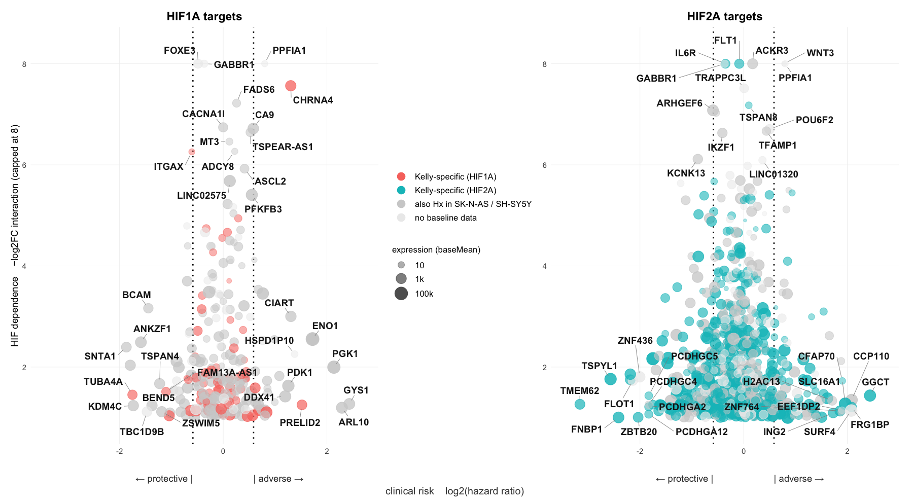<!-- -->

**Genes per panel - the difference to `in_dive` are genes without a
usable hazard ratio**

| Panel         | in_dive | plotted | Kelly_specific |
|:--------------|--------:|--------:|---------------:|
| HIF1A targets |     308 |     250 |             66 |
| HIF2A targets |    1122 |     838 |            513 |

<details>

<summary>

Code
</summary>

``` r
out_file <- here::here("6_XM_data_merge", "master_table_dive.xlsx")
openxlsx::write.xlsx(dive, out_file, rowNames = FALSE)
```

</details>

- [master_table_dive.xlsx](master_table_dive.xlsx) - 21,573 genes x 148
  columns, 34.6 MB

# HR Ratio of TOP HIF1A & HIF2A

Hazard ratios for the top HIF1A and HIF2A target genes shown in the
HIF-1β CUT&RUN figure, in the same order and colours. Filled points are
significant in the Cox model (p \< 0.05); the dashed lines mark the HR
1.5 / 1/1.5 risk cutoffs. Two genes carry older symbols in the master
table (COXFA4L2 = NDUFA4L2, CIMAP1B = ODF3L2) and are relabelled here;
LINC02649, STEAP1B-AS1 and FRG2B have no survival data.

<details>

<summary>

Code
</summary>

``` r
top_hif1a <- c("FOXE3", "CA9", "ALOX12B", "DENND1C", "TSPEAR-AS1", "LINC02649",
               "HBD", "ITGB3", "SMIM24", "EXOC3L2", "PFKFB3", "PCP4L1", "CDH15",
               "NDUFA4L2", "ASCL2", "ERVV-1", "PLVAP", "ARRDC2", "GALR1", "CABP7")
top_hif2a <- c("ODF3L2", "IL6R", "FLT1", "EPO", "STEAP1B-AS1", "FRG2B", "CALHM4",
               "KCNK13", "TRAPPC3L", "WT1-AS", "SLC9C2", "SASH1", "THBD",
               "ARHGEF6", "NTSR1", "AGXT", "KLHDC7B", "SLC46A3", "CFAP43",
               "PRODH")
relabel <- c(NDUFA4L2 = "COXFA4L2", ODF3L2 = "CIMAP1B")

hr_top <- dplyr::bind_rows(
    tibble(symbol = top_hif1a, group = "HIF1A targets"),
    tibble(symbol = top_hif2a, group = "HIF2A targets")) %>%
  dplyr::left_join(master %>% dplyr::select(symbol, HR, p_value_HR),
                   by = "symbol") %>%
  dplyr::mutate(
    label = ifelse(symbol %in% names(relabel), relabel[symbol], symbol),
    group = factor(group, levels = c("HIF1A targets", "HIF2A targets")),
    sig   = !is.na(p_value_HR) & p_value_HR < 0.05) %>%
  dplyr::group_by(group) %>%
  # Highest HR at the top of each panel; genes without survival data at the bottom.
  dplyr::mutate(label = factor(label, levels = label[order(HR, na.last = FALSE)])) %>%
  dplyr::ungroup()

hr_cols <- c("HIF1A targets" = "#F8766D", "HIF2A targets" = "#00BFC4")

ggplot(hr_top, aes(y = label, x = HR, colour = group)) +
  geom_vline(xintercept = 1, colour = "grey30", linewidth = 0.4) +
  geom_vline(xintercept = c(1/1.5, 1.5), colour = "grey65",
             linetype = "dashed", linewidth = 0.35) +
  geom_segment(aes(x = 1, xend = HR, yend = label),
               linewidth = 0.5, na.rm = TRUE) +
  geom_point(aes(fill = after_scale(ifelse(hr_top$sig, colour, "white"))),
             shape = 21, size = 2.6, stroke = 0.9, na.rm = TRUE) +
  geom_text(data = hr_top %>% dplyr::filter(is.na(HR)),
            aes(x = 1, label = "n/a"), colour = "grey55",
            size = 2.8, hjust = -0.4, fontface = "italic") +
  scale_x_continuous(trans = "log2",
                     breaks = c(0.5, 1/1.5, 1, 1.5, 2),
                     labels = c("0.5", "0.67", "1", "1.5", "2")) +
  scale_colour_manual(values = hr_cols, guide = "none") +
  facet_wrap(~group, scales = "free_y") +
  labs(x = "Hazard ratio (log scale)", y = NULL) +
  theme_minimal(base_size = 11) +
  theme(axis.text.y = element_text(face = "italic", colour = "grey15"),
        panel.grid.minor = element_blank(),
        panel.grid.major.y = element_blank(),
        panel.grid.major.x = element_line(colour = "grey92"),
        strip.text = element_text(face = "bold"))
```

</details>

**Figure 2. Hazard ratios of the top HIF1A and HIF2A targets**

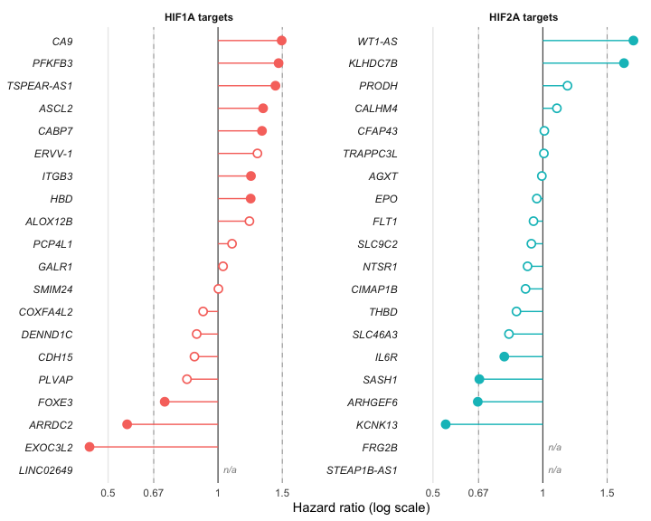<!-- -->

# Hypoxia response across cell lines: Kelly vs SK-N-AS / SH-SY5Y

How much of the Kelly hypoxia response do the two MYCN-non-amplified
lines share, and which part of it depends on HIF1A, HIF2A or ARNT? The
heatmaps show per-sample expression of Kelly WT, the three Kelly KOs,
SK-N-AS and SH-SY5Y. The lines come from separate experiments, and Kelly
itself from three sequencing projects, so raw values would mostly show
line and batch. Each experiment is therefore VST-transformed on its own
and every gene is centered on the normoxia mean of its own line or KO
(Kelly: per project). The HIF1A and HIF2A KO samples of project P557 are
Hx only, have no reference and are left out. Every Nx and Hx block is
drawn at the same width regardless of its sample number, so Kelly WT (31
samples) does not outweigh the 6-sample lines. A cell then reads as log2
change vs normoxia. The Nx columns are therefore white by construction,
not by a filter - they are the reference, and only their replicate
scatter remains visible. The price is that baseline differences between
the lines are removed on purpose; the strip on the left puts the
expression level (baseMean per line) back in. The last heatmap shows the
same data as a per-line z-score instead, the more common publication
style.

Four gene sets, from small to large: the CUT&RUN TOP20, all HIF targets,
all hypoxia-regulated genes, and the latter again as z-score. The panels
run SK-N-AS, SH-SY5Y, Kelly WT, then the three Kelly KOs. Rows are
clustered (Ward) on the mean Hx response of SK-N-AS, SH-SY5Y and Kelly
WT only - one value per line, so the three lines weigh equally and the
KOs only show how each cluster depends on HIF1A, HIF2A and ARNT. The
TOP20 are labelled on the right in every heatmap, on a HIF1A / HIF2A
coloured background.

<details>

<summary>

Code
</summary>

``` r
# The DESeq2 objects live on Google Drive; the centered VST matrix is cached so
# the document also knits without them. Delete the cache to rebuild it.
hm_cache <- here::here("6_XM_data_merge", "cache", "hx_heatmap_vst.rds")

if (file.exists(hm_cache)) {
  hm <- readRDS(hm_cache)
} else {
  gdrive <- "/Users/simonkelterborn/Library/CloudStorage/GoogleDrive-simon.kelterborn@gmail.com/Meine Ablage/! OneDrive Charité"
  # Load (not attach) DESeq2 for its S4 methods - attaching would mask dplyr verbs.
  loadNamespace("DESeq2")

  dds_k <- readRDS(file.path(gdrive, "dds_filtered_with_metadata.rds"))
  e <- new.env()
  load(file.path(gdrive, "SKNAS_SHSY5Y.dds"), envir = e)
  dds_b <- e$dds

  vst_k <- SummarizedExperiment::assay(DESeq2::vst(dds_k, blind = TRUE))
  vst_b <- SummarizedExperiment::assay(DESeq2::vst(dds_b, blind = TRUE))
  shared <- intersect(rownames(vst_k), rownames(vst_b))

  cd_k <- SummarizedExperiment::colData(dds_k)
  ko_names <- c(WT = "Kelly", `HIF1a-KO` = "HIF1A KO", `HIF2a-KO` = "HIF2A KO",
                `HIF1b-KO` = "ARNT KO")
  cd_b <- SummarizedExperiment::colData(dds_b)
  hm_cols <- rbind(
    data.frame(sample = colnames(vst_k),
               line = unname(ko_names[as.character(cd_k$genotype)]),
               condition = as.character(cd_k$condition),
               batch = paste(cd_k$genotype, cd_k$project)),
    data.frame(sample = colnames(vst_b), line = as.character(cd_b$Celltype),
               condition = ifelse(cd_b$Condition == "Hypoxia", "Hx", "Nx"),
               batch = as.character(cd_b$Celltype)))

  hm_mat <- cbind(vst_k[shared, ], vst_b[shared, ])
  # Batches without normoxia samples (the P557 KOs are Hx only) have no
  # reference to center on and are dropped.
  has_nx <- tapply(hm_cols$condition == "Nx", hm_cols$batch, any)
  keep   <- has_nx[hm_cols$batch]
  hm_cols <- hm_cols[keep, ]
  hm_mat  <- hm_mat[, keep]
  for (b in unique(hm_cols$batch)) {
    i <- hm_cols$batch == b
    hm_mat[, i] <- hm_mat[, i] - rowMeans(hm_mat[, i & hm_cols$condition == "Nx", drop = FALSE])
  }

  hm <- list(mat = hm_mat, cols = hm_cols)
  saveRDS(hm, hm_cache)
}

# Plot order of all sample groups; the HIF KOs are Kelly derivatives.
hm_panels <- c("SK-N-AS", "SH-SY5Y", "Kelly", "HIF1A KO", "HIF2A KO", "ARNT KO")

tab(as.data.frame.matrix(table(factor(hm$cols$line, levels = hm_panels),
                               factor(hm$cols$condition, levels = c("Nx", "Hx")))) %>%
      tibble::rownames_to_column("line"),
    paste0("Heatmap input: samples per line and condition (",
           format(nrow(hm$mat), big.mark = ","), " genes present in both experiments)"))
```

</details>

**Heatmap input: samples per line and condition (57,785 genes present in
both experiments)**

| line     |  Nx |  Hx |
|:---------|----:|----:|
| SK-N-AS  |   3 |   3 |
| SH-SY5Y  |   3 |   3 |
| Kelly    |  16 |  15 |
| HIF1A KO |   9 |  10 |
| HIF2A KO |   8 |   8 |
| ARNT KO  |   8 |   6 |

<details>

<summary>

Code
</summary>

``` r
hm_lines <- c("SK-N-AS", "SH-SY5Y", "Kelly")

# The TOP20 per HIF from the CUT&RUN figure (top_hif1a / top_hif2a above).
top20 <- dplyr::bind_rows(
    tibble(symbol = top_hif1a, group = "HIF1A targets"),
    tibble(symbol = top_hif2a, group = "HIF2A targets")) %>%
  dplyr::inner_join(master %>% dplyr::select(symbol, Ensembl, baseMean_Kelly),
                    by = "symbol") %>%
  dplyr::group_by(symbol) %>%
  dplyr::slice_max(baseMean_Kelly, n = 1, with_ties = FALSE) %>%
  dplyr::ungroup() %>%
  dplyr::filter(Ensembl %in% rownames(hm$mat)) %>%
  dplyr::mutate(label = ifelse(symbol %in% names(relabel), relabel[symbol], symbol))

# Hypoxia response per gene and line: mean of the Hx samples, i.e. log2 vs Nx.
hx_resp <- sapply(hm_lines, function(l)
  rowMeans(hm$mat[, hm$cols$line == l & hm$cols$condition == "Hx"]))
# Same for all six panels (incl. the KOs), for the alternative row clustering.
hx_resp_all <- sapply(hm_panels, function(l)
  rowMeans(hm$mat[, hm$cols$line == l & hm$cols$condition == "Hx"]))

# All HIF targets from the Target column, as HIF1A / both / HIF2A row groups.
in_hm <- master %>%
  dplyr::filter(Ensembl %in% rownames(hm$mat)) %>%
  dplyr::distinct(Ensembl, .keep_all = TRUE)
tgt_group <- c(Hif1a = "HIF1A", Hif1a_Hif2a = "both", Hif2a = "HIF2A")
targets <- in_hm %>% dplyr::filter(!is.na(Target))
targets <- setNames(tgt_group[targets$Target], targets$Ensembl)

# Hypoxia-regulated genes: padj < 0.05 and |log2FC| > 1 in at least one line.
deg <- function(l2fc, padj) !is.na(padj) & padj < 0.05 & abs(l2fc) > 1
hx_deg <- cbind(
  Kelly     = deg(in_hm$Kelly.Hx.vs.Nx.log2FoldChange, in_hm$Kelly.Hx.vs.Nx.padj),
  `SK-N-AS` = deg(in_hm$log2FC_SKNAS,  in_hm$padj_SKNAS),
  `SH-SY5Y` = deg(in_hm$log2FC_SHSY5Y, in_hm$padj_SHSY5Y))
rownames(hx_deg) <- in_hm$Ensembl

# Too many for one heatmap, and ~90% of them come from Kelly alone. Take the
# strongest responders of each line in turn (ranked by |VST response|, which
# damps low-count genes) until 500 genes are reached, so every line contributes
# its own top genes instead of Kelly swamping the set.
hx_rank <- lapply(hm_lines, function(l) {
  g <- rownames(hx_deg)[hx_deg[, l]]
  g[order(-abs(hx_resp[g, l]))]
})
k <- 0
repeat {
  k <- k + 1
  hx500 <- unique(unlist(lapply(hx_rank, head, k)))
  if (length(hx500) >= 500) break
}

# Induction dominates the strongest responses (HIF activates; repression is
# indirect and limited by mRNA decay), so the set above is ~96% up. Smaller
# variant with a fixed up / down ratio: the same balanced per-line selection,
# run separately for induced and repressed genes.
hx_top_dir <- function(n, dir) {
  rk <- lapply(hm_lines, function(l) {
    g <- rownames(hx_deg)[hx_deg[, l]]
    g <- g[sign(hx_resp[g, l]) == dir]
    g[order(-abs(hx_resp[g, l]))]
  })
  k <- 0
  repeat {
    k <- k + 1
    sel <- unique(unlist(lapply(rk, head, k)))
    if (length(sel) >= n) return(sel)
  }
}
hx100_up   <- hx_top_dir(70, 1)
hx100_down <- setdiff(hx_top_dir(30, -1), hx100_up)
hx100      <- c(hx100_up, hx100_down)
# Reference set for section 5: the top 100 plus all TOP20 genes.
hx_ref     <- union(hx100, top20$Ensembl)
hx1000     <- union(hx_top_dir(700, 1), hx_top_dir(300, -1))

# Fixed row groups by which cell lines respond (DEG in either direction).
hx_pattern <- function(ens) {
  d <- hx_deg[ens, hm_lines, drop = FALSE]
  base <- rowSums(d[, c("SK-N-AS", "SH-SY5Y"), drop = FALSE])
  setNames(dplyr::case_when(d[, "Kelly"] & base == 2 ~ "all 3 lines",
                            d[, "Kelly"] & base == 1 ~ "Kelly + 1 line",
                            d[, "Kelly"]             ~ "Kelly only",
                            base > 0                 ~ "SK/SH only",
                            TRUE                     ~ "no line"), ens)
}

# Per-line z-score: every gene scaled to mean 0 / sd 1 within each line.
hm_z <- hm$mat
for (l in hm_panels) {
  i <- hm$cols$line == l
  z <- t(scale(t(hm$mat[, i])))
  z[is.na(z)] <- 0
  hm_z[, i] <- z
}

highlight <- top20 %>% dplyr::select(Ensembl, label, group)
grp_cols  <- c(HIF1A = unname(hr_cols[1]), both = "#8E7CC3",
               HIF2A = unname(hr_cols[2]), other = "grey80",
               `all 3 lines` = "#636363", `Kelly + 1 line` = "#969696",
               `Kelly only` = "#BDBDBD", `SK/SH only` = "#E0E0E0",
               `no line` = "#F7F7F7")
# Shorter legend keys so all legends fit in one row below the plot.
hm_guide <- guide_colourbar(barwidth = unit(5, "lines"), barheight = unit(0.6, "lines"),
                            title.vjust = 0.9)

# Expression level per line for the left-hand strip.
base_means <- in_hm %>%
  dplyr::select(Ensembl, Kelly = baseMean_Kelly, `SK-N-AS` = baseMean_SKNAS,
                `SH-SY5Y` = baseMean_SHSY5Y)

# Primary tumours (Agilent microarray, 478 tumours, already normalised across
# arrays): best probe per gene (highest mean), log2 with a floor at 16 against
# the negative background-corrected values, then a z-score per gene across the
# cohort. Absolute array intensities are not comparable to RNA-seq counts, so
# only the relative pattern between tumours is used. Cached like the VST.
tum_cache <- here::here("6_XM_data_merge", "cache", "tumour_z.rds")
if (file.exists(tum_cache)) {
  tum <- readRDS(tum_cache)
} else {
  arr  <- readxl::read_xlsx(here::here("6_XM_data_merge", "primary_nb_microarra_Counts_4v1.xlsx"))
  scol <- grep("^X\\d", names(arr), value = TRUE)
  lg   <- log2(pmax(as.matrix(arr[, scol]), 16))
  keep <- !is.na(arr$Ensembl) & grepl("^ENSG", arr$Ensembl)
  best <- tibble(i = which(keep), Ensembl = arr$Ensembl[keep],
                 m = rowMeans(lg[keep, ])) %>%
    dplyr::group_by(Ensembl) %>% dplyr::slice_max(m, n = 1, with_ties = FALSE)
  lg <- lg[best$i, ]
  rownames(lg) <- best$Ensembl
  tum <- list(z    = t(scale(t(lg))),
              mycn = lg["ENSG00000134323", ])
  tum$z <- tum$z[rowSums(is.na(tum$z)) == 0, ]
  saveRDS(tum, tum_cache)
}

# Clinical annotation of the tumours, condensed into two group columns: MYCN
# status (Nmyc gain counts as not amplified) and outcome. Matched to the array
# columns by scan name.
tum_meta <- read.csv(here::here("6_XM_data_merge", "Primary_NB_Microarray_meta",
                                "metadata_nb.csv"), check.names = FALSE)[, -1] %>%
  dplyr::transmute(
    sample  = paste0("X", Scan_Name),
    MYCN    = dplyr::case_when(MYCN == "amplified" ~ "amplified",
                               grepl("^not amplified", MYCN) ~ "not ampl."),
    Stage   = dplyr::case_when(INS_stage %in% c("1", "2", "2A", "2B") ~ "1-2",
                               TRUE ~ INS_stage),
    Outcome = dplyr::recode(death_of_disease,
                            `alive without event` = "event-free",
                            `alive with relapse/primary tumor` = "relapse",
                            deceased = "deceased"),
    mycn_expr = tum$mycn[sample]) %>%
  dplyr::filter(sample %in% colnames(tum$z))
tum_levels <- list(MYCN         = c("not ampl.", "amplified"),
                   Outcome      = c("event-free", "relapse", "deceased"))
tum_groups <- purrr::imap_dfr(tum_levels, function(lv, panel) {
  tum_meta %>%
    dplyr::transmute(sample, panel = panel, group = .data[[panel]]) %>%
    dplyr::filter(group %in% lv) %>%
    dplyr::add_count(group) %>%
    dplyr::mutate(label = factor(paste0(group, " (", n, ")"),
                                 levels = unique(paste0(group, " (", n, ")")[order(match(group, lv))])))
}) %>%
  dplyr::mutate(panel = factor(panel, levels = names(tum_levels)))

# Hypoxia score per tumour: mean z-score of a gene set, each gene signed by
# the direction of its cell-line response (positive = follows the program).
tum_score <- function(ens) {
  te <- intersect(ens, rownames(tum$z))
  colMeans(tum$z[te, , drop = FALSE] * sign(rowMeans(hx_resp[te, , drop = FALSE])))
}

# Clinical hazard ratio per gene for the HR strip.
hr_vals <- in_hm %>% dplyr::select(Ensembl, HR, p_value_HR)

# Row order: Ward clustering on the mean Hx response of the three cell lines
# (one value per line), so each line weighs the same - clustering on all samples
# would let the 31 Kelly WT and the KO samples decide. Done separately within
# each group when `split` is given (named vector Ensembl -> group). Returns y
# positions with a small gap between groups.
hm_rows <- function(ens, split = NULL, resp = hx_resp) {
  if (is.null(split)) split <- setNames(rep("all", length(ens)), ens)
  grp <- ifelse(ens %in% names(split), split[ens], "other")
  lv  <- intersect(c(names(grp_cols), "all"), unique(grp))
  gap <- max(1, round(length(ens) / 100))
  y <- c(); off <- 0
  for (g in lv) {
    e <- ens[grp == g]
    if (length(e) > 1) e <- e[hclust(dist(resp[e, , drop = FALSE]), method = "ward.D2")$order]
    y   <- c(y, setNames(off + seq_along(e), e))
    off <- off + length(e) + gap
  }
  list(y = y, group = setNames(grp, ens)[names(y)])
}

hx_heatmap <- function(ens, mat = hm$mat, lim = 4, split = NULL, rows = NULL,
                       fill_name = "log2 Hx vs Nx", title = NULL, nx = FALSE,
                       tumours = FALSE, top20_legend = TRUE, gene_names = FALSE) {
  ens <- union(highlight$Ensembl, ens)
  if (is.null(rows)) rows <- hm_rows(ens, split)
  pos <- rows$y
  n   <- max(pos)
  m   <- mat[names(pos), , drop = FALSE]

  # Every Nx / Hx block gets the same width (Nx on 0-1, Hx on 1-2), however
  # many samples it holds - otherwise the 31 Kelly WT samples dominate. With
  # nx = FALSE only the Hx block is drawn: after centering, Nx holds nothing
  # but replicate scatter.
  cols <- hm$cols %>%
    dplyr::filter(nx | condition == "Hx") %>%
    dplyr::mutate(line = factor(line, levels = hm_panels),
                  condition = factor(condition, levels = c("Nx", "Hx"))) %>%
    dplyr::arrange(line, condition, batch) %>%
    dplyr::group_by(line, condition) %>%
    dplyr::mutate(xmin = as.integer(condition) - 1 + (dplyr::row_number() - 1) / dplyr::n(),
                  xmax = as.integer(condition) - 1 + dplyr::row_number() / dplyr::n()) %>%
    dplyr::ungroup()
  long <- tibble(Ensembl = rep(rownames(m), ncol(m)),
                 sample  = rep(colnames(m), each = nrow(m)),
                 value   = as.vector(m)) %>%
    dplyr::mutate(y = pos[Ensembl]) %>%
    dplyr::inner_join(cols %>% dplyr::select(sample, line, xmin, xmax), by = "sample")
  xscale <- scale_x_continuous(limits = c(if (nx) 0 else 1, 2), expand = c(0, 0))
  panel_labs <- labeller(line = c(Kelly = "Kelly WT", setNames(hm_panels[-1], hm_panels[-1])))
  marks <- highlight %>% dplyr::mutate(y = pos[Ensembl])
  bm <- base_means %>%
    dplyr::filter(Ensembl %in% names(pos)) %>%
    tidyr::pivot_longer(-Ensembl, names_to = "line", values_to = "baseMean") %>%
    dplyr::mutate(y = pos[Ensembl], line = factor(line, levels = hm_lines))

  yscale <- scale_y_continuous(limits = c(0.5, n + 0.5), expand = c(0, 0),
                               oob = scales::oob_keep)

  # Nx / Hx written into the bar itself instead of a separate legend.
  cond_blk <- cols %>% dplyr::distinct(line, condition) %>%
    dplyr::mutate(x = as.integer(condition) - 0.5)

  p_cond <- ggplot(cond_blk) +
    geom_rect(aes(xmin = x - 0.5, xmax = x + 0.5, ymin = 0, ymax = 1, fill = condition),
              show.legend = FALSE) +
    geom_text(aes(x = x, y = 0.5, label = condition, colour = condition),
              size = 2.4, fontface = "bold", show.legend = FALSE) +
    scale_fill_manual(values = c(Nx = "grey82", Hx = "grey35")) +
    scale_colour_manual(values = c(Nx = "grey25", Hx = "white")) +
    xscale +
    facet_grid(. ~ line, labeller = panel_labs) +
    theme_void(base_size = 10) +
    theme(strip.text = element_text(face = "bold", size = 8, margin = margin(b = 3)),
          panel.spacing.x = unit(3, "pt"))

  p_main <- ggplot(long, aes(xmin = xmin, xmax = xmax, ymin = y - 0.5, ymax = y + 0.5,
                             fill = value)) +
    geom_rect() +
    scale_fill_gradient2(low = "#4682C4", mid = "white", high = "#C03A3E",
                         limits = c(-lim, lim), oob = scales::squish,
                         name = fill_name, guide = hm_guide) +
    facet_grid(. ~ line) +
    xscale + yscale +
    theme_void(base_size = 10) +
    theme(strip.text = element_blank(), panel.spacing.x = unit(3, "pt"))

  p_bm <- ggplot(bm, aes(x = line, y = y, fill = log10(baseMean + 1))) +
    geom_raster() +
    scale_fill_gradient(low = "#F2F0F7", high = "#3F007D", limits = c(0, 4),
                        oob = scales::squish, na.value = "grey90",
                        breaks = 0:4, labels = c("1", "10", "100", "1k", "10k"),
                        name = "baseMean", guide = hm_guide) +
    scale_x_discrete(expand = c(0, 0)) + yscale +
    theme_void(base_size = 10) +
    theme(axis.text.x = element_text(angle = 90, hjust = 1, vjust = 0.5, size = 7,
                                     margin = margin(t = 2)))

  # Hazard ratio: green protective, magenta adverse; grey = no survival data.
  hr <- hr_vals %>% dplyr::filter(Ensembl %in% names(pos)) %>%
    dplyr::mutate(y = pos[Ensembl])
  p_hr <- ggplot(hr, aes(x = "HR", y = y, fill = log2(HR))) +
    geom_raster() +
    scale_fill_gradient2(low = "#4DAC26", mid = "white", high = "#D01C8B",
                         limits = c(-1, 1), oob = scales::squish, na.value = "grey90",
                         breaks = log2(c(0.5, 1/1.5, 1, 1.5, 2)),
                         labels = c("0.5", "0.67", "1", "1.5", "2"),
                         name = "HR", guide = hm_guide) +
    scale_x_discrete(expand = c(0, 0)) + yscale +
    theme_void(base_size = 10) +
    theme(axis.text.x = element_text(angle = 90, hjust = 1, vjust = 0.5, size = 7,
                                     margin = margin(t = 2)))

  # Primary tumours, condensed to clinical groups: mean z-score (across the
  # cohort) of each gene within each group. Each group column has equal width.
  if (tumours) {
    te <- intersect(names(pos), rownames(tum$z))
    tl <- tum_groups %>%
      dplyr::group_by(panel, label) %>%
      dplyr::reframe(Ensembl = te,
                     value = rowMeans(tum$z[te, sample, drop = FALSE])) %>%
      dplyr::mutate(y = pos[Ensembl])
    tum_facet <- facet_grid(. ~ panel, scales = "free_x", space = "free_x",
                            labeller = as_labeller(function(x) sub(" ", "\n", x)))
    p_tum <- ggplot(tl, aes(x = label, y = y, fill = value)) +
      geom_raster() +
      scale_fill_gradient2(low = "#4682C4", mid = "white", high = "#C03A3E",
                           limits = c(-1, 1), breaks = c(-1, 0, 1), oob = scales::squish,
                           name = "tumours\n(mean z)", guide = hm_guide) +
      scale_x_discrete(expand = c(0, 0)) + yscale + tum_facet +
      theme_void(base_size = 10) +
      theme(strip.text = element_blank(), panel.spacing.x = unit(3, "pt"),
            axis.text.x = element_text(angle = 90, hjust = 1, vjust = 0.5, size = 7,
                                       margin = margin(t = 2)))
    # Header row: "Primary NB tumours" over the whole block, the clinical
    # panel names below it, each centred over its group columns.
    tt <- dplyr::distinct(tl, panel, label) %>% dplyr::arrange(panel, label) %>%
      dplyr::mutate(x = seq_along(label))
    tp <- tt %>% dplyr::group_by(panel) %>%
      dplyr::summarise(xmin = min(x) - 0.45, xmax = max(x) + 0.45, x = mean(x))
    p_tum_top <- ggplot() +
      annotate("rect", xmin = 0.55, xmax = nrow(tt) + 0.45, ymin = 1.55, ymax = 2.45, fill = "grey35") +
      annotate("text", x = (nrow(tt) + 1) / 2, y = 2, label = paste0("Primary NB tumours (", ncol(tum$z), ")"),
               colour = "white", fontface = "bold", size = 3) +
      geom_rect(data = tp, aes(xmin = xmin, xmax = xmax, ymin = 0.55, ymax = 1.45), fill = "grey75") +
      geom_text(data = tp, aes(x = x, y = 1, label = panel), fontface = "bold", size = 2.8) +
      scale_x_continuous(limits = c(0.5, nrow(tt) + 0.5), expand = c(0, 0)) +
      theme_void(base_size = 10)
  } else {
    p_tum <- p_tum_top <- plot_spacer()
  }

  # HIF target (Target column: induced in WT, lost in the KO) for every row.
  tg <- tibble(Ensembl = names(pos), y = pos,
               group = factor(ifelse(Ensembl %in% names(targets), targets[Ensembl], "other"),
                              levels = c("HIF1A", "both", "HIF2A", "other")))
  p_tgt <- ggplot(tg, aes(x = "Target", y = y, fill = group)) +
    geom_raster() +
    scale_fill_manual(values = grp_cols, drop = FALSE, name = "HIF target",
                      labels = c(HIF1A = "HIF1A", both = "both", HIF2A = "HIF2A",
                                 other = "none")) +
    scale_x_discrete(expand = c(0, 0)) + yscale +
    theme_void(base_size = 10) +
    theme(axis.text.x = element_text(angle = 90, hjust = 1, vjust = 0.5, size = 7,
                                     margin = margin(t = 2)))

  # Target-group strip, only when rows are split into groups.
  p_grp <- if (!is.null(split)) {
    gd <- tibble(y = pos, group = rows$group)
    ggplot(gd, aes(x = 1, y = y, fill = group)) +
      geom_raster(show.legend = FALSE) +
      # Only groups tall enough to hold their name are labelled in the strip.
      geom_text(data = gd %>% dplyr::group_by(group) %>%
                  dplyr::summarise(y = mean(y), n = dplyr::n()) %>%
                  dplyr::filter(n >= 0.01 * nchar(as.character(group)) * length(pos)),
                aes(label = paste0(group, "\n(", n, ")")), angle = 90, size = 2.4,
                lineheight = 0.85,
                colour = "grey10") +
      scale_fill_manual(values = grp_cols) +
      scale_x_continuous(expand = c(0, 0)) + yscale +
      theme_void()
  } else plot_spacer()

  # Optional small name for every row, right next to it; the TOP20 keep their
  # larger repelled labels further out.
  lab_x0 <- if (gene_names) 0.75 else 0.25
  all_names <- if (gene_names) {
    tibble(Ensembl = names(pos), y = pos) %>%
      dplyr::filter(!Ensembl %in% marks$Ensembl) %>%
      dplyr::mutate(label = in_hm$symbol[match(Ensembl, in_hm$Ensembl)],
                    label = ifelse(is.na(label), Ensembl, label))
  } else tibble(y = numeric(0), label = character(0))
  p_lab <- ggplot(marks, aes(x = 0, y = y, label = label, fill = group)) +
    # Invisible tiles only to give the legend rectangular keys.
    geom_tile(width = 0, height = 0, alpha = 0.45) +
    geom_text(data = all_names, aes(x = 0.03, y = y, label = label), inherit.aes = FALSE,
              hjust = 0, size = 1.8, fontface = "italic", colour = "grey30") +
    ggrepel::geom_label_repel(direction = "y", hjust = 0, nudge_x = lab_x0,
                              xlim = c(lab_x0, NA), size = 2.4, fontface = "italic",
                              alpha = 0.45, label.size = 0, colour = NA,
                              label.padding = unit(0.12, "lines"),
                              segment.colour = "grey60", segment.size = 0.25,
                              min.segment.length = 0, box.padding = 0.05,
                              max.overlaps = Inf, seed = 1, show.legend = FALSE) +
    # Opaque text on top of the translucent boxes (same positions via same seed).
    ggrepel::geom_label_repel(direction = "y", hjust = 0, nudge_x = lab_x0,
                              xlim = c(lab_x0, NA), size = 2.4, fontface = "italic",
                              fill = NA, label.size = 0, colour = "grey10",
                              label.padding = unit(0.12, "lines"),
                              segment.colour = NA, min.segment.length = 0,
                              box.padding = 0.05, max.overlaps = Inf, seed = 1,
                              show.legend = FALSE) +
    scale_fill_manual(values = hr_cols, name = "TOP20",
                      guide = if (top20_legend) "legend" else "none") +
    scale_x_continuous(limits = c(0, if (gene_names) 2.1 else 1.6), expand = c(0, 0)) + yscale +
    theme_void()

  plot_spacer() + plot_spacer() + plot_spacer() + plot_spacer() + p_cond + plot_spacer() +
    p_tum_top + plot_spacer() +
    p_grp + p_bm + p_hr + p_tgt + p_main + plot_spacer() + p_tum + p_lab +
    plot_layout(ncol = 8,
                widths = c(if (is.null(split)) 0.01 else 0.35, 0.9, 0.3, 0.3,
                           if (nx) 13 else 8, if (tumours) 0.15 else 0.01,
                           if (tumours) 3 else 0.01, if (gene_names) 3.2 else 2.4),
                heights = c(0.5, 12), guides = "collect") +
    plot_annotation(title = title) &
    theme(legend.position = "bottom", legend.text = element_text(size = 8),
          legend.title = element_text(size = 9),
          legend.key.size = unit(0.8, "lines"),
          plot.title = element_text(face = "bold", size = 11))
}

# Several heatmaps as one figure, so they can be enlarged together on GitHub.
hx_pair <- function(..., widths = NULL) {
  patchwork::wrap_plots(lapply(list(...), function(p) patchwork::wrap_elements(full = p)),
                        nrow = 1, widths = widths)
}

hx_summary <- function(label, set) {
  ens <- union(top20$Ensembl, set)
  r   <- hx_resp[ens, , drop = FALSE]
  tibble(Set = label, genes = length(ens),
         TOP20_in_set = sum(top20$Ensembl %in% set),
         Kelly = median(r[, "Kelly"]), `SK-N-AS` = median(r[, "SK-N-AS"]),
         `SH-SY5Y` = median(r[, "SH-SY5Y"]),
         rho_SKNAS  = cor(r[, "Kelly"], r[, "SK-N-AS"], method = "spearman"),
         rho_SHSY5Y = cor(r[, "Kelly"], r[, "SH-SY5Y"], method = "spearman"))
}
```

</details>

## 1. TOP20 (log2 Hx vs Nx)

<details>

<summary>

Code
</summary>

``` r
hx_heatmap(character(0), title = "CUT&RUN TOP20 HIF1A / HIF2A targets (log2 Hx vs Nx)")
```

</details>

**Figure 3. CUT&RUN TOP20 HIF1A / HIF2A targets**

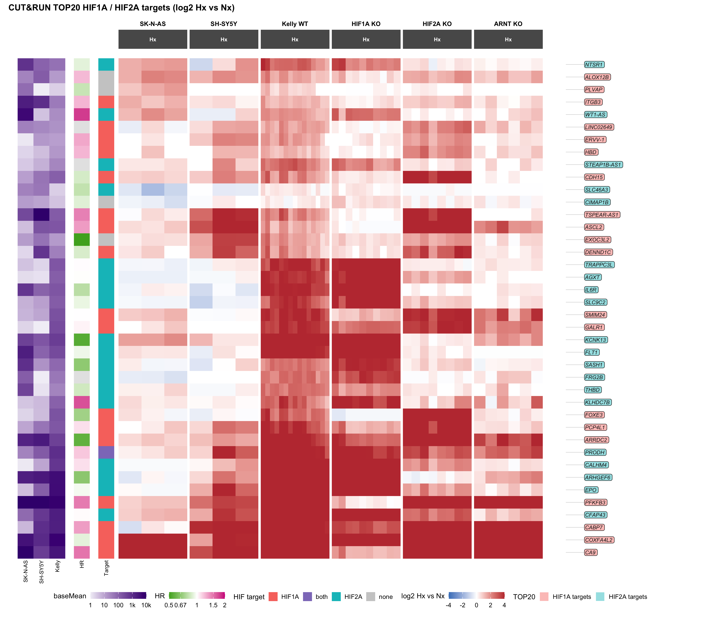

All 40 genes are readable. The KO columns confirm the assignment: the
HIF2A TOP20 lose their induction in the HIF2A KO (median Hx response 0.3
vs 3.5 log2 in Kelly WT) and keep it in the HIF1A KO (4.1); the HIF1A
TOP20 behave the other way round (HIF1A KO 0.5, HIF2A KO 4.3, WT 2.0).
In both cases the remaining HIF compensates with an even stronger
induction. The ARNT KO reduces both groups (0.8 / 0.4) but does not
abolish them - CA9, COXFA4L2 and PFKFB3 stay fully induced.

Across the lines the two HIF groups separate sharply: the **HIF1A TOP20
are largely shared with SH-SY5Y** (median 1.7 - CA9, PFKFB3, COXFA4L2,
ASCL2, CABP7 and others), and partly with SK-N-AS (0.6). The **HIF2A
TOP20 are essentially Kelly-specific** (~0 in both baseline lines);
KCNK13, NTSR1, EPO, PRODH and CFAP43 are the few with a visible response
elsewhere.

## 2. All HIF1A and HIF2A targets (log2 Hx vs Nx)

All genes of the `Target` column: Hx-induced in Kelly WT (padj \< 0.05,
log2FC \> 1) and lost in the respective KO (interaction padj \< 0.05,
log2FC \< -1). Rows are split into HIF1A-only, both and HIF2A-only
targets (strip on the left: turquoise HIF2A, purple on both lists, red
HIF1A) and clustered within each group. The thin grey group on top holds
the four TOP20 genes that are not in `Target` (PLVAP, ALOX12B, EXOC3L2,
CIMAP1B - CUT&RUN TOP20, but missing the KO criterion).

**HIF targets: Target column vs the counts on the colleague’s slides**

| List | this analysis | of which on both lists | in heatmap | colleague’s slides |
|:---|---:|---:|---:|---:|
| HIF1A targets | 365 | 43 | 335 | 367 |
| HIF2A targets | 1515 | 43 | 1416 | 1333 |

Same definition as on the colleague’s slides (KO negative interaction ∩
WT-up), and HIF1A matches almost exactly. HIF2A comes out ~180 genes
larger here. All her counts are lower (WT hypoxia DEGs 6628 vs 8265 here
with \|log2FC\| \> 1), which points to a different DESeq2 run or an
extra filter rather than a different target logic. The heatmap holds
slightly fewer genes, since only genes measured in both experiments can
be shown.

<details>

<summary>

Code
</summary>

``` r
hx_heatmap(names(targets), split = targets,
           title = "All HIF1A and HIF2A targets (log2 Hx vs Nx)")
```

</details>

**Figure 4. All HIF1A and HIF2A targets**

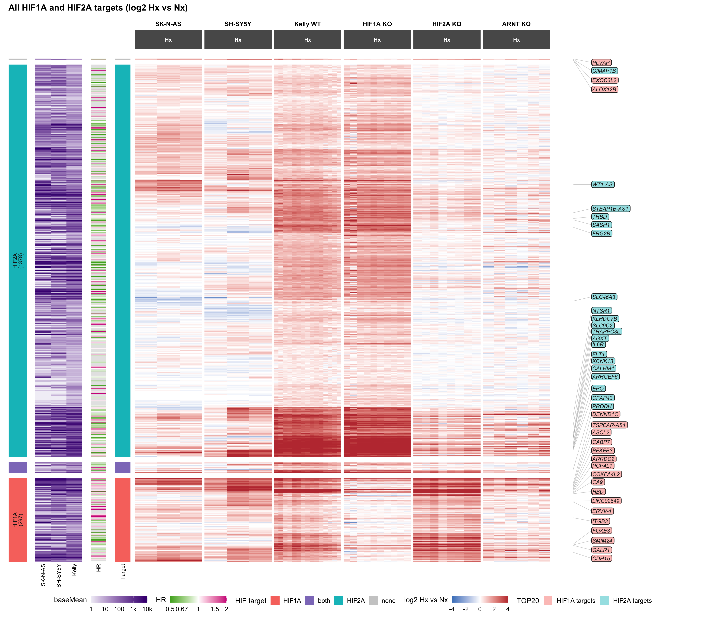

The split makes the difference between the two arms obvious. The HIF2A
block - three quarters of all targets - is induced in Kelly WT and the
HIF1A KO, gone in the HIF2A KO, and answers only in patches in SK-N-AS
and SH-SY5Y. The HIF1A targets mirror this in the KOs and respond in all
three lines, most clearly in SH-SY5Y. The ARNT KO keeps a weakened
response in both blocks.

## 3. Top 500 hypoxia-regulated genes (log2 Hx vs Nx)

**Hypoxia-regulated genes (padj \< 0.05, \|log2FC\| \> 1)**

| Line            | genes |
|:----------------|------:|
| SK-N-AS         |  2018 |
| SH-SY5Y         |  1430 |
| Kelly           |  7619 |
| any line        |  8728 |
| all three lines |   435 |
| shown           |   502 |

All hypoxia-regulated genes together are too many for one heatmap, and
most come from Kelly alone. Neither a random draw nor the top genes by
Kelly fold change would show the baseline lines fairly - both would just
reproduce the Kelly response. The set shown therefore takes the
**strongest responders of each line in turn** (top 221 per line by
\|log2 vs Nx\|) up to 500 genes, so every line contributes its own top
genes. Up- and down-regulated genes are included.

From here on only the Hx samples are drawn in the log2 heatmaps: after
centering on the Nx mean, the Nx block holds nothing but replicate
scatter around 0. The **HR** strip next to the expression strip gives
the clinical hazard ratio per gene (green protective, magenta adverse,
grey no survival data).

On the right, the same genes in **478 primary neuroblastomas**
(microarray), condensed into clinical groups: MYCN expression and
outcome. Each column is the mean z-score of the gene across the tumours
of that group, with the z-score taken per gene over the whole cohort.
Array intensities cannot be put on the log2-vs-Nx scale of the cell
lines, so only the difference between groups counts: red = higher in
this group than in the average tumour.

MYCN expression on the array is bimodal (Figure 5): the amplified
tumours form a separate peak at high expression, the non-amplified ones
one broad peak without a natural gap. A split of the non-amplified
tumours into thirds by expression was tried: the hypoxia score falls
step by step with rising MYCN, from the lowest third (+0.09) to the
amplified tumours (−0.13). For the heatmaps the amplification status is
kept.

<details>

<summary>

Code
</summary>

``` r
ggplot(tum_meta, aes(x = mycn_expr, fill = MYCN)) +
  geom_histogram(binwidth = 0.25, boundary = 0) +
  scale_fill_manual(values = c(amplified = "#C03A3E", `not ampl.` = "grey60"),
                    na.value = "grey85", name = "MYCN") +
  labs(x = "MYCN expression (log2 array intensity)", y = "tumours") +
  theme_minimal(base_size = 10)
```

</details>

**Figure 5. MYCN expression in the primary tumours by amplification
status**

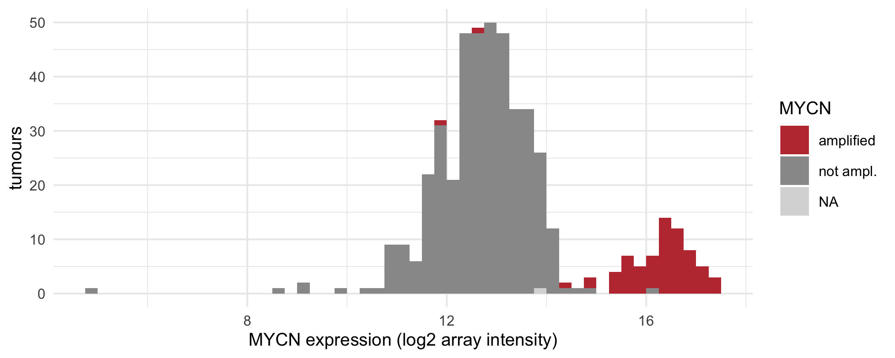

<details>

<summary>

Code
</summary>

``` r
hx_rows_500 <- hm_rows(union(highlight$Ensembl, hx500))
hx_heatmap(hx500, rows = hx_rows_500, tumours = TRUE,
           title = "Top 500 hypoxia-regulated genes (log2 Hx vs Nx; tumours: mean z per group)")
```

</details>

**Figure 6. Top 500 hypoxia-regulated genes, with the primary tumours**

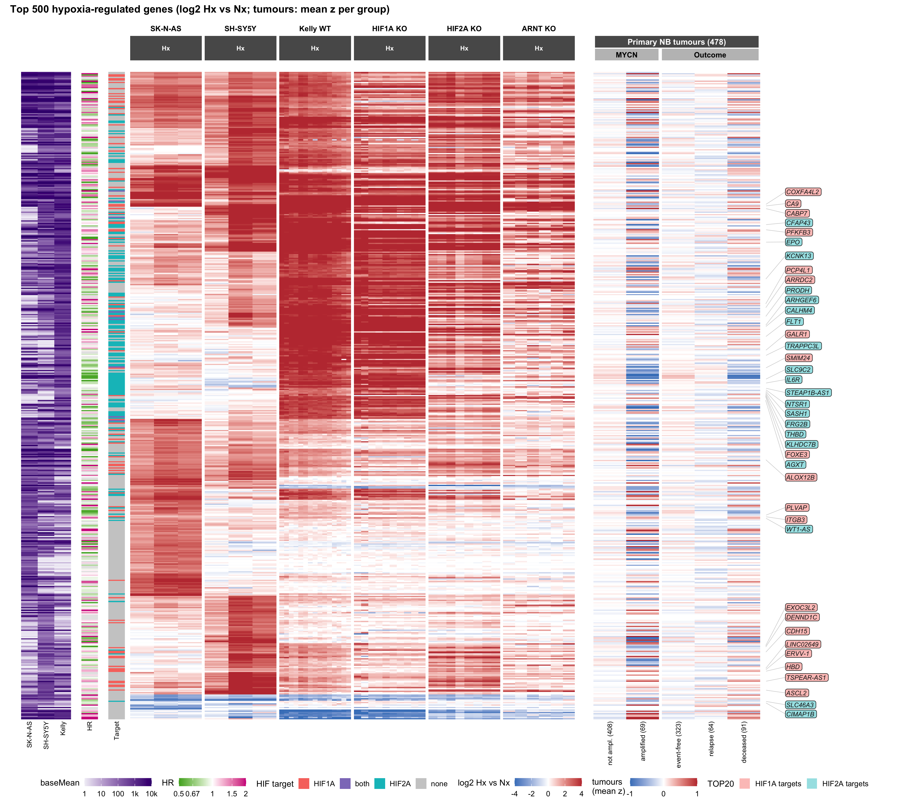

**Tumour hypoxia score (median of the mean signed z of the shown genes)
per clinical group; p for the overall score**

| panel   | group            |  score | score_up | score_down | p       |
|:--------|:-----------------|-------:|---------:|-----------:|:--------|
| MYCN    | not ampl. (408)  |  0.013 |    0.012 |      0.094 | 5.8e-07 |
| MYCN    | amplified (69)   | -0.125 |   -0.107 |     -0.410 |         |
| Outcome | event-free (323) |  0.007 |    0.005 |      0.108 | 1.9e-02 |
| Outcome | relapse (64)     | -0.021 |   -0.023 |     -0.076 |         |
| Outcome | deceased (91)    | -0.035 |   -0.022 |     -0.180 |         |

Counter to the expectation that aggressive tumours are more hypoxic, the
cell-line hypoxia program is slightly *weaker* in MYCN-amplified tumours
(score −0.13 vs +0.01), above all through the repressed genes (−0.41),
and to a lesser degree in fatal cases (which overlap largely with MYCN
amplification). Within the non-amplified tumours the score also falls
with rising MYCN expression (see the thirds above), so the effect
follows the MYCN level, not only the amplification. The effects are
small: a score of −0.1 means the shown genes sit on average 0.1 SD below
the cohort mean. Bulk tumour expression has no normoxic reference, so
this score mixes hypoxia with everything else that differs between the
groups - above all the MYCN-driven program itself, which shifts many of
these genes. The heatmap shows that the shift is not uniform: single
blocks go up in MYCN-amplified tumours while others go down.

With the baseline lines contributing their own top genes, line-specific
blocks appear: genes induced only in SK-N-AS or only in SH-SY5Y (Kelly
white), a repressed block shared by all three lines, and the strong
Kelly block, which the baseline lines follow only partly. The TOP20 lie
almost all in the Kelly-dominated blocks.

## 4. Top 500 hypoxia-regulated genes (z-score per line)

Same genes and row order as above, but each gene is z-scored within each
line (mean 0, sd 1 over that line’s samples). Nx is now blue wherever Hx
goes up, so the contrast looks stronger - but the effect size is lost: a
small response in SK-N-AS looks as strong as a large one in Kelly. Rows
without a real response (e.g. Kelly in the baseline-specific blocks)
turn into noise.

<details>

<summary>

Code
</summary>

``` r
hx_heatmap(hx500, mat = hm_z, lim = 2, rows = hx_rows_500, fill_name = "z-score",
           nx = TRUE, tumours = TRUE,
           title = "Top 500 hypoxia-regulated genes (z-score per line; tumours: mean z per group)")
```

</details>

**Figure 7. Top 500 hypoxia-regulated genes, z-score per line**

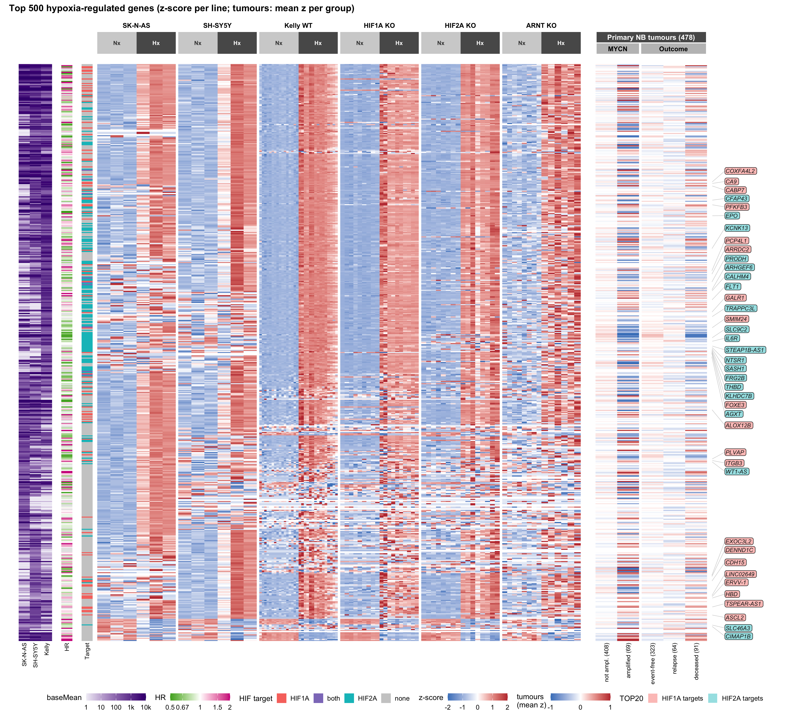

## 5. Top 100 hypoxia-regulated genes, 70 up / 30 down (log2 Hx vs Nx)

The strongest hypoxia responses are almost all inductions, so the top
500 contain only 18 repressed genes. Here the balanced per-line
selection runs separately for induced and repressed genes: 70 up and 31
down, roughly the up/down ratio of all hypoxia DEGs. All TOP20 genes are
added to these 100, so the reference set has 133 genes; every gene is
named in small print, the TOP20 additionally with the larger coloured
labels.

### Reference heatmap

<details>

<summary>

Code
</summary>

``` r
hx_pat_ref  <- hx_pattern(hx_ref)
hx_rows_ref <- hm_rows(hx_ref, hx_pat_ref)
hx_heatmap(hx_ref, split = hx_pat_ref, rows = hx_rows_ref, tumours = TRUE, gene_names = TRUE,
           title = "Reference: top 100 (70 up / 30 down) + TOP20 (log2 Hx vs Nx; grouped by responding lines)")
```

</details>

**Figure 8. Reference heatmap: top 100 (70 up / 30 down) plus TOP20**

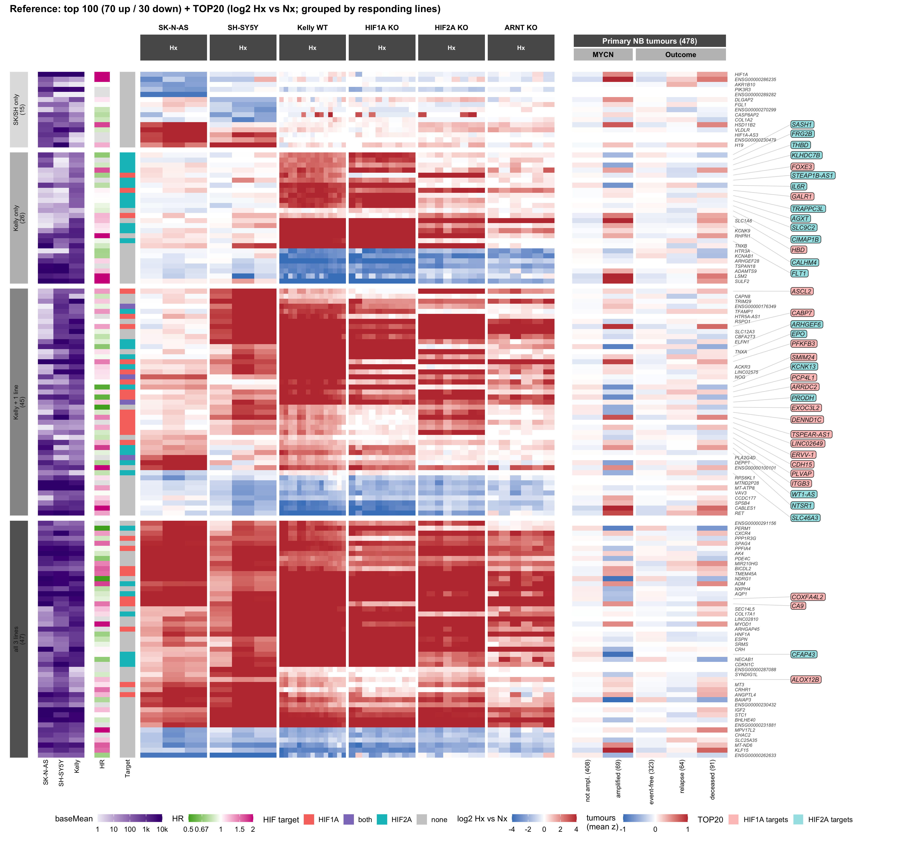<!-- -->

The reference shows log2 Hx vs Nx (Hx samples only) with the rows
grouped by the responding lines and clustered within each group (see
5b). It is the basis for the comparisons below, which show two or three
versions side by side, the reference on the left (in 5a and 5b in the
middle). Click an image to enlarge it.

### 5a. Scaling: log2 with Nx columns (left), log2 Hx only (middle), z-score per line (right)

<details>

<summary>

Code
</summary>

``` r
hx_pair(
  hx_heatmap(hx_ref, split = hx_pat_ref, rows = hx_rows_ref, nx = TRUE, tumours = TRUE,
             top20_legend = FALSE, gene_names = TRUE,
             title = "Reference genes (log2 vs Nx mean, with Nx)"),
  hx_heatmap(hx_ref, split = hx_pat_ref, rows = hx_rows_ref, tumours = TRUE, top20_legend = FALSE,
             gene_names = TRUE, title = "Reference (log2 Hx vs Nx)"),
  hx_heatmap(hx_ref, split = hx_pat_ref, mat = hm_z, lim = 2, rows = hx_rows_ref, fill_name = "z-score",
             nx = TRUE, tumours = TRUE, top20_legend = FALSE, gene_names = TRUE,
             title = "Reference genes (z-score per line)"),
  widths = c(14, 12, 14))
```

</details>

**Figure 9. Reference genes in three scalings: log2 with Nx, log2 Hx
only, z-score**

<!-- -->

### 5b. Row order: clustered (left), grouped by responding lines (middle), grouped by HIF target (right)

Instead of one clustering over all rows, the genes are first put into
fixed groups and clustered only within each group. In the middle, the
groups say in which lines the gene is hypoxia-regulated (DEG in either
direction): in all three, in Kelly and one baseline line, in Kelly only,
only in SK-N-AS and/or SH-SY5Y (“SK/SH only”), or in none (TOP20 genes
below the DEG cutoff, “no line”). Right, the groups are the HIF targets
from the Target column (induced in WT Kelly and lost in the KO). Only
the cell-line response enters the clustering; the HR and the tumour data
are read out against it, not used to sort.

<details>

<summary>

Code
</summary>

``` r
hx_pair(
  hx_heatmap(hx_ref, rows = hm_rows(hx_ref), tumours = TRUE, top20_legend = FALSE, gene_names = TRUE,
             title = "Reference genes (clustered on 3 lines)"),
  hx_heatmap(hx_ref, split = hx_pat_ref, rows = hx_rows_ref, tumours = TRUE,
             top20_legend = FALSE, gene_names = TRUE,
             title = "Reference (grouped by responding lines)"),
  hx_heatmap(hx_ref, split = targets, rows = hm_rows(hx_ref, targets), tumours = TRUE,
             top20_legend = FALSE, gene_names = TRUE,
             title = "Reference genes (grouped by HIF target)"))
```

</details>

**Figure 10. Reference genes in three row orders: clustered, by
responding lines, by HIF target**

<!-- -->

### 5c. Gene number: reference (left) vs top 1000 (right), both 70 up / 30 down

<details>

<summary>

Code
</summary>

``` r
hx1000_all  <- union(top20$Ensembl, hx1000)
hx_pat_1000 <- hx_pattern(hx1000_all)
hx_pair(
  hx_heatmap(hx_ref, split = hx_pat_ref, rows = hx_rows_ref, tumours = TRUE, top20_legend = FALSE,
             gene_names = TRUE, title = "Reference (log2 Hx vs Nx; grouped by responding lines)"),
  hx_heatmap(hx1000_all, split = hx_pat_1000, rows = hm_rows(hx1000_all, hx_pat_1000), tumours = TRUE,
             top20_legend = FALSE,
             title = "Top 1000, 70 up / 30 down + TOP20 (log2 Hx vs Nx; grouped by responding lines)"),
  widths = c(13, 11))
```

</details>

**Figure 11. Reference genes vs top 1000**

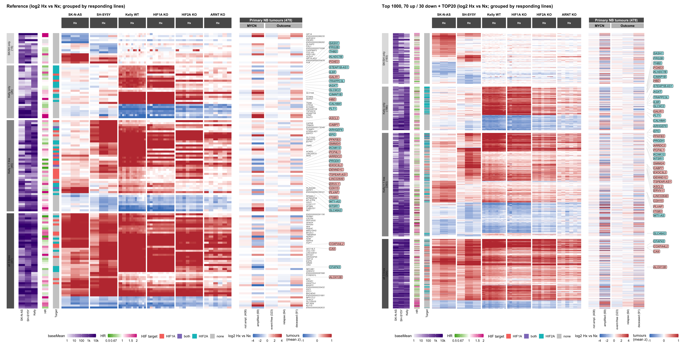<!-- -->

### Tumour score

**Tumour hypoxia score for the top 100 (70 up / 30 down) per clinical
group**

| panel   | group            |  score | score_up | score_down | p       |
|:--------|:-----------------|-------:|---------:|-----------:|:--------|
| MYCN    | not ampl. (408)  |  0.015 |    0.002 |      0.070 | 1.7e-07 |
| MYCN    | amplified (69)   | -0.097 |   -0.011 |     -0.282 |         |
| Outcome | event-free (323) |  0.007 |   -0.007 |      0.075 | 7.8e-02 |
| Outcome | relapse (64)     | -0.038 |   -0.028 |      0.002 |         |
| Outcome | deceased (91)    | -0.016 |    0.049 |     -0.170 |         |

The split score shows where the MYCN difference comes from: the
hypoxia-*induced* genes hardly differ between amplified and
non-amplified tumours (`score_up` near 0), but the hypoxia-*repressed*
genes are clearly higher in MYCN-amplified tumours (`score_down` −0.28,
i.e. they do *not* follow the hypoxic repression) and, more weakly, in
fatal cases. Many of these repressed genes carry an adverse HR (magenta
in the HR strip). So MYCN-amplified tumours do not look less hypoxic by
their induced genes - they keep genes high that hypoxia shuts off in the
cell lines, plausibly MYCN-driven genes such as proliferation and
biosynthesis genes.

**Median Hx response (log2 vs Nx) per line, and Spearman correlation of
the per-gene response with Kelly**

| Set | genes | TOP20_in_set | Kelly | SK-N-AS | SH-SY5Y | rho_SKNAS | rho_SHSY5Y |
|:---|---:|---:|---:|---:|---:|---:|---:|
| TOP20 | 40 | 40 | 2.71 | 0.43 | 0.89 | 0.09 | 0.25 |
| TOP20 + HIF targets | 1717 | 36 | 1.08 | 0.28 | 0.28 | 0.23 | 0.37 |
| TOP20 + hypoxia-regulated | 519 | 23 | 2.50 | 1.35 | 1.64 | -0.14 | 0.23 |
| TOP20 + top 100 (70 up / 30 down) | 133 | 8 | 2.66 | 0.51 | 1.71 | 0.46 | 0.56 |
| TOP20 + top 1000 (70 up / 30 down) | 1016 | 25 | 1.07 | 0.56 | 0.60 | 0.42 | 0.62 |

## 6. UMAP of all hypoxia-regulated genes

All hypoxia-regulated genes (DEG in at least one of the three lines)
with survival data, one point per gene. Unlike the heatmap clustering,
the embedding uses the HR and expression level as well, as four blocks:

- **log2 Hx vs Nx** in the six panels (three lines, three KOs)
- **HIF dependence**: the interaction terms, i.e. the Hx response in
  each KO minus the response in WT Kelly (HIF1A, HIF2A, ARNT KO), signed
  by the direction of the Kelly response. The KO responses alone are
  already in the first block, but there they sit next to five panels
  that mostly move together with Kelly, so the *difference* between WT
  and KO - what makes a gene a HIF1A or HIF2A target - carried little
  weight. As its own block it counts as much as the response itself.
- **log2 HR**
- **log10 baseMean** in the three lines

The tumour data are left out: their contrasts are almost the same
variable as the HR (the HR comes from the same cohort, Spearman 0.79 -
0.95), so they would let the clinical axis enter several times.

Every column is scaled, and every block is divided by √(number of
columns), so each block weighs the same regardless of how many columns
it has. The panels show the same embedding, coloured by one variable
each.

<details>

<summary>

Code
</summary>

``` r
umap_ens <- in_hm$Ensembl[rowSums(hx_deg) > 0]
tum_grp_mean <- sapply(split(tum_groups$sample, tum_groups$label),
                       function(s) rowMeans(tum$z[, s, drop = FALSE]))
grp_col <- function(g) tum_grp_mean[, grep(paste0("^", g, " \\("), colnames(tum_grp_mean))]
tum_contrast <- cbind(
  `MYCN amp - not`        = grp_col("amplified") - grp_col("not ampl."),
  `deceased - event-free` = grp_col("deceased") - grp_col("event-free"))
log2_hr <- setNames(log2(hr_vals$HR), hr_vals$Ensembl)
bm_mat  <- base_means %>% tibble::column_to_rownames("Ensembl") %>% as.matrix()
umap_ens <- intersect(umap_ens, names(log2_hr)[!is.na(log2_hr)])

# HIF dependence: response in each KO minus the response in WT Kelly (the
# interaction term, on the VST scale), signed by the direction of the Kelly
# response, so negative = the KO loses the hypoxia response, for induced and
# repressed genes alike.
umap_dep <- (hx_resp_all[umap_ens, c("HIF1A KO", "HIF2A KO", "ARNT KO")] -
             hx_resp_all[umap_ens, "Kelly"]) * sign(hx_resp_all[umap_ens, "Kelly"])
umap_blocks <- list(log2     = hx_resp_all[umap_ens, ],
                    HIF_dep  = umap_dep,
                    HR       = cbind(log2HR = log2_hr[umap_ens]),
                    baseMean = log10(bm_mat[umap_ens, ] + 1))
umap_x <- do.call(cbind, lapply(umap_blocks, function(b) scale(b) / sqrt(ncol(b))))
set.seed(1)
umap_fit <- uwot::umap(umap_x, n_neighbors = 15, min_dist = 0.05, ret_nn = TRUE)
umap_xy  <- umap_fit$embedding

# Clusters are found in the input space, not in the 2D picture: Leiden on the
# same 15-nearest-neighbour graph the UMAP is built from.
umap_nn <- umap_fit$nn$euclidean$idx
umap_g  <- igraph::simplify(igraph::graph_from_edgelist(
  cbind(rep(seq_len(nrow(umap_nn)), ncol(umap_nn) - 1), as.vector(umap_nn[, -1])),
  directed = FALSE))
set.seed(1)
umap_cl <- igraph::cluster_leiden(umap_g, objective_function = "modularity",
                                  resolution = 0.8, n_iterations = 10)$membership
# Number the clusters from most induced to most repressed.
umap_cl <- as.integer(factor(umap_cl, levels = order(-tapply(hx_resp_all[umap_ens, "Kelly"], umap_cl, median))))

ud <- tibble(Ensembl = umap_ens, U1 = umap_xy[, 1], U2 = umap_xy[, 2],
             target   = ifelse(umap_ens %in% names(targets), targets[umap_ens], "none"),
             pattern  = hx_pattern(umap_ens),
             kelly    = hx_resp_all[umap_ens, "Kelly"],
             bm       = log10(bm_mat[umap_ens, "Kelly"] + 1),
             hr       = log2_hr[umap_ens],
             amp      = tum_contrast[match(umap_ens, rownames(tum_contrast)), 1],
             cluster  = factor(umap_cl))

umap_theme <- list(theme_void(base_size = 11), coord_equal(),
                   theme(legend.position = "bottom", plot.background = element_rect(fill = "white", colour = NA),
                         plot.title = element_text(face = "bold")))
umap_cat <- function(col, values, title) {
  ggplot(ud %>% dplyr::arrange(.data[[col]] != "none"), aes(U1, U2, colour = .data[[col]])) +
    geom_point(size = 0.35) + scale_colour_manual(values = values, name = NULL) +
    guides(colour = guide_legend(override.aes = list(size = 3), nrow = 2)) +
    ggtitle(title) + umap_theme
}
# Strongest values drawn last, so they are not buried under the faint ones.
umap_num <- function(col, lim, title, name, low = "#2166AC", high = "#B2182B") {
  brk <- c(-lim, 0, lim)
  ggplot(ud %>% dplyr::arrange(abs(.data[[col]])), aes(U1, U2, colour = .data[[col]])) +
    geom_point(size = 0.35) +
    scale_colour_gradient2(low = low, mid = "grey90", high = high, limits = c(-lim, lim),
                           breaks = brk, oob = scales::squish, name = name, guide = hm_guide,
                           na.value = "grey97") +
    ggtitle(title) + umap_theme
}

umap_cat("pattern", c(`all 3 lines` = "#E41A1C", `Kelly + 1 line` = "#FF7F00",
                        `Kelly only` = "#377EB8", `SK/SH only` = "#4DAF4A"), "Responding lines") +
  umap_num("kelly", 3, "Hypoxia response in Kelly", "log2 Hx vs Nx") +
  umap_cat("target", c(grp_cols[c("HIF1A", "both", "HIF2A")], none = "grey85"), "HIF target") +
  (ggplot(ud %>% dplyr::arrange(bm), aes(U1, U2, colour = bm)) + geom_point(size = 0.35) +
     scale_colour_gradient(low = "#EFEDF5", high = "#3F007D", name = "log10 baseMean", guide = hm_guide) +
     ggtitle("Expression in Kelly") + umap_theme) +
  umap_num("hr", 1, "Hazard ratio", "log2 HR", low = "#4DAC26", high = "#D01C8B") +
  (ggplot(ud, aes(U1, U2, colour = cluster)) + geom_point(size = 0.35) +
     geom_label(data = ud %>% dplyr::group_by(cluster) %>%
                  dplyr::summarise(U1 = median(U1), U2 = median(U2)),
                aes(label = cluster), colour = "grey10", size = 4, label.size = 0,
                fill = scales::alpha("white", 0.7)) +
     scale_colour_brewer(palette = "Set1", guide = "none") +
     ggtitle("Leiden clusters") + umap_theme) +
  patchwork::plot_layout(nrow = 2, ncol = 3)
```

</details>

**Figure 12. UMAP of all hypoxia-regulated genes with survival data**

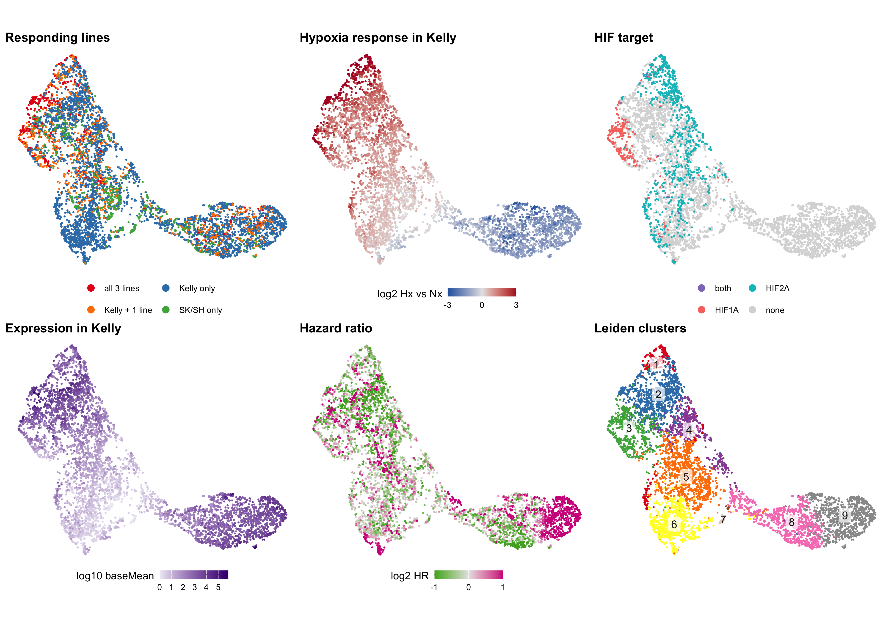<!-- -->

**Spearman correlation between response, HR, expression and the tumour
contrasts (5941 genes)**

| feature | Kelly | log2HR | baseMean | MYCN amp - not | deceased - event-free |
|:---|---:|---:|---:|---:|---:|
| Kelly | 1.00 | -0.25 | -0.05 | -0.23 | -0.24 |
| log2HR | -0.25 | 1.00 | 0.07 | 0.86 | 0.95 |
| baseMean | -0.05 | 0.07 | 1.00 | 0.08 | 0.06 |
| MYCN amp - not | -0.23 | 0.86 | 0.08 | 1.00 | 0.88 |
| deceased - event-free | -0.24 | 0.95 | 0.06 | 0.88 | 1.00 |

**Leiden clusters: medians per cluster (log2 Hx vs Nx per line, HIF1A vs
2A = signed dependence, positive = HIF1A)**

| cluster | genes | % up | Kelly | SK-N-AS | SH-SY5Y | % all 3 lines | % Kelly only | % HIF1A tgt | % HIF2A tgt | HIF1A vs 2A | baseMean | HR | MYCN amp - not |
|:---|---:|---:|---:|---:|---:|---:|---:|---:|---:|---:|---:|---:|---:|
| 1 | 274 | 100 | 2.39 | 0.19 | 0.37 | 7 | 65 | 5 | 74 | -2.35 | 167 | 0.92 | -0.14 |
| 2 | 895 | 99 | 1.46 | 0.52 | 0.47 | 15 | 61 | 1 | 30 | -0.68 | 1425 | 0.80 | -0.29 |
| 3 | 550 | 98 | 1.18 | 0.80 | 0.86 | 17 | 32 | 37 | 1 | 1.35 | 348 | 1.02 | 0.00 |
| 4 | 478 | 96 | 0.86 | 0.46 | 0.27 | 5 | 67 | 1 | 28 | -1.20 | 55 | 0.94 | -0.19 |
| 5 | 1016 | 90 | 0.43 | 0.68 | 0.37 | 3 | 45 | 1 | 18 | -0.74 | 8 | 0.98 | -0.08 |
| 6 | 804 | 81 | 0.29 | 0.00 | 0.00 | 0 | 92 | 2 | 14 | -0.67 | 3 | 1.02 | 0.01 |
| 7 | 44 | 48 | 0.00 | -1.12 | -0.01 | 0 | 7 | 0 | 0 | 0.00 | 0 | 0.98 | -0.05 |
| 8 | 941 | 6 | -0.97 | -0.39 | -0.54 | 2 | 62 | 0 | 0 | -0.21 | 220 | 0.91 | -0.14 |
| 9 | 939 | 0 | -1.30 | -0.59 | -0.58 | 3 | 74 | 0 | 0 | -0.90 | 2054 | 2.16 | 0.74 |

What the embedding shows:

- **HIF1A and HIF2A targets now separate.** With the interaction block,
  the HIF1A targets form their own region (cluster 3, left edge), and
  the HIF2A targets gather along the upper and inner part of the induced
  side (clusters 1, 2, 4). Without that block they were scattered over
  the whole induced side. This is partly by construction - the Target
  column is defined by the same KO interaction - but it shows where in
  the response the two HIFs act: HIF1A on genes that the baseline lines
  share, HIF2A mostly on responses specific to Kelly.
- **Apart from that the genes form a continuum.** UMAP settings change
  only how tight the points pack, t-SNE gives the same picture, PCA is
  dominated by a few extreme genes. The clusters are cuts through this
  continuum (Leiden, resolution 0.8, on the input space).
- **Induced genes (clusters 1-6)**:
  - **1** - the strongest, almost purely HIF2A-dependent Kelly response
    (74% HIF2A targets, Kelly log2 2.4, baseline lines barely respond).
  - **2** - strong induction of highly expressed genes, partly HIF2A;
    the most protective cluster (HR 0.80).
  - **3** - the HIF1A cluster: 37% HIF1A targets, induced in all three
    lines (SK-N-AS and SH-SY5Y follow Kelly most closely here),
    HIF1A-dependent.
  - **4** - moderate, HIF2A-dependent, Kelly-dominated.
  - **5, 6** - weak induction of barely expressed genes; 6 is
    Kelly-only.
- **7** - a small group (44 genes) regulated only in SK-N-AS.
- **Repressed genes (clusters 8-9)** split by the HR: cluster **9** is
  highly expressed, adverse (median HR 2.2) and high in MYCN-amplified
  tumours - the MYCN-like genes that hypoxia shuts off in the cell
  lines. Cluster **8** is neutral.
- The HR of the induced clusters stays close to 1: adverse and
  protective induced genes sit side by side.

# Hypoxia-induced genes: protective or adverse?

The question, built up in three stages: (1) do the genes that go up
under hypoxia predict better or worse outcome, (2) does the answer
differ between HIF1A and HIF2A targets, and (3) does it depend on the
MYCN context - Kelly is MYCN-amplified, SK-N-AS and SH-SY5Y are not.

Two things to keep in mind when reading the numbers. Only 25,398 of the
64,537 rows have survival data at all (the hazard ratios come from the
high-risk microarray cohort), so every set shrinks once it is
intersected with the HR data. And that background is not 50/50: 23.9% of
all genes with survival data are `adverse` and 18.2% `protective`, so a
raw majority is not yet a signal - each set is therefore also tested
*against* that background (Fisher test on adverse vs protective counts;
`OR_adv` \> 1 means enriched for adverse).

Sets are defined on the full master table, not the reduced dive table,
because genes induced only in the baseline lines may fail the Kelly
expression filter.

<details>

<summary>

Code
</summary>

``` r
up_kelly <- !is.na(master$Kelly.Hx.vs.Nx.padj) & master$Kelly.Hx.vs.Nx.padj < 0.05 &
            master$Kelly.Hx.vs.Nx.log2FoldChange > 1
dn_kelly <- !is.na(master$Kelly.Hx.vs.Nx.padj) & master$Kelly.Hx.vs.Nx.padj < 0.05 &
            master$Kelly.Hx.vs.Nx.log2FoldChange < -1
up_base  <- (!is.na(master$padj_SKNAS)  & master$padj_SKNAS  < 0.05 & master$log2FC_SKNAS  > 1) |
            (!is.na(master$padj_SHSY5Y) & master$padj_SHSY5Y < 0.05 & master$log2FC_SHSY5Y > 1)

has_hr  <- !is.na(master$HR)
bg_adv  <- sum(master$HR_risk == "adverse", na.rm = TRUE)
bg_prot <- sum(master$HR_risk == "protective", na.rm = TRUE)

# One row of statistics per gene set: the within-set majority (binomial test,
# adverse vs protective), the enrichment against the background (Fisher), and
# the continuous shift of the HR distribution (Wilcoxon on log2 HR).
hr_stats <- function(label, stage, sel) {
  s    <- sel & has_hr
  adv  <- sum(master$HR_risk[s] == "adverse")
  prot <- sum(master$HR_risk[s] == "protective")
  fis  <- fisher.test(matrix(c(adv, prot, bg_adv - adv, bg_prot - prot), 2))
  wc   <- wilcox.test(log2(master$HR[s]), log2(master$HR[has_hr & !sel]))
  data.frame(Set = label, stage = stage,
             n = sum(sel), HR_data = sum(s),
             protective = prot, ns = sum(master$HR_risk[s] == "ns"), adverse = adv,
             pct_prot = 100 * prot / sum(s), pct_adv = 100 * adv / sum(s),
             median_HR = median(master$HR[s]),
             p_majority = binom.test(adv, adv + prot)$p.value,
             OR_adv = unname(fis$estimate), p_vs_bg = fis$p.value,
             p_shift = wc$p.value)
}

hr_res <- dplyr::bind_rows(
  hr_stats("Hx up in Kelly",         "Hx in Kelly",  up_kelly),
  hr_stats("Hx down in Kelly",       "Hx in Kelly",  dn_kelly),
  hr_stats("HIF1A targets",          "HIF targets",  master$Target %in% "Hif1a"),
  hr_stats("HIF2A targets",          "HIF targets",  master$Target %in% "Hif2a"),
  hr_stats("HIF1A+HIF2A targets",    "HIF targets",  master$Target %in% "Hif1a_Hif2a"),
  hr_stats("Kelly-specific up",      "MYCN context", up_kelly & !is.na(master$Hx_Baseline) &
                                                       master$Hx_Baseline == "none"),
  hr_stats("up in Kelly + baseline", "MYCN context", up_kelly & !is.na(master$Hx_Baseline) &
                                                       master$Hx_Baseline != "none"),
  hr_stats("baseline-only up",       "MYCN context", up_base & !up_kelly))

hr_tab <- function(stage) {
  hr_res %>%
    dplyr::filter(stage == !!stage) %>%
    dplyr::mutate(dplyr::across(c(pct_prot, pct_adv), ~sprintf("%.1f%%", .x)),
                  median_HR = round(median_HR, 2), OR_adv = round(OR_adv, 2),
                  dplyr::across(c(p_majority, p_vs_bg, p_shift), ~sprintf("%.1e", .x))) %>%
    dplyr::select(-stage)
}
```

</details>

## Stage 1: what hypoxia regulates in Kelly

Of the 5,882 hypoxia-induced genes, 3,566 have survival data - and among
those, **protective clearly outnumbers adverse** (651 vs 436, binomial p
= 9e-11). Against the adverse-leaning background the depletion is even
stronger (OR 0.47). The mirror image is the more striking result: the
genes hypoxia *represses* are heavily adverse (42% adverse vs 14%
protective, OR 2.5, median HR 1.27). In this cohort the adverse part of
the hypoxia response is what gets switched *off*, not on.

**Hx-regulated genes (Kelly WT, \|log2FC\| \> 1, padj \< 0.05) vs
survival**

| Set | n | HR_data | protective | ns | adverse | pct_prot | pct_adv | median_HR | p_majority | OR_adv | p_vs_bg | p_shift |
|:---|---:|---:|---:|---:|---:|:---|:---|---:|:---|---:|:---|:---|
| Hx up in Kelly | 5882 | 3566 | 651 | 2479 | 436 | 18.3% | 12.2% | 0.95 | 7.4e-11 | 0.47 | 1.9e-31 | 4.3e-38 |
| Hx down in Kelly | 2383 | 1861 | 260 | 823 | 778 | 14.0% | 41.8% | 1.27 | 1.6e-60 | 2.46 | 4.0e-37 | 0.0e+00 |

## Stage 2: HIF1A vs HIF2A targets

The thesis that HIF1A targets are adverse and HIF2A targets protective
is, in this form, **not supported**: both target sets lean protective,
and HIF1A targets are *not* adverse-enriched (12% adverse vs 15%
protective). The direct comparison of the two ratios is far from
significant (Fisher p = 0.40). Only the continuous view leaves a hint in
the expected direction: the HR distribution of HIF2A targets sits
slightly lower (median 0.94 vs 1.00, Wilcoxon p = 0.013) - a weak
protective shift for HIF2A rather than an adverse shift for HIF1A. The
combined HIF1A+HIF2A set is too small to say anything (5 classified
genes).

**HIF target sets (Target column) vs survival**

| Set | n | HR_data | protective | ns | adverse | pct_prot | pct_adv | median_HR | p_majority | OR_adv | p_vs_bg | p_shift |
|:---|---:|---:|---:|---:|---:|:---|:---|---:|:---|---:|:---|:---|
| HIF1A targets | 322 | 238 | 36 | 173 | 29 | 15.1% | 12.2% | 1.00 | 4.6e-01 | 0.61 | 5.9e-02 | 1.7e-01 |
| HIF2A targets | 1472 | 928 | 168 | 653 | 107 | 18.1% | 11.5% | 0.94 | 2.8e-04 | 0.47 | 1.6e-09 | 9.4e-13 |
| HIF1A+HIF2A targets | 43 | 29 | 2 | 24 | 3 | 6.9% | 10.3% | 0.87 | 1.0e+00 | 1.14 | 1.0e+00 | 1.4e-01 |

**Direct HIF1A vs HIF2A comparison**

| Test                                              | p     |
|:--------------------------------------------------|:------|
| adverse:protective ratio, HIF1A vs HIF2A (Fisher) | 0.4   |
| log2 HR distribution, HIF1A vs HIF2A (Wilcoxon)   | 0.013 |

## Stage 3: the MYCN context

Splitting the hypoxia-induced genes by where they respond: `Hx_Baseline`
separates the Kelly-specific ones (`none`) from those also induced in
SK-N-AS / SH-SY5Y; the third set are genes induced *only* in the
baseline lines. The result is a gradient: the **Kelly-specific response
is the most protective-leaning** (11% adverse, OR 0.38), the shared
response sits in the middle, and the baseline-only response is closest
to background - still mildly protective (OR 0.69, p = 0.017), but with
the weakest signal. So the protective association of hypoxia-induced
genes is strongest exactly in the MYCN-amplified context, and no set
flips to adverse.

**Hypoxia-induced genes by cell-line context vs survival**

| Set | n | HR_data | protective | ns | adverse | pct_prot | pct_adv | median_HR | p_majority | OR_adv | p_vs_bg | p_shift |
|:---|---:|---:|---:|---:|---:|:---|:---|---:|:---|---:|:---|:---|
| Kelly-specific up | 2811 | 1919 | 400 | 1307 | 212 | 20.8% | 11.0% | 0.93 | 2.6e-14 | 0.38 | 6.7e-30 | 2.3e-31 |
| up in Kelly + baseline | 1357 | 1021 | 172 | 701 | 148 | 16.8% | 14.5% | 0.96 | 2.0e-01 | 0.64 | 1.2e-04 | 2.2e-06 |
| baseline-only up | 788 | 537 | 92 | 361 | 84 | 17.1% | 15.6% | 0.98 | 6.0e-01 | 0.69 | 1.7e-02 | 1.8e-02 |

## The whole picture

All eight sets on one axis: share of protective genes to the left,
adverse to the right, with the background shares as dashed reference
lines. Every hypoxia-*induced* set stays left of the background on the
adverse side; only the hypoxia-*repressed* genes break the pattern.

<details>

<summary>

Code
</summary>

``` r
pol_cols <- c(protective = "#3B6FC9", adverse = "#E8632C")

pol <- hr_res %>%
  dplyr::mutate(Set = factor(Set, levels = rev(Set)),
                stage = factor(stage, levels = unique(stage))) %>%
  tidyr::pivot_longer(c(pct_prot, pct_adv), names_to = "side", values_to = "pct") %>%
  dplyr::mutate(side = ifelse(side == "pct_prot", "protective", "adverse"),
                x = ifelse(side == "protective", -pct, pct),
                n = ifelse(side == "protective", protective, adverse))

ggplot(pol, aes(x = x, y = Set, fill = side)) +
  geom_col(width = 0.62) +
  geom_vline(xintercept = 0, colour = "grey30", linewidth = 0.4) +
  geom_vline(xintercept = c(-100 * bg_prot / sum(has_hr), 100 * bg_adv / sum(has_hr)),
             linetype = "dashed", colour = "grey55", linewidth = 0.35) +
  geom_text(aes(label = n, hjust = ifelse(side == "protective", 1.15, -0.15)),
            size = 2.9, colour = "grey15") +
  scale_x_continuous(labels = function(x) sprintf("%g%%", abs(x)),
                     expand = expansion(mult = 0.12)) +
  scale_fill_manual(values = pol_cols, breaks = c("protective", "adverse"),
                    name = NULL) +
  facet_grid(stage ~ ., scales = "free_y", space = "free_y", switch = "y") +
  labs(x = "share of genes with survival data (dashed = background)", y = NULL) +
  theme_minimal(base_size = 10) +
  theme(panel.grid.major.y = element_blank(),
        panel.grid.minor = element_blank(),
        strip.placement = "outside",
        strip.text.y.left = element_text(angle = 0, face = "bold", hjust = 1),
        legend.position = "top")
```

</details>

**Figure 13. Share of protective and adverse genes per gene set**

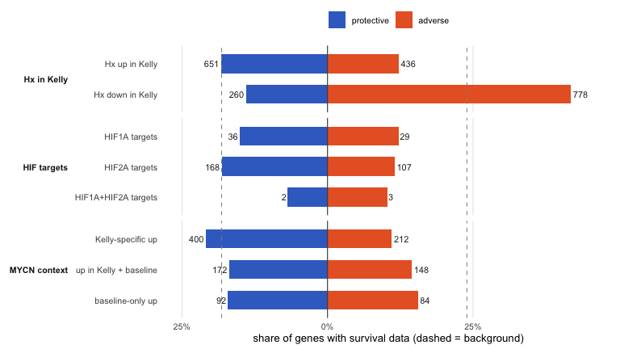<!-- -->

**Answer to the opening question:** in these data hypoxia-induced genes
are mainly *protective* - as a raw majority, against the background, and
in every subset tested. The adverse arm of the hypoxia response consists
of the genes hypoxia represses. The HIF1A-adverse / HIF2A-protective
split does not hold as a dichotomy; there is at most a mild protective
shift of HIF2A targets. And the protective lean is strongest in the
Kelly-specific (MYCN-amplified) response. All of this is association in
a high-risk cohort, not causality - adverse-classified single genes
still exist in every set (WT1-AS and KLHDC7B above are examples).

## The full CUT&RUN overlap lists

The same question, asked of the complete HIF-1β CUT&RUN overlap lists
(peaks within 100 kb, split into HIF1A-unique and HIF2A-unique genes)
instead of the RNA-seq-derived sets. All list genes are present in the
master table via their Ensembl IDs; 24 genes appear on both lists.
Following the volcano-plot wording, *harmful* here is what the tables
call `adverse`. The list membership is also available as the `CaR`
column of the master table (values `Hif1a` / `Hif2a` / `Hif1a_Hif2a`,
mirroring `Target`).

The result mirrors stage 2, now from the binding side: the **HIF2A peak
list is clearly protective-leaning** (92 protective vs 45 harmful of 474
with survival data), while the **HIF1A list is balanced** (16 vs 14 of
123) and indistinguishable from background. The direct comparison of the
two ratios is not significant (Fisher p = 0.21) - the lists differ in
how strongly they deviate from background, not provably from each other.

<details>

<summary>

Code
</summary>

``` r
car_h1 <- readxl::read_xlsx(here::here("6_XM_data_merge", "HIF1A_unique_genes_100kb.xlsx"))
car_h2 <- readxl::read_xlsx(here::here("6_XM_data_merge", "HIF2A_unique_genes_100kb.xlsx"))

sel_car1 <- master$Ensembl %in% car_h1$Ensembl
sel_car2 <- master$Ensembl %in% car_h2$Ensembl

car_res <- dplyr::bind_rows(
  hr_stats("HIF1A targets", "CUT&RUN", sel_car1),
  hr_stats("HIF2A targets", "CUT&RUN", sel_car2))

tab(car_res %>%
      dplyr::mutate(dplyr::across(c(pct_prot, pct_adv), ~sprintf("%.1f%%", .x)),
                    median_HR = round(median_HR, 2), OR_adv = round(OR_adv, 2),
                    dplyr::across(c(p_majority, p_vs_bg, p_shift), ~sprintf("%.1e", .x))) %>%
      dplyr::rename(harmful = adverse, pct_harm = pct_adv, OR_harm = OR_adv) %>%
      dplyr::select(-stage),
    "CUT&RUN overlap lists (100 kb) vs survival")
```

</details>

**CUT&RUN overlap lists (100 kb) vs survival**

| Set | n | HR_data | protective | ns | harmful | pct_prot | pct_harm | median_HR | p_majority | OR_harm | p_vs_bg | p_shift |
|:---|---:|---:|---:|---:|---:|:---|:---|---:|:---|---:|:---|:---|
| HIF1A targets | 145 | 123 | 16 | 93 | 14 | 13.0% | 11.4% | 1.01 | 8.6e-01 | 0.66 | 2.7e-01 | 5.8e-01 |
| HIF2A targets | 581 | 474 | 92 | 337 | 45 | 19.4% | 9.5% | 0.91 | 7.3e-05 | 0.37 | 1.5e-08 | 2.7e-10 |

<details>

<summary>

Code
</summary>

``` r
car_cols <- c(protective = "#4682C4", harmful = "#C03A3E")

car_pol <- car_res %>%
  dplyr::mutate(Set = factor(Set, levels = rev(Set))) %>%
  tidyr::pivot_longer(c(pct_prot, pct_adv), names_to = "side", values_to = "pct") %>%
  dplyr::mutate(side = factor(ifelse(side == "pct_prot", "protective", "harmful"),
                              levels = c("protective", "harmful")),
                x = ifelse(side == "protective", -pct, pct),
                n = ifelse(side == "protective", protective, adverse))

ggplot(car_pol, aes(x = x, y = Set, fill = side)) +
  geom_col(width = 0.55) +
  geom_vline(xintercept = 0, colour = "grey30", linewidth = 0.4) +
  geom_vline(xintercept = c(-100 * bg_prot / sum(has_hr), 100 * bg_adv / sum(has_hr)),
             linetype = "dashed", colour = "grey55", linewidth = 0.35) +
  geom_text(aes(label = n, hjust = ifelse(side == "protective", 1.15, -0.15)),
            size = 3, colour = "grey15") +
  scale_x_continuous(labels = function(x) sprintf("%g%%", abs(x)),
                     expand = expansion(mult = 0.12)) +
  scale_fill_manual(values = car_cols, name = NULL) +
  labs(x = "share of genes with survival data (dashed = background)", y = NULL) +
  theme_minimal(base_size = 10) +
  theme(panel.grid.major.y = element_blank(),
        panel.grid.minor = element_blank(),
        legend.position = "top")
```

</details>

**Figure 14. Share of protective and adverse genes in the CUT&RUN
overlap lists**

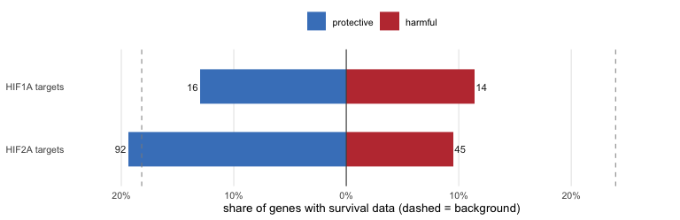<!-- -->

# KCNK13, CASP9, DR5: an apoptosis-priming signature?

KCNK13 (THIK-1) is the most protective HIF2A target from the CUT&RUN
shortlist (HR 0.54) and essentially unstudied in cancer - its literature
is about microglia, where the channel gates inflammasome activation via
K⁺ efflux. K⁺ efflux is also a permissive condition for apoptosome
assembly, and the two apoptosis genes that hypoxia co-induces in Kelly
are exactly the matching pieces: CASP9 (the apoptosome caspase) and
TNFRSF10B (death receptor DR5). The working hypothesis: HIF2A does not
kill the cells, it lowers their apoptosis threshold - and tumors that
keep this priming intact behave less aggressively.

The counts view below shows the per-sample normalized counts across all
four genotypes. The KCNK13 induction collapses in the HIF2A-KO, is
halved (in log2 terms) in the HIF1B-KO - consistent with HIF2A needing
its dimerization partner ARNT - and is untouched in the HIF1A-KO. CASP9
and DR5 move the same way at smaller amplitude. SK-N-AS / SH-SY5Y add
nothing here: KCNK13 is hypoxia-induced there too (log2FC 1.9 in
SK-N-AS), and the baseline lines have no KO genotypes to separate the
HIFs.

<details>

<summary>

Code
</summary>

``` r
prime_symbols <- c("KCNK13", "CASP9", "TNFRSF10B")
prime_display <- c(KCNK13 = "KCNK13 (THIK-1)", CASP9 = "CASP9",
                   TNFRSF10B = "TNFRSF10B (DR5)")

prime <- master %>%
  dplyr::filter(symbol %in% prime_symbols) %>%
  dplyr::group_by(symbol) %>%
  dplyr::slice_max(baseMean_Kelly, n = 1, with_ties = FALSE) %>%
  dplyr::ungroup() %>%
  dplyr::mutate(panel = sprintf("%s\nHx log2FC %.1f  |  HR %.2f (%s)",
                                prime_display[symbol],
                                Kelly.Hx.vs.Nx.log2FoldChange, HR, HR_risk),
                panel = factor(panel, levels = panel[match(prime_symbols, symbol)]))

cd <- prime %>%
  dplyr::select(panel, dplyr::all_of(count_cols)) %>%
  tidyr::pivot_longer(-panel, names_to = "sample", values_to = "counts") %>%
  dplyr::mutate(
    genotype = dplyr::recode(sub("_(Nx|Hx)_[0-9]+$", "", sub("^counts_", "", sample)),
                             "WT" = "Kelly WT", "HIF1a-KO" = "HIF1A-KO",
                             "HIF2a-KO" = "HIF2A-KO", "HIF1b-KO" = "HIF1B-KO"),
    genotype = factor(genotype, levels = c("Kelly WT", "HIF1A-KO",
                                           "HIF2A-KO", "HIF1B-KO")),
    condition = factor(ifelse(grepl("_Hx_", sample), "Hx", "Nx"),
                       levels = c("Nx", "Hx")))

cond_cols <- c(Nx = "#3B6FC9", Hx = "#E8632C")

ggplot(cd, aes(genotype, counts + 1, colour = condition)) +
  geom_point(position = position_jitterdodge(jitter.width = 0.12,
                                             dodge.width = 0.55),
             size = 1.2, alpha = 0.65) +
  stat_summary(fun = median, fun.min = median, fun.max = median,
               geom = "crossbar", width = 0.42, fatten = 0,
               linewidth = 0.5, position = position_dodge(0.55)) +
  scale_y_log10(labels = function(x) format(x, big.mark = ",", scientific = FALSE)) +
  scale_colour_manual(values = cond_cols, name = NULL) +
  facet_wrap(~panel, scales = "free_y") +
  labs(x = NULL, y = "normalized counts + 1 (log scale)") +
  theme_minimal(base_size = 10) +
  theme(panel.grid.minor = element_blank(),
        panel.grid.major.x = element_blank(),
        strip.text = element_text(face = "bold", size = 8.5),
        axis.text.x = element_text(angle = 30, hjust = 1),
        legend.position = "top")
```

</details>

**Figure 15. KCNK13, CASP9 and DR5 counts per genotype and condition**

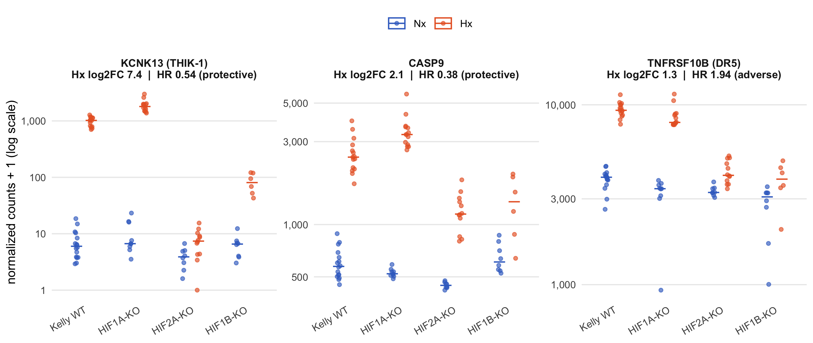<!-- -->

One honest wrinkle the panel titles expose: the trio is not uniformly
protective. KCNK13 (0.54) and CASP9 (0.38) are, but DR5 itself scores
adverse (HR 1.94) - unsurprising for a death receptor that doubles as a
general stress-response gene, and a reminder that the priming reading
rests on the K⁺-efflux/apoptosome pair, not on DR5.

The pattern to take away: in WT and HIF1A-KO the three genes move
together under hypoxia; in HIF2A-KO the response is gone while the cells
are exposed to the same 1% O₂. If KCNK13 were simply a marker of cells
drifting into apoptosis, the KOs would induce it like the WT - instead
it behaves like a deliberate, HIF2A-driven program. Whether that program
actually lowers the apoptotic threshold is a wet-lab question: Annexin /
cleaved-caspase-3 under hypoxia in WT vs HIF2A-KO, with and without a
THIK-1 blocker.
